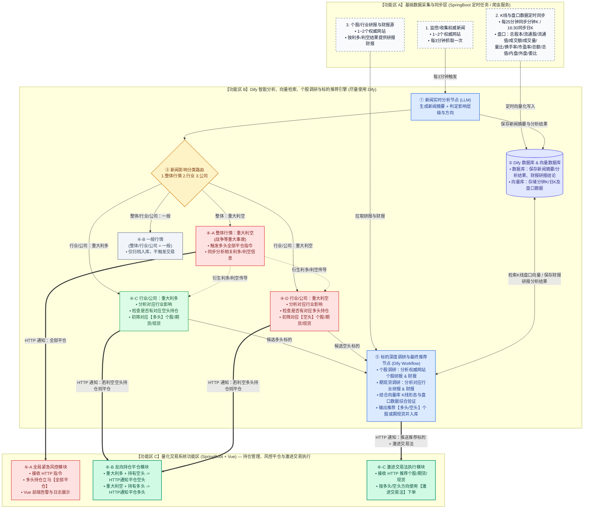

# AI 智能选股与量化交易系统联动设计文档 (Dify + SpringBoot/Vue)

> **文档说明**：本文档基于《选股流程结构设计.xlsx》梳理生成，包含完整的**全链路操作流程拆解**、**Dify 与量化交易系统（SpringBoot + Vue）功能区边界划分**、**可编辑 Mermaid 流程图**、**现有流程中的 7 处不完整/断点问题排查与落地方案**，以及**跨系统 HTTP 通信接口规范**。

> **当前有效边界说明（2026-10-20）**：本文件保留为原型讨论和历史流程参考。若本文件与《量化交易系统完整设计方案说明书_V4.md》或《详设_0_整体流程文档.md》冲突，以后两者为准。特别是：Dify只生成新闻/研究分析草稿；Spring Boot负责校验、保存研究事件、发布下游事件和Paper门禁；Dify不得直接平仓、开仓或调用真实交易接口。
> 配套的 HTML5 Canvas 交互式流程图请打开同目录下的 `选股流程结构设计_Canvas流程图.html`。

---

## 一、 核心设计原则与三大功能区划分

> **当前实现解释：** 本章中的“功能区 A/B/C”保留原型分工，但当前落地采用“Spring Boot 业务事实源 + Dify 研究智能体 + Spring Boot 事件/状态主控”的方式。原型图中若出现 Dify 直接触发平仓、激进交易或把行情写入向量库，均属于历史讨论流程，不得直接据此实现。

根据需求“**以上流程目的是得出推荐的个股和期货（现货），尽量使用 Dify；后面量化交易使用量化交易系统（SpringBoot + Vue）**”，整体架构划分为三个职责边界清晰的功能区：

### 1. 【功能区 A】基础数据采集与同步层（定时调度管道）
负责从外部权威数据源高频采集新闻、行情盘口、财报与研报数据，并推送或同步至 Dify：
 * **新闻监控与收集**：由 Spring Boot 监控授权新闻源并按配置采集，完成原文保存、来源/时间/授权/质量检查和幂等去重后，创建 Dify 研究任务；Dify完成分析草稿，Spring Boot校验并保存研究事件，再通知后续研究流程。采集周期属于数据源配置，不应硬编码为所有来源统一每3分钟。
  * **K 线与盘口数据定时同步**：
  * **同步频率**：交易时段**每 25 分钟**同步一次分钟级 K 线；每日收盘后 **16:30** 同步日 K 线。
  * **同步字段**：包含 K 线数据（开高低收量额）及对应的 **13 项核心盘口数据**（总股本、流通股、流通值、成交额、成交量、量比、换手率、市盈率、总额、总值、内盘、外盘、委比等）。
  * **存储目标**：原始数据、结构化数值、点时版本和研究事件主记录保存在 Spring Boot 数据层；Dify Dataset/向量库只存放授权文本检索和解释材料，不能作为事实、行情或量价特征主库。
  * **个股/行业研报与财报数据源**：由 Spring Boot 按授权范围采集、保存和版本化；研究事件发布后，Dify可通过受控上下文进行检索和解释。重大程度和方向是研究候选，不直接授权交易动作。

### 2. 【功能区 B】Dify 智能分析与标的推荐功能区（核心大脑，尽量使用 Dify）
 承担新闻和研究材料的语义理解、事件分类、影响变量和传导链草稿、正反方问题及自然语言解释；最终候选筛选、量价状态、策略适配、风险和交易计划由 Spring Boot 确定性流程负责。
 * **节点 ① 新闻分析（LLM）**：生成新闻摘要，提取核心实体，返回影响层级候选、重大程度候选、方向候选、引用和反方问题；返回结果属于结构化研究草稿。
 * **节点 ② 结果校验与事件发布（Spring Boot）**：校验 Schema、引用、来源、时间、授权、行业/个股身份和冲突，保存 AI 草稿与核验后的研究事件，并发布后续研究事件。
 * **节点 ③ Dify Dataset/向量库**：仅用于授权文本检索、研究解释和问答上下文，不保存事实、行情、量价特征和交易状态主记录。
 * **节点 ③ 新闻影响分类路由（条件分支）**：
 * **分支 ④-A（整体行情：重大风险候选）**：发布研究/风险事件，Spring Boot确定性复核新增风险、受影响Paper持仓和用户确认要求；不由Dify直接全部平仓。
  * **分支 ④-B（整体/行业/公司：一般）**：仅归档保存至 Dify 数据库，不触发下游交易动作。
 * **分支 ④-C/④-D（行业/公司方向候选）**：保存事件影响和研究方向候选，由 Spring Boot进行标的身份、工具可交易性、量价状态、观察池和风险复核；不直接产生平仓或开仓命令。
 * **节点 ⑤ 标的深度研究草稿生成**：
  * **基本面调研**：个股调取权威网站个股财报与研报；期货/现货调取对应行业财报与研报。
  * **技术面解释**：Dify可解释 Spring Boot 已计算的K线、量价和盘口状态；数值计算、状态确认和二期交易时机优化由 Spring Boot负责。
  * **结论回传**：Dify返回带引用的研究草稿；Spring Boot保存研究事件/候选研究结果并通知后续流程。候选仍需经过观察、策略、人工和Paper门禁。

### 3. 【功能区 C】量化交易系统功能区（SpringBoot + Vue）
专注于实盘账户连接、持仓状态管理、风险控制与极速订单执行：
 * **模块 ⑥-A 风险事件复核**：接收 Spring Boot发布的研究/风险事件，按确定性规则暂停新增Paper风险、检查持仓并生成待确认动作。
 * **模块 ⑥-B 研究事件和候选接收**：接收核验后的研究事件和候选结果，进入观察池、策略和风险流程。
 * **模块 ⑥-C Paper执行**：仅接收已确认交易计划并通过Paper风控的模拟委托；一期禁止真实交易和Dify直接执行。

---

## 二、 全链路操作流程图（Mermaid 源码）

> 下方流程图保留原始选股原型的可视化参考。当前实施时，所有“HTTP平仓/激进交易”节点均替换为“Spring Boot研究事件/风险复核/候选草稿回调”，并经过研究、策略、人工和Paper门禁。



---

## 三、 现有流程中“不完整/存在断点”的 7 个关键问题与补充方案

通过对 Excel 原表中的基础数据与流程逐行交叉推演，以下 **7 个关键节点**在当前描述中尚未闭环，建议在开发阶段按以下方案补齐：

### 1. 整体行情缺少“重大利多”分支，且“整体重大利空”的衍生分析后续流转未闭合
* **原表描述**：
  * `1. 整体行情：一般、重大利空(战争等重大事故)`
  * `整体：重大利空：多头：立马通知(HTTP)全部平仓，并分析相关利多信息和利空信息`
* **存在问题**：
  1. 缺少了**“整体行情：重大利多”**分支（例如央行超预期大幅降准降息、国家级重大救市或财政刺激政策）。
  2. 在“整体重大利空”通知多头全部平仓后，写明了“**并分析相关利多信息和利空信息**”，但没有说明分析出来之后怎么处理（例如战争爆发利多黄金/原油/军工，利空航空/跨境旅游，是否继续进入行业选股流程？）。
* **补充建议**：
  * 在路由节点增加【整体行情：重大利多】分支：通知量化系统平仓全部空头持仓，并自动将“宽基股指期货（IF/IC/IM）、券商及核心领涨行业”送入节点 ⑤ 进行多头标的推荐。
  * 将【整体行情：重大利空】分析出的“衍生利多行业”与“衍生利空行业”闭环连接至【分支 ④-C】和【分支 ④-D】，继续完成避险多头标的与受损空头标的的推荐。

### 2. Dify 无法直接感知“当前实盘持仓”，导致反向平仓判断存在数据断点
* **原表描述**：
  * `如果利空 空头持仓(通过(HTTP)，通知平仓空头持仓)`
  * `如果利空 多头持仓(通过(HTTP)，通知平仓多头持仓)`
* **存在问题**：账户当前持有哪些股票/期货的多头或空头仓位，实时状态保存在 **SpringBoot 量化交易系统**的数据库/内存里，Dify 本身并不知道当前是否有持仓。
* **补充建议（推荐方案 A）**：
  * **方案 A（推荐，职责最清晰）**：Dify 在判定出“某行业/公司重大利多或重大利空”时，直接通过 HTTP 将受影响的【行业编码 + 关联标的列表 + 多空方向】推送给 SpringBoot 的 `/api/v1/position/close-reverse` 接口；由 SpringBoot 本地查询持仓表，若发现持有反向仓位则立即执行平仓。
  * **方案 B（Dify 主动查询）**：在 Dify Workflow 中配置一个查询持仓的 HTTP Tool（调用 SpringBoot `GET /api/v1/position/current`），Dify 比对存在反向持仓后再调用平仓接口。

### 3. K 线与 13 项盘口数据在选股流程中的具体使用位置未明确，且向量化检索方式需优化
* **原表描述**：
  * 基础数据第 2 条要求：`每天定时(每25分钟同步K / 晚上4点半同步日K) - 包括对应的盘口数据(总股本/流通股/流通值/成交额/成交量/量比/换手率/市盈/总额/总值/内盘/外盘/委比等)(K线数据存到对应的向量数据库)`。
  * 但在【流程】部分只写了：`分析个股/期货现货的研报和财报`，未提及何时调用向量数据库里的 K 线与盘口数据。
* **补充建议**：
  1. **流程补齐**：在【节点 ⑤ 标的深度调研与推荐生成】中，将**基本面（财报+研报）**与**技术面（向量库 K 线+盘口数据）**并列为双重过滤条件。例如：新闻与财报筛选出 5 只受益个股后，结合 K 线趋势（是否处于上升通道、是否放量突破）与盘口数据（量比 > 1.5、外盘 > 内盘、委比正向、未一字涨停无法买入）筛出最优的 1~2 只标的推荐给量化系统。
  2. **向量库存储优化**：Embedding 向量模型对纯数字表格（如一串开高低收浮点数）的语义理解能力极弱。建议在每 25 分钟/16:30 同步入库时，先用脚本将 K 线与盘口指标转化为**结构化语义特征卡片**（例如：`【600XXX 某某股份 | 2026-10-13 14:30】日K趋势：5日均线上穿20日均线多头排列；量价盘口：量比2.35（明显放量），换手率6.8%，市盈率(TTM) 18.5，外盘占比64%（主动买盘强劲），委比+28.4%，流通市值145亿`），再存入 Dify 向量库，这样 LLM 检索时的准确率会大幅提升。

### 4. 每 3 分钟高频抓取新闻的“幂等去重机制”缺失
* **原表描述**：`每3分钟抓取一次，立即分析(Dify)`。
* **存在问题**：同一条重磅新闻（如某部委发布行业新政或某龙头公司发布业绩预告）在半小时内会被不同媒体转发或被爬虫多次抓取。若不去重，Dify 会在第 3 分钟、第 6 分钟、第 9 分钟反复触发 HTTP 激进交易接口，导致**重复满仓下单**。
* **补充建议**：
  * **一级去重（爬虫/SpringBoot 侧）**：基于新闻 URL、标准化标题 SimHash 去重。
  * **二级去重（Dify 侧）**：新闻进入 Dify Workflow 后，先在 Dify 向量数据库的“历史新闻库”中检索过去 24 小时内的摘要，若语义相似度 `Score > 0.85` 且涉及的行业/公司实体一致，则判定为重复新闻，直接终止后续交易分支。

### 5. 缺少“行业 -> 具体个股/期货/现货”的标准化映射字典
* **原表描述**：`行业/公司：重大利多 -> 分析对应行业影响 -> 找到对应多头个股或者期货现货`。
* **存在问题**：当新闻是宏观或行业新闻（如“国家大力推进固态电池产业化”或“印尼限制镍矿出口”），新闻正文中往往没有出现具体的股票代码或期货合约代码。如果直接让大模型凭自身训练记忆去猜股票代码，极易出现代码张冠李戴、推荐已退市/ST股票或遗漏最新板块龙头的问题。
* **补充建议**：
  * 在 Dify 知识库中建立一份结构化的**《行业/概念板块 — 核心龙头股 — 期货/现货品种映射表》**（包含：申万一/二级行业、热门概念、前 5 大龙头股代码及名称、是否支持融券、对应商品期货主力合约代码如 `ni`/`lc`/`rb`）。
  * Dify 识别出受影响行业后，先从该映射表中精确检索出候选标的池，再进入节点 ⑤ 调取财报研报和盘口数据。

### 6. 国内 A 股个股“做空机制”的现实约束
* **原表描述**：`重大利空 -> 找到对应空头个股或者期货现货 -> 通过(HTTP)使用激进交易法交易`。
* **存在问题**：在 A 股市场，普通个股无法直接裸卖空（融券业务不仅标的范围受限，且实盘往往无券可融）；而商品期货、股指期货、ETF 期权则支持双向灵活做空。
* **补充建议**：
  * 在 Dify 的【空头标的推荐节点】增加市场可交易性过滤：
    * 若利空指向大宗商品或宏观行业，**优先输出对应的商品期货/股指期货主力合约**执行激进做空；
    * 若利空指向单家 A 股上市公司，Dify 先核对该股是否在《可融券且有券源白名单》中；若不可做空，则仅触发**“平仓已有该股多头持仓 + 加入风控黑名单禁止买入”**，避免向实盘发送无法执行的 A 股卖空指令。

### 7. 非交易时段（盘后/夜间/周末）新闻触发 HTTP 下单的排队机制缺失
* **原表描述**：每 3 分钟抓取新闻 -> 分析得出推荐个股 -> 通过 HTTP 使用激进交易法交易。
* **存在问题**：重磅财经政策、公司财报公告往往在**下午 15:00 收盘后、晚间 20:00 或周末**发布。此时 A 股或日盘期货处于休市状态，如果 Dify 立即调用 HTTP 触发激进交易，柜台会直接拒绝委托（废单）。
* **补充建议**：
  * 在 **SpringBoot 量化交易系统**中增加**“交易日历与时段网关”**：
    * 若收到 Dify HTTP 推荐信号时处于**连续竞价交易时段**，立即执行激进交易法；
    * 若处于**非交易时段（盘后/周末/节假日）**，将推荐标的存入 SpringBoot 的 `盘前预埋单队列（Pending Order Queue）`，并在 Vue 端高亮展示；待次一交易日开盘集合竞价（9:15~9:25）或开盘瞬间（9:30），结合最新开盘盘口（如是否高开过多或一字涨跌停）自动或半自动触发执行。

---

## 四、 Dify 与 SpringBoot 量化交易系统 HTTP 接口规范建议

为了保证 Dify Workflow 中的 `HTTP Request` 节点与 SpringBoot 后端无缝对接，建议在 SpringBoot 侧暴露以下 3 个标准 RESTful 接口：

### 1. 全局紧急平仓接口（整体重大利空触发）
* **Endpoint**：`POST /api/v1/quant/risk/close-all-long`
* **调用方**：Dify 分支 ④-A（整体行情：重大利空）
* **Request Body (JSON)**：
```json
{
  "eventId": "news_20261013_001",
  "eventType": "MARKET_MAJOR_BEARISH",
  "newsSummary": "突发重大地缘冲突事件，引发全球避险情绪升温",
  "action": "CLOSE_ALL_LONG_ IMMEDIATELY",
  "timestamp": 1791916800000
}
```

---

## 五、与当前总纲和详设基线的差异修订

本文件早期原型中的“Dify直接调用平仓/激进交易接口”“Dify数据库保存行情和事实”“Dify完成最终推荐后直接推送交易系统”等描述，不再作为当前实现依据。当前有效链路为：

```text
Spring Boot采集和保存新闻原文
→ 创建研究任务
→ Dify返回摘要、事实候选、重大程度候选、行业/个股关联候选、利多/利空候选和反方问题
→ Spring Boot校验Schema、引用、时间、授权、身份和冲突
→ Spring Boot保存AI草稿和核验后的研究事件
→ Spring Boot发布研究事件并通知后续研究/候选/风险流程
→ 候选进入观察池、策略、人工确认和Paper门禁
```

Dify不得直接调用真实交易、Paper订单、全局平仓或反向平仓接口。若保留旧HTTP示例，仅用于说明历史原型断点，实际接口应改为研究事件/风险复核/候选草稿回调，执行权留在 Spring Boot。

### 5.1 二期量价关系优化和交易时机预留

二期计划通过量价关系研究优化发现交易时机，包括价格位置、成交量/成交额、持仓量、量价推进效率、突破持续性、回调/反弹确认、盘口和订单流等。此能力不应在一期原型中被描述为自动择时或自动交易。

一期应由 Spring Boot 保留多周期行情、量价特征、市场状态、特征版本、观察窗口、成功标签、成本和回放接口；Dify只负责解释这些结构化结果。二期再由 Spring Boot进行历史验证、时机优化和策略适配。

### 2. 反向持仓检查与平仓接口（行业/公司重大利多或利空触发）
* **Endpoint**：`POST /api/v1/quant/position/close-reverse`
* **调用方**：Dify 分支 ④-C / ④-D
* **Request Body (JSON)**：
```json
{
  "eventId": "news_20261013_002",
  "scope": "INDUSTRY",
  "sentiment": "MAJOR_BULLISH",
  "affectedIndustries": ["半导体", "光刻胶"],
  "affectedSymbols": ["688981.SH", "002371.SZ", "300661.SZ"],
  "closeDirection": "SHORT",
  "reason": "行业出台重大扶持政策，利空现有空头持仓，通知立即平仓对应空头"
}
```

### 3. 推荐标的激进交易执行接口（深度调研完成后触发）
* **Endpoint**：`POST /api/v1/quant/trade/aggressive-order`
* **调用方**：Dify 节点 ⑤（标的深度调研与最终推荐生成）
* **Request Body (JSON)**：
```json
{
  "eventId": "news_20261013_002",
  "strategy": "AGGRESSIVE_TRADING",
  "recommendations": [
    {
      "symbol": "002371.SZ",
      "name": "北方华创",
      "assetType": "STOCK",
      "direction": "LONG",
      "confidenceScore": 92,
      "fundamentalSummary": "Q3营收同比增长38%，归母净利润增长45%，机构研报一致维持买入评级",
      "technicalSummary": "日K放量突破平台，25分钟K线均线多头排列，量比2.6，换手率4.2%，外盘占比66%，委比+31%"
    },
    {
      "symbol": "IM2611.CFE",
      "name": "中证1000股指期货主力",
      "assetType": "FUTURES",
      "direction": "LONG",
      "confidenceScore": 86,
      "fundamentalSummary": "科技成长板块整体受益于产业政策催化",
      "technicalSummary": "突破日内分时均线压制，持仓量温和放大"
    }
  ],
  "timestamp": 1791916850000
}
```
