# QuantPF 详设 0：整体流程文档

| 项目 | 内容 |
|:---|:---|
| 文档名称 | 详设_0_整体流程文档 |
| 系统 | QuantPF（Quant Portfolio Framework） |
| 文档版本 | V1.3 |
| 编制日期 | 2026-10-23 |
| 文档定位 | 指导各子模块详设、契约设计和代码仓施工的整体流程基线 |
| 适用范围 | 一期研究辅助、候选筛选、机会提示、策略适配、Paper/Shadow 和复盘验证 |
| 上游总纲 | 《量化交易系统完整设计方案说明书_V4.md》 |
| 上游技术分册 | 《总体业务架构及记录落地功能进度.md》 |
| 相关原型 | `Dify流程设计/选股流程结构设计与优化建议.md` |
| 当前代码仓 | `D:\workspace\quant\RuoYi-Vue-Plus` |

> 本文档定义端到端流程、Dify 与 Spring Boot 边界、状态和施工基线，不替代各子模块详设。后续子模块详设必须引用本文档的流程、状态和契约原则。二期自动实盘须另行完成合规、安全、授权、接入和灰度放行，不在本文档的一期实施范围内。

## 目录

1. 目的、术语与设计约束
2. 总体架构和业务流
3. 端到端主流程
4. 数据采集与治理
5. Dify研究辅助流程及输出契约
6. 事实—解释—预测链
7. 候选筛选、研究卡与观察池
8. 预警、审核和交易计划
9. Paper/Shadow交易与持仓管理
10. 风险事件和期货移仓
11. 回测、概率验证与复盘
12. 状态机
13. Dify与Spring Boot功能边界
14. 数据对象、接口和事件
15. 现有代码仓映射和施工顺序
16. 异常、幂等、安全与审计
17. 测试和阶段门禁
18. 子模块详设拆分及维护规则

---

## 1. 目的、术语与设计约束

### 1.1 文档目的

把总纲中的业务目标串成可指导代码仓施工的流程：

```text
数据采集与治理
→ Dify辅助研究
→ Spring Boot核验事实并执行确定性计算
→ 候选筛选和研究卡
→ 策略适配、等待和预警
→ 交易计划与人工确认
→ Paper/Shadow执行
→ 持仓管理、复盘、验证和规则迭代
```

### 1.2 规范性词语

| 词语 | 含义 |
|:---|:---|
| 必须 | 子模块设计和实现必须遵守 |
| 应 | 默认遵守；偏离时形成架构决策记录 |
| 草稿 | 未经 Spring Boot 校验或人工确认的结果 |
| 业务事实 | 来源、时间、身份和质量均已核验的事实 |
| Paper / 模拟实盘 | 本平台模拟资金账户和内部模拟委托、撮合、成交、持仓；不接真实交易通道，不进入交易所撮合/结算 |
| `PAPER_MANUAL` | 每笔计划由用户确认后，通过Paper风险门禁进入内部模拟撮合 |
| `PAPER_AUTO` | 用户预先授权账户、策略版本、品种、允许动作、运行时段和风险限额后，由确定性策略触发内部模拟委托；每笔仍逐项通过模块四风险门禁 |
| Shadow | 跟踪行情和策略结果，不改变Paper账户，不创建账户委托/资金流水/持仓 |
| Backtest | 使用冻结的历史点时数据回放，与实时Paper账户状态隔离 |

### 1.3 一期目标与范围

一期目标不是自动赚钱或接入交易所真实交易，而是让用户基于可追溯信息发现候选、理解证据和反方风险、等待明确条件，并在本平台用模拟资金进行手动或受控自动模拟实盘，完成挂单/撤单、建仓/开仓、平仓、持仓和期货移仓，之后复盘验证。系统优先减少无依据交易、追涨杀跌、过时信息、观点当事实和临时改变策略。

一期包含多源采集、授权和点时治理、新闻/公告/财报/研报/产业研究辅助、股票/期货/现货候选、基本面/供需/量价分析、研究卡、策略适配、观察池、预警、交易计划、组合风险、Paper/Shadow、平台内部策略驱动模拟实盘、回测验证、复盘、问答、审计和监控。

一期不包含交易所/券商/期货公司真实委托或成交、QMT/CTP真实 submit/cancel、真实账户自动平仓、Dify直接下单、真实资金交易、未授权数据再分发、用不完整历史证明概率、以向量库替代结构化事实库、完整订单流图或完整图表工作台。自动 Paper 是平台内部模拟资金执行，不等于真实自动实盘。

一期必须为二期“通过量价关系研究优化发现交易时机”预留数据和架构边界：保存多周期K线、成交量、成交额、持仓量、盘口摘要、价格位置、市场状态、量价特征版本、观察窗口和验证标签；一期只提供确定性量价状态、观察和预警，不实现高级订单流自动择时，也不把量价优化结果直接转换为订单。

### 1.4 全局硬约束

1. Spring Boot 是业务事实源和确定性主系统；Dify 是研究辅助和语言交互层。
2. 候选不是信号，信号不是交易计划，交易计划不是订单。
3. 研究流、交易流、验证流共享数据但不得互相越权。
4. 历史研究必须区分当时可见数据和之后修订数据。
5. 写操作必须幂等、审计并可回放。
6. 重大事件先产生研究事件、告警或风险复核，不允许 Dify 直接平仓/开仓。
7. 人工覆盖不能绕过数据授权、工具权限、确定性风控和 Paper 门禁。
8. Dify 不可用时，原始采集、确定性计算、已有 Paper、风控和审计仍可运行或明确降级。
9. 一期禁止真实交易通道。

### 1.5 目标用户与引导式流程基线

本系统一期普通用户是团队内部人员及经过授权的其他熟悉人员。他们通常了解股票/期货基本操作，但不是技术人员或金融分析人员。后续子详设、产品设计和代码实现不得要求普通用户理解量化公式、策略表达式、风险模型、数据源配置或Dify技术概念。

用户层级必须与业务权限分离：

~~~text
引导型普通用户：提出研究目标、查看解释、确认观察和Paper模拟
业务审核用户：核验事实、研究卡、策略/交易计划并记录理由
专业管理用户：配置数据、策略、风险、权限、Dify、任务和审计
~~~

端到端流程必须遵循“系统准备、用户确认”的交互原则：

~~~text
用户提出目标或选择快捷任务
→ Spring Boot自动收集授权上下文并冻结快照
→ Dify/确定性服务自动生成研究和策略结果
→ 系统展示结论、依据、风险、状态和下一步
→ 用户只确认/拒绝/延期/加入观察或接受Paper计划
→ Spring Boot执行权限、状态、RiskCheck、幂等和审计
~~~

普通用户输入基线：常用研究任务核心输入不超过3项；系统能够从对象、上下文、账户和历史偏好推导的字段不再要求重复填写；专业字段默认隐藏，用户可以查看但不能被迫理解或修改。人工确认表示接受系统整理结果，不代表用户必须重新完成专业分析。

所有阻断状态必须用普通语言说明：为什么不能继续、系统已经完成什么、用户下一步可以做什么。普通用户不应看到无法解释的技术错误码作为唯一提示。


### 1.6 用户输入责任矩阵

| 内容 | 系统自动完成 | 普通用户 | 审核用户 | 专业管理员 |
|:---|:---|:---|:---|:---|
| 新闻/材料采集、摘要、行业/标的关联候选 | 必须 | 不填写 | 可查看/复核 | 配置来源 |
| 事实、引用、影响变量、反方问题 | 生成候选 | 查看/确认 | 审核/退回 | 管理规则 |
| 候选评分、策略匹配、等待条件 | 计算 | 查看 | 审核例外 | 管理版本 |
| 交易计划、数量、止损、风险影响 | 计算/预填 | 查看并确认 | 审核/退回 | 管理模板 |
| 数据源、指标公式、风险规则、Dify配置 | 不向普通用户暴露 | 不填写 | 不修改 | 配置/发布 |

代码施工时，字段必须标记为 SYSTEM_DERIVED、USER_CONFIRMATION、REVIEW_REQUIRED 或 ADMIN_CONFIG。普通用户页面不得把系统生成字段渲染成普通必填输入框。

### 1.7 引导式任务的统一状态

复杂流程可使用支撑对象 GuidedTask，保存任务类型、当前步骤、系统已完成步骤、待用户确认步骤、下一步动作、阻断原因和来源版本。用户关闭页面后可以从同一任务继续，不得要求重新填写已确认内容。

### 1.8 二期量价主导机会发现基线

一期保留新闻/事件、股票基本面、商品供需、量价四类研究入口；二期新增并明确一条独立的量价主导机会发现流。二期机会发现不依赖近期新闻，优先从A股、港股、美股、期货、外汇/海外经纪商品的价格行为和量价关系中发现候选，再由因子、市场状态和大模型解释增强。

~~~text
量价/价格行为扫描
→ 确定性特征和因子过滤
→ 历史条件与跨资产比较
→ Dify解释、假设和反方问题
→ 新闻/基本面/供需作为可选增强
→ 候选/等待状态
→ 策略适配、风险、Paper和验证
~~~

新闻、财报、研报和供需数据缺失时，二期仍可保留量价候选，但必须标记证据缺口和适用限制。Dify不得生成量价指标、因子值、正式信号、仓位或订单；Spring Boot负责这些确定性结果和版本。


---

## 2. 总体架构和业务流

### 2.1 总体逻辑架构

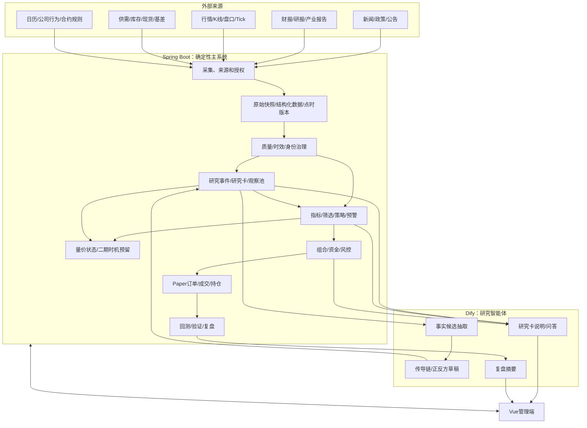

### 2.2 三条业务流

```text
研究流：数据监听 → 事实核验 → 解释/预测 → 候选决策卡 → 观察池
交易流：触发预警 → 重新检查 → 策略适配 → 交易计划 → Paper/Shadow → 持仓管理
验证流：保存点时快照 → 生成成功/失败标签 → 成本后绩效 → 样本外/滚动/校准 → 规则迭代
```

研究流不能直接生成订单；交易流不能静默修改研究事实；验证流不能用未来数据重写历史结论。规则变更须人工确认并版本化。

### 2.3 核心对象关系

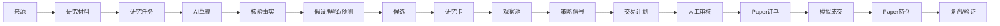

---

## 3. 端到端主流程

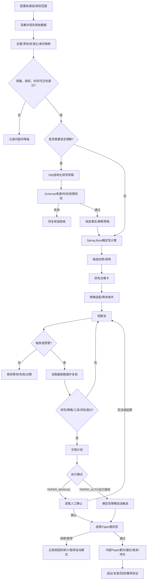

| 阶段 | 输入 | 处理 | 输出 |
|:---|:---|:---|:---|
| S0 | 来源、授权、频率 | 来源组和备源配置 | 可采集来源 |
| S1 | 外部材料/行情 | 采集和原始保存 | 原始快照 |
| S2 | 原始快照 | 去重、身份、质量、时效治理 | 可用性状态 |
| S3 | 可用材料 | AI辅助、事实核验、研究分析 | 事实/解释/研究草稿 |
| S4 | 研究和结构化指标 | 初筛、深筛、淘汰记录 | 候选池 |
| S5-S6 | 候选/研究卡 | 策略适配、等待、预警 | 观察池状态 |
| S7-S8 | 触发候选 | 交易计划、人工确认、风控和Paper | 模拟订单/成交/持仓 |
| S9 | 点时快照和交易结果 | 归因、概率、规则复核 | 复盘和规则建议 |

---

## 4. 数据采集与治理

### 4.1 来源组原则

| 来源组 | 来源目标 | 用途和核验 |
|:---|:---|:---|
| 新闻/政策 | 2～3个权威新闻、政府或监管来源 | 核发布时间、原文事实、转载关系 |
| 公司公告/财报 | 2～3个正式披露或授权结构化来源 | 原文优先；冲突转人工 |
| 研报/行业报告 | 2～3个合法授权来源 | 相同转载不视为独立证据 |
| 行情/量价 | 1个主源+1个备源 | 核价格、时间、合约身份 |
| 商品供需 | 2～3个交易所/行业/授权来源 | 核单位、地区、品级和周期 |

每个来源记录主备关系、授权、覆盖范围、更新频率、延迟、历史回溯、额度和替代规则。来源数量是冗余目标，不代表网站天然权威或网页可任意抓取。

### 4.2 采集与治理流程

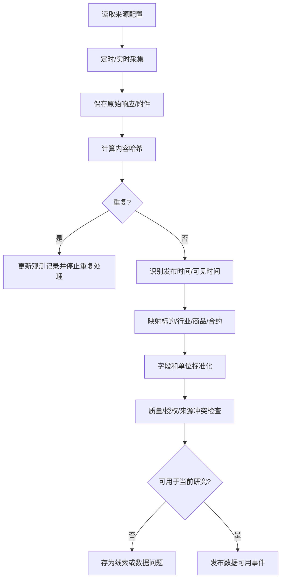

### 4.3 时间和质量

维护 `published_at`、`available_at`、`effective_at`、`observed_at`、`revised_at`、`snapshot_version`。回测只能用 `available_at <= decision_time` 的数据，修订不得覆盖旧快照。

质量状态建议：

```text
AVAILABLE / DELAYED / PARTIAL / CONFLICTED / UNAUTHORIZED
STALE / INVALID / PENDING_REVIEW
```

| 情况 | 动作 |
|:---|:---|
| 主源失败、备源可用 | 切换并标记来源 |
| 主备均失败 | 暂停依赖该数据的新决策 |
| 来源冲突 | 保留版本、降级并人工复核 |
| 数据过期 | 可展示和复盘，不可用于新开仓判断 |
| 授权不清 | 禁止当前用途 |
| 历史不完整 | 可观察，不可据此证明完整概率 |
| 标的身份不清 | 不得进入候选和交易流 |

### 4.4 新闻监控到研究事件流程

新闻链是“数据与标的基础”到“研究与候选发现”的跨模块流程：

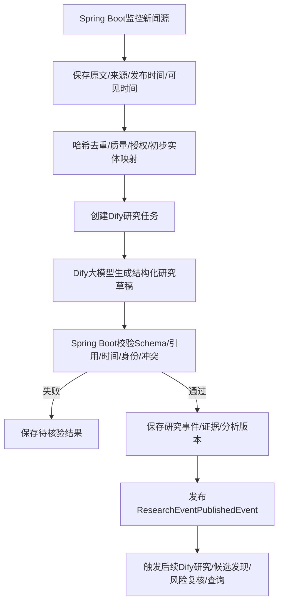

新闻原文、来源、去重、授权、时间和质量属于数据治理；Dify摘要、重大程度候选、行业/个股关联候选和利多/利空候选属于研究草稿；研究事件最终状态、持久化、版本、幂等和通知由 Spring Boot 负责。Dify 不直接修改业务状态或调用交易执行。

### 4.5 量价时机二期预留

数据治理必须为二期量价关系优化保留：

```text
多周期K线
成交量/成交额/持仓量
盘口摘要和流动性字段
价格位置和市场状态
量价特征版本
观察窗口和信号时间
成功/失败标签
成本、滑点和市场状态分组
```

一期允许输出量价状态、等待、机会已过和未确认等研究/预警结果；二期才基于历史样本和回放优化交易时机，不提前承诺自动择时。

---

## 5. Dify研究辅助流程及输出契约

### 5.1 正确定位

Dify 通过 Workflow/Agent 调用大模型，对 Spring Boot 提供的授权材料和结构化上下文进行理解、抽取、归纳和分析，并按约定 Schema 返回结构化研究草稿。

```text
原始材料
→ Dify大模型分析
→ 事实候选、解释草稿、预测草稿、反方问题
→ Spring Boot校验Schema、引用、时间、授权和身份
→ 核验事实及可追溯研究版本
```

因此，“Dify返回事实候选”不等于它确认了系统事实：

```text
Dify事实候选 ≠ VERIFIED_FACT
Dify预测草稿 ≠ 统计概率
Dify操作建议 ≠ 订单指令
Dify风险提示 ≠ 自动平仓命令
```

### 5.2 输入上下文

Spring Boot 发起研究任务时提供最小必要且可追溯的输入：

```json
{
  "requestId": "req_001",
  "idempotencyKey": "research:mat_001:v1:event",
  "researchTaskId": "rt_001",
  "taskType": "EVENT_FACT_EXTRACTION",
  "materialIds": ["mat_001"],
  "sourceRefs": ["src_001"],
  "subjectRefs": ["industry_x"],
  "snapshotId": "snap_001",
  "publishedAt": "2026-10-20T09:10:00+08:00",
  "availableAt": "2026-10-20T09:12:00+08:00",
  "authorizationStatus": "PERSONAL_RESEARCH_ALLOWED",
  "researchQuestion": "提取事实候选、影响变量和反方问题",
  "workflowVersion": "event-research-v1",
  "promptVersion": "event-research-prompt-1.0"
}
```

不得发送交易凭据、无关个人信息或完成研究不需要的账户明细。用户问答所需持仓上下文应采用最小化、去标识化的摘要。

### 5.3 工作流拆分

| Workflow | 输入 | 输出 |
|:---|:---|:---|
| 事件事实抽取 | 新闻、公告、政策材料 | 事件类型、实体、事实候选、原文引用、时间识别、冲突提示 |
| 研究解释 | 已核验事实、结构化指标 | 影响变量、传导链、支持/反方证据、未知项和证伪条件 |
| 研究卡说明 | Spring Boot研究卡 | 普通语言结论、指标解释、等待条件、风险和下一步 |
| 自然语言问答 | 用户问题、权威查询结果 | 带证据的回答和条件式研究建议 |
| 复盘摘要 | 快照、计划、成交、持仓和绩效 | 归因文字草稿和待人工确认问题 |

### 5.4 结构化输出分层

#### 5.4.1 材料理解和事实候选

```json
{
  "summary": "某行业发布新的产业政策",
  "eventType": "INDUSTRY_POLICY",
  "impactScope": "INDUSTRY",
  "entities": [
    {"rawMention": "相关产业", "entityType": "INDUSTRY", "normalizedSubjectHint": "industry_x"}
  ],
  "sentiment": "POTENTIALLY_BULLISH",
  "factCandidates": [
    {
      "factId": "fc_001",
      "statement": "政策提出提高相关产业的支持力度",
      "factType": "POLICY_CONTENT",
      "sourceRef": "src_001",
      "sourceQuote": "原文引用片段",
      "certainty": "EXPLICIT",
      "verificationStatus": "PENDING_VERIFICATION"
    }
  ]
}
```

`sentiment` 和 `normalizedSubjectHint` 都只是大模型候选判断，不是交易方向或正式标的身份。

#### 5.4.2 解释草稿

```json
{
  "interpretationDraft": {
    "impactVariables": [
      {"name": "行业政策支持强度", "direction": "POSITIVE", "strength": "MEDIUM", "timeHorizon": "MEDIUM_TERM"}
    ],
    "transmissionChain": ["政策支持增强", "行业投资预期改善", "相关企业订单和盈利预期可能改善"],
    "directBeneficiaries": ["相关设备供应商"],
    "potentialLosers": ["受成本上升影响的下游企业"],
    "followUpDataRequired": ["政策执行细则", "业务收入占比", "实际订单或产能数据"]
  }
}
```

#### 5.4.3 预测草稿和反方问题

```json
{
  "predictionDraft": {
    "direction": "LONG_BIAS",
    "period": "MEDIUM_TERM",
    "conditions": ["政策细则落地", "订单出现验证", "价格没有过度提前反映"],
    "invalidatingConditions": ["政策未落地", "订单未兑现", "估值显著过高"],
    "probabilityStatus": "NOT_COMPUTED_BY_DIFY"
  },
  "counterQuestions": [
    {"question": "市场是否已经提前交易该政策预期?", "importance": "HIGH"},
    {"question": "相关公司是否有真实业务和利润暴露?", "importance": "HIGH"}
  ]
}
```

模型可提出条件式预测草稿，但历史样本、概率、收益、回撤和仓位由 Spring Boot 的验证与规则计算产生。

### 5.5 输出校验流程

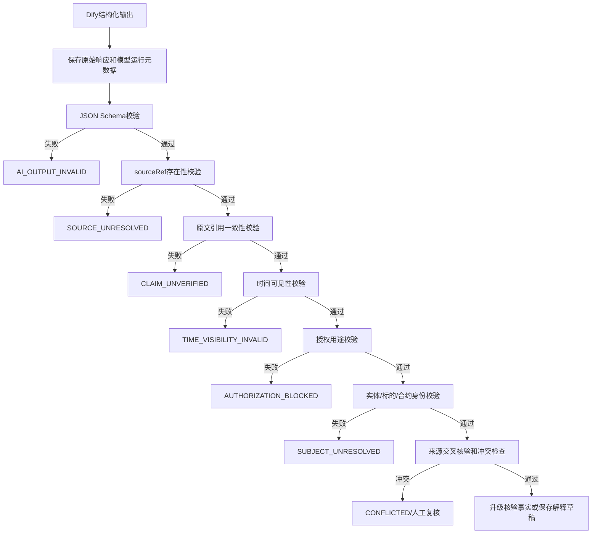

引用必须绑定材料版本和可定位片段。无法稳定验证引用时只能标记为待核验；LLM 的置信度不得替代来源验证。输出失败需保留原响应和原因，但不能进入新开仓候选。

### 5.6 自然语言问答流程

```text
用户提出问题
→ Dify识别意图和研究周期
→ Spring Boot查询候选、研究卡、来源、质量、量价、策略和风险门禁
→ Dify仅依据查询结果组织回答并引用证据
→ UI展示结论、专业解释、原始来源、风险和下一步
```

回答“能否买入/建仓/做空”时，最终建议必须明确为“可进入Paper计划、等待、减仓/退出复核、机会已过、禁止开仓、不参与”等条件式研究意见。任何建议不能绕过系统门禁。

### 5.7 Dify不可用降级

原始采集、结构化指标、已有研究卡、Paper、风控和审计继续运行；新材料标记 `AI_ANALYSIS_PENDING`。不伪造事实、解释或概率，不将待分析材料升级为可开仓研究结论。

---

## 6. 事实—解释—预测链

### 6.1 事实层

事实只描述已发生并可追溯的内容，例如库存变化、公告披露、开工率变化或价格突破。事实层禁止直接写成“所以必涨/必跌/立即买卖”。Dify抽取的是事实候选，Spring Boot校验来源、原文、时间、授权、实体和冲突后，才可生成 `VERIFIED_FACT`。

### 6.2 解释层

解释将事实连接到经济变量，例如：

```text
库存上升
→ 供应暂时大于需求
→ 现货压力增加
→ 基差可能走弱
→ 远月期货压力增加
```

解释需写清影响变量、方向、强度、期限、直接受益/受损者、反向传导和待验证数据。Dify可生成解释草稿；业务版本、来源关联和后续失效状态由 Spring Boot 管理。

### 6.3 预测层

预测必须是条件式，包含方向、周期、成立条件、失效条件、历史样本、成本后期望和最大不利波动。Dify只能提出前四项草稿；历史样本和统计结果由 Spring Boot 计算，且须有点时数据、成本模型、基准和样本外验证。

### 6.4 反方研究和版本

每个对象保存支持证据、反方证据、未知信息、可能错误环节、关键证伪条件和替代工具。新事实进入时，关联解释/预测标记待重算，不得静默覆盖历史版本。

---

## 7. 候选筛选、研究卡与观察池

### 7.1 四类候选入口

| 入口 | 主要链路 |
|:---|:---|
| 事件入口 | 新闻/公告核验 → 影响变量 → 行业/公司/商品/合约映射 |
| 股票入口 | 业务真实性 → 盈利质量 → 行业比较 → 估值/预期差 → 事件敏感度 |
| 商品入口 | 供应/需求/库存/利润/季节性 → 现货/基差/期限结构 → 合约映射 |
| 量价入口 | 价格位置 → 成交量/持仓量 → 市场状态 → 形成待研究线索 |

### 7.2 初筛和深筛

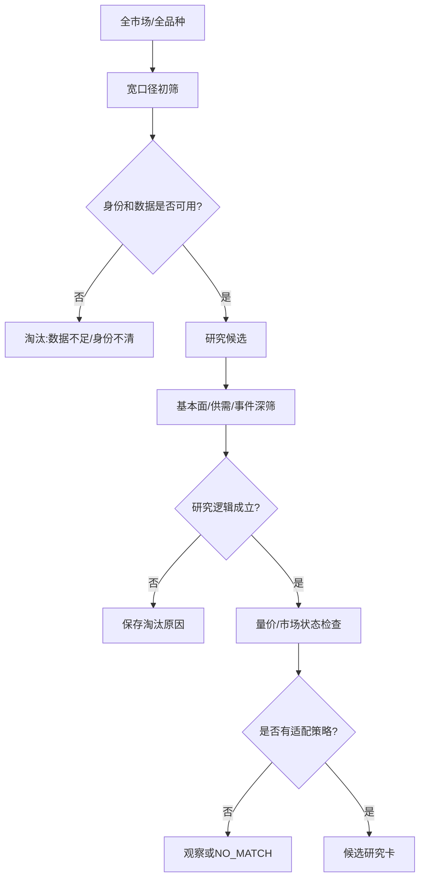

筛选阶梯：

```text
全市场/全品种 → 初筛候选 → 研究候选 → 观察候选 → 交易就绪候选
```

每次筛选保存入口、范围、条件、数据时点、规则版本、候选、淘汰对象及原因。原因至少覆盖数据不足、业务不真实、预期已反映、供需矛盾、量价失败、风险过高、流动性不足、组合重复、策略无匹配和工具不可交易。

### 7.3 研究决策卡

研究卡由 Spring Boot 形成结构化状态和数值，Dify只组织说明文字。字段至少包括：

```text
标的/合约身份、资产类型、方向、预测周期
核心事实和来源、市场原有预期、新增信息
影响变量、传导链、基本面/供需和估值/预期差
基差/期限结构、量价状态、市场状态
支持证据、反方证据、未知信息、证伪条件
候选策略、适用条件、已满足/未满足条件
触发、止损、退出、最长等待时间
历史样本、条件概率、成本后预期、最大不利波动
组合边际风险、数据质量、最终状态和版本
```

用户展示分三层：普通语言结论 → 专业指标解释 → 原始数据/来源/时间/公式。

研究周期分开描述：短期约2周、中期约3个月至1年、长期约半年至3年。短期技术信号不能外推为长期结论；期货中长期观点须说明具体合约、移仓换月和期限结构影响。

### 7.4 策略适配

策略不决定什么资产值得研究，只决定已筛选标的适合什么交易方式、入场条件、止损和退出。正确顺序为：

```text
研究决定方向 → 候选筛选通过 → 分析K线/成交量/持仓量/价格位置
→ 匹配适用策略 → 等待策略触发
```

策略适用范围卡记录资产、方向、周期、市场状态、价格位置、量价条件、必要确认、禁用条件、入场/止损/退出、历史样本、期望值和有效期。`NO_MATCH`只代表当前没有合适交易方式，不代表研究方向错误。策略状态：`MATCHED`、`TRIGGERED`、`WAITING`、`NO_MATCH`、`EXPIRED`、`INVALIDATED`。

### 7.5 观察池和等待卡

主状态：`CANDIDATE → WATCHLIST → WAITING_TRIGGER → NEAR_TRIGGER → TRADE_READY → PAPER_ACTIVE`。

异常状态：`DATA_CONFLICT`、`THESIS_CONFLICT`、`EXPIRED`、`INVALIDATED`、`BLOCKED`、`NO_MATCH`。

等待卡保存观察原因、已满足/未满足条件、触发后复核项、失效条件、最长等待时间和下次复核时间。状态变化由 Spring Boot 规则驱动，不由 Dify 改写。

---

## 8. 预警、审核和交易计划

### 8.1 预警原则

预警用于提醒重新检查，不自动转成订单。预警类型包括价格、技术结构、量价异动、新闻/公告、财报预期、库存/供需、基差、期限结构、策略触发和风险簇集中度。每个预警包含对象、条件、有效期、触发时间、触发快照、复核问题和允许动作。

### 8.2 预警触发后的重新检查

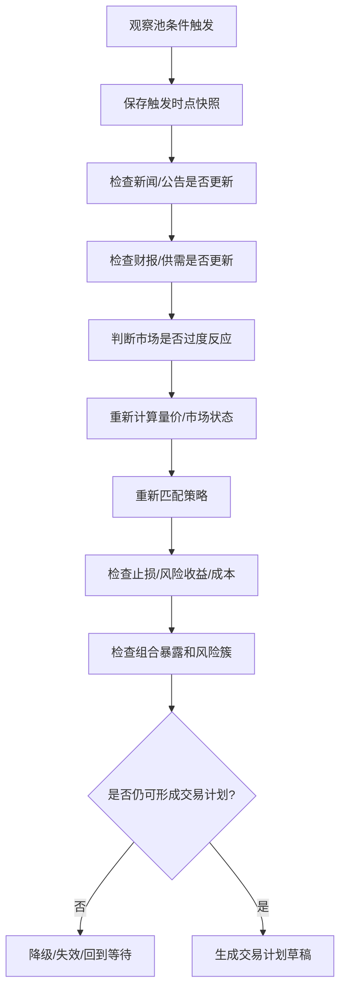

### 8.3 交易计划和人工审核

交易计划由 Spring Boot 创建不可变版本，关联账户、标的、方向、订单动作、策略和版本、事件/假设、入场区间、止损、止盈、退出规则、持有周期、风险额、数量、保证金、滑点、风险簇、有效期、失效条件和审核状态。

以下事项需要人工确认、否决、延期或有理由地覆盖：重大新闻和异常财报；消息发布后价格已明显运行；股票最终候选；期货最终方向；现货数据用于交易表达；授权/延迟/历史完整性问题；AI与原文不一致；启用或修改 `PAPER_AUTO` 的账户/策略/品种/动作/限额授权；`PAPER_MANUAL` 候选进入Paper；研究、概率、策略或风险规则修改。`PAPER_AUTO`运行期间不要求每笔新开仓人工点击，但每笔动作仍须通过模块四逐笔风险检查和审计。

审核状态：`CONFIRMED`、`REJECTED`、`DEFERRED`、`OVERRIDDEN`、`EXPIRED`。人工覆盖只能改变研究状态、排序、备注和有效期，不能绕过授权、工具权限、风险和 Paper 门禁。

---

## 9. Paper/Shadow交易与持仓管理

### 9.1 下单前检查顺序

```text
1. 交易日和交易时段
2. 数据质量和最新行情
3. 产品、标的和合约状态
4. 研究方向与订单动作一致性
5. 股票买入/期货开平权限
6. 价格、数量和最小变动单位
7. 止损距离和单笔风险金额
8. 组合相关性和行业/商品风险簇
9. 保证金、可用资金和压力测试
10. Kill Switch、账户熔断和幂等键
11. Paper/Shadow模式确认
12. 写订单、审计和信号执行记录
```

### 9.2 方向和订单动作校验

| 研究方向 | 订单动作 | 允许条件 |
|:---|:---|:---|
| `LONG` | `BUY_OPEN` | 股票状态正常，或期货可交易且风险通过 |
| `SHORT` | `SELL_OPEN` | 期货可交易，或股票有合规空头权限 |
| 期货多头退出 | `SELL_CLOSE` | 存在可用多头持仓 |
| 期货空头退出 | `BUY_CLOSE` | 存在可用空头持仓 |
| `HEDGE_SHORT` | `SELL_OPEN` | 存在现货风险且套保比例/基差规则通过 |
| `SPREAD` | 多腿组合订单 | 所有腿通过流动性和保证金检查 |

方向和开平仓标志不一致必须拒绝并审计。利空个股不能默认映射为裸卖空；无法合法表达的研究结论不得转成开空订单。

### 9.3 Paper委托流程

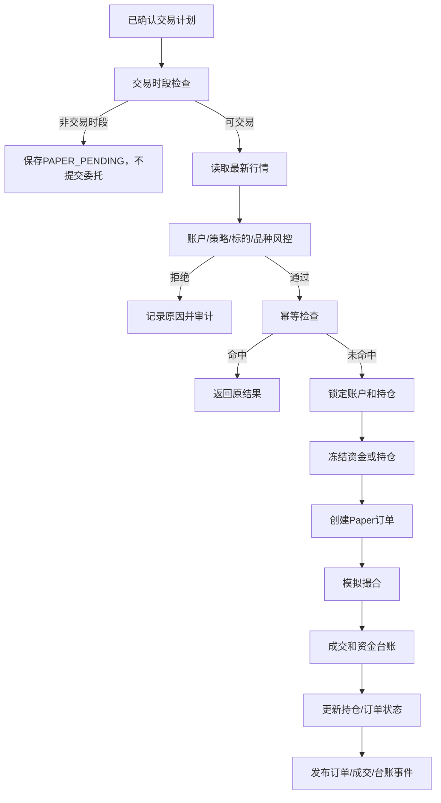

非交易时段只保存候选或待复核计划。下一交易时段需用最新行情、标的状态和风险重新检查，不能将盘后推荐自动变成次日订单。

### 9.4 仓位计算和订单状态

```text
positionRatio = min(确定性仓位函数输入, maxPositionRatio)
targetAmount  = totalCapital × positionRatio
rawQty        = targetAmount / price
finalQty      = floor(rawQty / lotSize) × lotSize
```

模型自由生成的置信度不能当作统计概率直接决定仓位。最终数量还须通过单笔风险、组合预算、资金/保证金、压力测试和硬风控。

订单生命周期：`PENDING → SUBMITTED → PARTIAL_FILL → FILLED`；终态还包括 `CANCELLED`、`REJECTED`、`EXPIRED`。一期所有委托和成交均为本地 Paper/Shadow。

### 9.5 持仓监控

Spring Boot 持续检查止损、止盈、追踪退出、假设失效、反向事件、数据质量、组合风险簇、资金/保证金及期货到期/移仓窗口。产生动作计划或告警后仍须遵守授权和 Paper 规则。

---

## 10. 风险事件和期货移仓

### 10.1 重大事件流程

旧原型“Dify识别重大利空后直接全部平多/激进交易”不作为实现流程。正确流程：

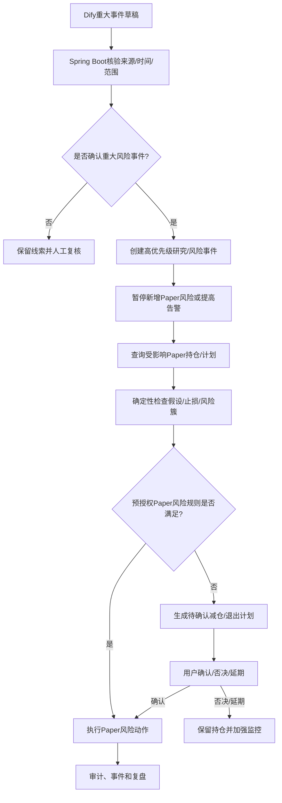

系统性事件可自动停止新增 Paper 风险、提高告警、重算暴露、标记研究卡待复核，但 Dify 不得直接访问订单执行服务。任何自动 Paper 风险动作也必须是显式、可测试、可审计的 Spring Boot 规则，且不能扩展成真实委托。

### 10.2 期货移仓换月

```text
识别移仓窗口
→ 创建移仓计划
→ 平旧合约Paper委托
→ 确认平旧成交
→ 开新合约Paper委托
→ 确认开新成交
→ 更新研究对象和持仓关联
```

异常进入 `NEEDS_RECONCILIATION`，不得假设两腿均成交。合约身份、到期日、保证金、交割风险和新旧合约流动性必须分别校验。

---

## 11. 回测、概率验证与复盘

### 11.1 回测规则

| 规则 | 要求 |
|:---|:---|
| 成交时点 | 信号在K线N收盘后产生，N+1才允许成交（bar+1） |
| 复权 | 记录 `adjust_flag`，默认前复权 `FORWARD` |
| 年化 | 使用 `KlinePeriod.annualFactor()`，不一律乘平方根252 |
| 成本 | 开平仓分别计算手续费并建模滑点 |
| 涨跌停 | 建模价格限制和无法成交 |
| 时间 | 仅使用当时可见数据 |
| 版本 | 固化数据、指标、策略和参数版本 |

### 11.2 验证流程

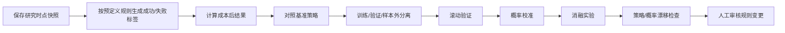

成功标签须预先定义预测周期、目标收益、最大不利波动、止损/止盈、成本、基准和市场状态分组。概率必须报告样本量、区间和样本外表现；历史不完整、授权不明或版本缺失的数据不能包装成完整样本。

### 11.3 复盘

复盘覆盖实际交易、达到条件但未交易、进入观察池未触发、被淘汰但后来明显变动的对象及替代标的。输出研究方向、事实时效、传导链、量价、策略、等待纪律、执行成本、仓位和组合风险归因，并提出规则变更建议。

Dify 可生成复盘摘要，不能修改成交、绩效或历史研究事实。规则变更由用户确认并产生新版本。

---

## 11.3 普通用户操作压缩与状态解释

研究流、交易流和验证流都应提供普通用户入口：

~~~text
快捷研究 → 系统自动分析 → 结论卡 → 加入观察/稍后处理
观察触发 → 系统自动生成交易计划 → 查看风险摘要 → 接受或拒绝Paper模拟
Paper结果 → 系统自动记录 → 普通语言复盘 → 用户确认是否继续关注
~~~

系统自动生成或计算的内容包括来源、摘要、事实候选、行业/标的关联、策略匹配、等待条件、价格/数量建议、止损/失效条件、资金影响、风险结果和复盘草稿。普通用户不填写策略公式、指标阈值、仓位公式、风险预算或撮合参数。

产品设计必须对每个操作标注：系统自动完成、用户只需确认、审核用户需要复核、专业管理员可配置。没有合格候选、数据未就绪或风险不允许时，应展示可理解的原因和下一步，不要求用户自行排查底层数据。

## 11.4 二期量价主导验证流

二期新增的机会发现流与新闻研究流并列，不得把新闻研究设置为量价候选的必经前置：

~~~text
市场/资产价格与量价数据
→ 多周期特征、市场状态和因子快照
→ 量价机会扫描与候选解释
→ 历史点时验证、样本外/滚动验证
→ 可选关联新闻/财报/供需/制度数据
→ 研究候选和等待条件
→ 模块三策略适配
→ 模块四风险、Paper/Shadow和复盘
~~~

二期验收必须覆盖A股、港股、美股、期货、外汇/海外经纪商品的时间、时区、币种、交易日历、交易时段、流动性和数据质量差异；不能把股票或期货的一套绝对阈值直接复制到其他资产。


### 11.5 二期量价主导机会流与新闻可选增强

二期的量价机会流与新闻研究流并列，新闻不是必经前置：

~~~text
量价/价格行为发现
→ 因子和市场状态过滤
→ 点时/样本外/滚动验证
→ Dify解释、假设和反方问题
→ 可选新闻/基本面/供需增强
→ 候选/等待
→ 策略、风险、Paper和复盘
~~~

该流程覆盖A股、港股、美股、期货、外汇/海外经纪商品。没有近期新闻时仍可产生量价候选；有新闻时只作为上下文增强，不覆盖量价事实、因子计算和风险门禁。


## 12. 状态机

### 12.1 研究材料和事实

```text
材料：RAW → NORMALIZED → DEDUPLICATED → QUALITY_CHECKED → RESEARCH_QUEUED → RESEARCHED → ARCHIVED
事实：PENDING_VERIFICATION → VERIFIED_FACT → REVISED
异常：CONFLICTED / UNAUTHORIZED / STALE / INVALID / SOURCE_UNRESOLVED / CLAIM_UNVERIFIED
```

### 12.2 研究事件

```text
NEW → COLLECTED → DEDUPLICATED → VERIFIED → VARIABLE_MAPPED
→ THESIS_LONG / THESIS_SHORT / THESIS_NEUTRAL
→ CANDIDATE_READY → REVIEWED → EXPIRED / DISMISSED
```

`THESIS_LONG`不代表允许买入，`THESIS_SHORT`不代表允许开空。

### 12.3 研究卡和交易计划

```text
研究卡：DRAFT → RESEARCH_READY → USER_REVIEW → CONFIRMED → WATCHLIST → INVALIDATED/EXPIRED
交易计划：DRAFT → FUNDAMENTAL_APPROVED → PRICE_CONFIRMED → INSTRUMENT_VALIDATED
→ RISK_APPROVED → PAPER_PENDING → PAPER_OPENED → MONITORED
→ PARTIAL_CLOSED/CLOSED → REVIEW_PENDING → REVIEWED
```

交易计划失败状态：`REJECTED_DATA`、`REJECTED_FUNDAMENTAL`、`REJECTED_PRICE`、`REJECTED_TOOL`、`REJECTED_RISK`、`EXPIRED`、`HALTED`。

### 12.4 人工审核、策略和订单

```text
审核：CONFIRMED / REJECTED / DEFERRED / OVERRIDDEN / EXPIRED
策略：MATCHED / TRIGGERED / WAITING / NO_MATCH / EXPIRED / INVALIDATED
订单：PENDING → SUBMITTED → PARTIAL_FILL → FILLED
订单终态：CANCELLED / REJECTED / EXPIRED
```

---

## 13. Dify与Spring Boot功能边界

| 能力 | Spring Boot | Dify |
|:---|:---|:---|
| 数据源配置、采集、原始留存 | 权威负责 | 不负责 |
| 授权、来源、时间、版本和点时数据 | 权威负责 | 只读取最小上下文 |
| 标的/合约/现货身份 | 确认权威身份 | 可提出映射候选 |
| 数据质量、过期、冲突和硬过滤 | 负责 | 不得覆盖 |
| 新闻/公告/财报/研报文本理解 | 编排、存储、核验 | 辅助分析 |
| 事实候选和引用 | 校验并升级事实 | 生成草稿 |
| 传导链、正反方和证伪问题 | 管理版本和状态 | 生成草稿 |
| 基本面、供需、量价和技术指标 | 确定性计算 | 解释计算结果 |
| 候选筛选、状态机、策略和预警 | 权威负责 | 提供说明，不改状态 |
| 最终概率、收益、回撤和仓位 | 权威负责 | 不负责 |
| 组合、风险预算、保证金和压力测试 | 权威负责 | 不负责 |
| 审核状态、交易计划和Paper订单 | 权威负责 | 不得创建或修改 |
| 成交、账务、持仓和退出 | 权威负责 | 只可解释 |
| 回测、验证和复盘事实 | 权威负责 | 可生成复盘文字草稿 |
| 自然语言问答 | 提供查询结果和门禁状态 | 识别意图、组织证据 |
| 真实委托 | 一期禁止 | 永久禁止越权调用 |

### 13.1 Dify允许调用的能力

只允许受控的查询型或研究草稿提交型操作：查询材料、核验事实、研究卡、候选、指标、策略状态、数据质量、风险门禁、Paper持仓摘要；提交解释草稿、问答上下文和复盘摘要草稿。

禁止创建/取消真实订单、修改资金/持仓/风险状态、绕过人工审核、修改原始事实、改写历史研究版本、将利空转为 `SELL_OPEN`、将推荐转换为订单、自动全局平仓。

### 13.2 向量库边界

向量库可索引授权文本片段、研究说明、已确认解释和复盘材料；不能替代原始/结构化行情、点时版本、资金持仓、订单状态、风险状态、最终概率和回测结果。RAG 命中只是材料引用，不是来源权威性或事实真伪证明。

二期量价时机优化所需的数值特征、特征版本、时点、标签和验证结果必须保存在 Spring Boot 的结构化数据和回测体系中，不得仅保存为 Dify 向量文本。

---

## 14. 数据对象、接口和事件

### 14.1 核心对象

| 对象 | 域 | 用途 |
|:---|:---|:---|
| `DataSource` / `RawSnapshot` | 数据 | 来源授权、健康、原始响应和哈希 |
| `DataQualityIssue` / `PointInTimeSnapshot` | 数据 | 数据问题和点时版本 |
| `Instrument` / `MarketData` | 基础/行情 | 股票、合约、现货身份及行情 |
| `ResearchMaterial` / `ResearchTask` | 研究 | 材料及分析任务 |
| `AiResearchDraft` | 研究 | Dify原始输出、版本和校验结果 |
| `ResearchEvent` / `EventEvidence` | 研究 | Spring Boot核验后的新闻事件、证据和版本 |
| `QuantFeatureSnapshot` / `OpportunityTimingState` | 策略 | 一期量价状态和二期交易时机优化预留 |
| `VerifiedFact` / `ImpactVariable` | 研究 | 核验事实及影响变量 |
| `ResearchThesis` / `Candidate` | 研究 | 假设、方向和候选结果 |
| `DecisionCard` / `WatchlistItem` | 研究 | 研究卡及等待状态 |
| `Alert` / `StrategySignal` | 策略 | 预警和确定性触发 |
| `TradePlan` / `RiskCheck` | 交易/风险 | 交易计划和硬门禁结果 |
| `PaperOrder` / `PaperExecution` / `Position` | 执行 | 模拟委托、成交和持仓 |
| `ValidationSample` / `TradeReview` | 验证 | 样本、归因和复盘 |
| `AuditRecord` | 横向 | 操作及系统审计 |

关联主链：

```text
DataSource → RawSnapshot → ResearchMaterial → ResearchTask → AiResearchDraft
→ ResearchEvent → VerifiedFact → ResearchThesis → Candidate → DecisionCard → WatchlistItem
→ StrategySignal → TradePlan → PaperOrder → PaperExecution → Position → TradeReview
```

### 14.2 建议的数据对象落表范围

技术分册已提出目标表：`quantpf_data_source`、`quantpf_data_raw_snapshot`、`quantpf_data_quality_issue`、`quantpf_data_point_in_time`、`quantpf_research_task`、`quantpf_ai_research_draft`、`quantpf_research_event`、`quantpf_event_evidence`、`quantpf_quant_feature_snapshot`、`quantpf_fundamental_factor_snapshot`、`quantpf_event_exposure`、`quantpf_commodity_supply_demand`、`quantpf_basis_term_structure`、`quantpf_position_risk_cluster`、`quantpf_trade_plan`、`quantpf_stress_test_result`、`quantpf_trade_review`。字段、索引和迁移在对应子模块详设中展开，统一使用 Flyway。

### 14.3 Dify协作契约

请求至少携带：`requestId`、`idempotencyKey`、`researchTaskId`、`taskType`、材料/来源/主体引用、`snapshotId`、授权用途、`workflowVersion`、`promptVersion`、请求时间。

响应至少携带：`requestId`、`researchTaskId`、`runId`、状态、模型/Workflow/提示词版本、事实候选、解释/预测草稿、反方问题、引用、警告和完成时间。

校验结果至少包含：校验状态、升级事实ID、拒绝事实ID、警告、下一业务状态。保留原始响应用于审计。重复回调用同一幂等键返回原结果，不重复产生业务副作用。

### 14.4 API分组

```text
/api/quant/data/*          来源、行情和质量
/api/quant/research/*      材料、事件、事实和研究卡
/api/quant/candidate/*     候选池和观察池
/api/quant/strategy/*      策略、信号和预警
/api/quant/trade-plan/*    计划和人工审核
/api/quant/risk/*          风险、暴露和压力测试
/api/quant/order/*         Paper订单
/api/quant/account/*       Paper账户、资金和持仓
/api/quant/backtest/*      回测和验证
/api/quant/review/*        复盘和归因
/api/quant/assistant/*     自然语言问答
/api/quant/audit/*         审计和任务执行记录
```

Dify回调使用独立研究接口（例如 `POST /api/quant/research/dify/callback`），只接收分析结果，不得调用订单服务。现有 Paper API 继续保留，调用需经过已确认计划、用户操作或受控 Paper 跟盘流程。

### 14.5 事件和调度

事件建议覆盖数据源健康、质量问题、材料采集、研究任务、AI草稿、事实核验、候选、策略信号、预警、计划审核、Paper订单/成交/台账/风险和复盘。共通字段：`eventId`、类型、业务对象、发生/可见时间、Schema版本、来源、幂等键、`correlationId`、`causationId`和payload。

目标调度由 XXL-JOB 统一进入 `quantpf-job`，覆盖来源健康、基础数据、行情增量、新闻/公告/财报/供需采集、研究重试、候选筛选、观察池复核、预警、计划有效期、Paper跟盘、风险检查、移仓窗口、日终结算和复盘样本。当前台账记载 SnailJob/XXL-JOB迁移尚未完成；迁移前不得双栈调度。

---

## 15. 现有代码仓映射和施工顺序

### 15.1 当前落地基线

截至技术分册快照（2026-10-19），已有领域模型、Paper账户/订单/撤单/成交/账务/持仓、风控熔断、Paper跟盘、操作审计、任务执行审计、Flyway、OpenAPI/菜单/错误码契约及订单/成交/台账/风控事件。`quantpf-marketdata`、`quantpf-research`、`quantpf-strategy`、`quantpf-common`暂无业务Java源；`quantpf-backtest`和`quantpf-job`仅占位；XXL-JOB接入和量化前端业务页未施工。

### 15.2 代码模块映射

| 模块/路径 | 本文档职责 | 施工原则 |
|:---|:---|:---|
| `quantpf-domain` | 领域实体、枚举、值对象和仓储端口 | 在现有Paper对象上扩展研究对象 |
| `quantpf-marketdata` | 数据适配、行情、日历、公司行为、质量、点时版本 | 优先股票日线和新闻数据闭环 |
| `quantpf-research` | 研究任务、AI草稿、事实、研究事件、证据链、卡片、观察池、Dify适配与核验 | 先完成新闻事件闭环，不让AI写交易状态 |
| `quantpf-strategy` | 指标、候选规则、量价状态、策略适配、等待、预警和二期交易时机预留 | 确定性计算和规则版本化 |
| `quantpf-risk` | Paper风险、组合暴露、品种/合约风险 | 保留并渐进扩展 `PaperRiskGate` |
| `quantpf-finance` | Paper账务/台账及结构化财务因子 | 不重写现有账务事务 |
| `quantpf-execution` | Paper订单、撮合、成交、持仓和退出 | 复用已落地状态机、幂等和冻结逻辑 |
| `quantpf-backtest` | 点时回放、bar+1、成本、概率和验证 | 从占位扩展，不读未来数据 |
| `quantpf-job` | XXL-JOB Handler和任务编排 | 调度迁移门禁通过后接入 |
| `ruoyi-admin` | REST、权限、Dify回调、前端入口 | 控制器不直接写业务表 |
| `contract` | OpenAPI、事件、错误码和菜单事实源 | 新能力先改契约并验证 |
| `db/migration` | 数据库变更 | 只通过Flyway，不执行历史SQL直改 |

### 15.3 保护已落地Paper能力

保留并复用现有独立事务、`SELECT ... FOR UPDATE`、幂等键、资金/持仓冻结、复式账务、订单状态机、数据库唯一键/CHECK约束和操作审计。新研究流程通过应用服务调用Paper，不绕过事务和风控。

### 15.4 旧流程调整

| 旧做法 | 本设计的处理 |
|:---|:---|
| Dify推荐后直接激进交易 | 进入候选、研究卡和观察池；触发后形成Paper计划 |
| Dify直接全部平多/平空 | 形成风险事件；Spring Boot复核并进入Paper风险计划 |
| Dify直接调用下单接口 | 禁止；Dify回调与Paper订单API隔离 |
| 向量库作为事实/行情主库 | 结构化事实和数值存Spring Boot数据层，向量库仅辅助检索授权文本 |
| 盘后推荐自动变次日订单 | 保存待复核计划，交易时段用最新数据重检 |
| LLM置信度等于统计概率 | 概率由回测、样本外和校准产生 |
| 策略投票决定研究方向 | 研究先定方向，策略只负责交易方式适配 |
| 新闻分析结果直接保存在Dify数据库并通知交易系统 | Dify保存原始草稿；Spring Boot校验、保存研究事件、发布事件并通知后续流程 |
| 一期直接实施量价关系自动择时 | 一期保留量价特征、状态、标签和回放接口；二期再做交易时机优化 |

### 15.5 推荐实施顺序

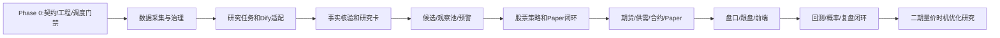

第一批代码施工建议：

1. 完成 Phase 0 门禁和正式契约；
2. 建立来源、原始快照、材料和质量问题的最小数据链；
3. 实现内容哈希去重和时间字段；
4. 建立研究任务和 Dify 适配器，先只做事件事实抽取；
5. 保存 AI 原始结果，完成 Schema、来源引用和时间/授权校验；
6. 实现股票候选与研究卡最小闭环；
7. 经人工确认后串接现有 Paper 服务；
8. 全链路稳定后扩展商品和期货。

第一批不做：Dify下单、真实通道、复杂自主Agent循环、完整行情向量库、实盘移仓、未经验证的概率驱动仓位和全量前端。

---

## 16. 异常、幂等、安全与审计

### 16.1 异常分类

```text
REQUEST_INVALID / IDEMPOTENCY_CONFLICT
SOURCE_UNAVAILABLE / DATA_QUALITY_FAILED / TIME_VISIBILITY_INVALID
AUTHORIZATION_BLOCKED / SUBJECT_UNRESOLVED
AI_OUTPUT_INVALID / AI_TIMEOUT / RESEARCH_CONFLICTED
STRATEGY_NOT_MATCHED / MARKET_CLOSED / INSTRUMENT_BLOCKED
RISK_REJECTED / ACCOUNT_HALTED / INSUFFICIENT_CASH / INSUFFICIENT_POSITION
ORDER_STATE_INVALID / RECONCILIATION_REQUIRED / INTERNAL_ERROR
```

### 16.2 幂等和重试

采集入库、研究任务、Dify回调、事实升级、人工审核、交易计划确认、Paper下单/撤单、跟盘、熔断/恢复、移仓步骤和复盘提交均须有幂等键。重复请求返回原结果；相同键不同参数报幂等冲突。Dify网络临时故障可按上限重试，保持同一业务任务和幂等键；Schema、授权和身份错误不盲目重试。

### 16.3 审计字段

关键操作记录 `requestId`、操作者/类型、动作、聚合对象、前后状态、原因、来源、Workflow/策略/规则版本、快照、结果和时间。Dify另记录 `runId`、模型、输入快照、原始输出、校验状态和耗时。

### 16.4 降级矩阵

| 故障 | 可继续 | 必须阻断 |
|:---|:---|:---|
| Dify超时 | 采集、结构化指标、既有Paper和风控 | 依赖新AI解释的事实升级 |
| Dify Schema错误 | 保存响应并人工复核 | 候选升级和计划生成 |
| 备源可用 | 使用备源并标记 | 无需停止可独立业务 |
| 所有行情源失效/行情过期 | 展示、复盘和风险监控 | 新开仓判断 |
| 授权不明 | 内部问题处理 | 当前用途的数据下游使用 |
| 组合风险超限 | 减风险复核 | 新增风险 |
| Kill Switch开启 | 查询和风险监控 | 所有新增订单 |

### 16.5 安全与权限

量化API沿用底座认证授权，按数据、研究审核、覆盖、策略、计划审核、Paper、风险、回测、复盘和审计权限分组。`DIFY_API_KEY`只进环境变量/密钥管理；回调校验来源或签名；Dify只访问最小权限研究接口，不获得交易凭据。默认账户为 Paper/Virtual；一期不得启用 LIVE、QMT/CTP submit/cancel。

---

## 17. 测试和阶段门禁

### 17.1 测试范围

```text
单元：去重/时间/身份/质量/引用校验/指标/策略/状态机/仓位/标签
集成：采集→研究→候选→观察→计划→风控→Paper→账务→审计/事件
接口：权限、Schema、错误码、幂等和Dify回调
故障：Dify超时/非法JSON/重复回调、来源冲突、行情过期、重复任务
回测对拍：bar+1、点时可见性、复权、成本、涨跌停、样本外隔离
```

### 17.2 阶段门禁

| 阶段 | 范围 | 验收重点 |
|:---|:---|:---|
| Phase 0 | 工具链、契约、Flyway、CI、调度迁移、敏感配置 | 基线通过；禁止双栈调度和真实交易能力 |
| Phase 1A | 股票日线、新闻/财报、候选、策略和Paper | 数据→研究→策略→Paper闭环可回放 |
| Phase 1B | 期货合约、保证金、开平和期货Paper | 合约生命周期与风险规则通过 |
| Phase 1C | 盘口、跟盘、前端 | 实时/盘中流程和用户审核可用 |
| Phase 1D | 回测、概率验证、复盘和前端闭环 | 点时、bar+1、成本、样本外和归因通过 |

任一阶段若 Dify 能绕过 Spring Boot 校验、候选可直达订单、Paper绕过幂等/审计、回测使用未来数据、风控不能阻止新增风险、调度双栈或出现真实 submit/cancel 路径，不得进入下一阶段。另：普通用户必须能在不填写专业策略/风险参数的情况下完成一次研究到Paper确认流程；否则不得进入前端闭环验收。

---


### 17.3 普通用户体验验收

除业务正确性外，阶段验收必须验证：

~~~text
普通用户不填写策略公式、指标周期、风险预算、仓位公式或撮合参数；
常用研究任务核心输入不超过3项；
系统可以解释每个阻断状态和下一步；
普通用户可以从研究结果走到Paper确认，而不需要阅读专业技术文档；
专业字段默认折叠，技术错误码不是唯一用户提示；
确认动作记录用户看到的建议版本和数据时间。
~~~

## 18. 子模块详设拆分及维护规则

### 18.1 后续子模块详设建议

```text
详设_1_数据与标的基础详细设计方案
详设_1C_标的身份、交易日历与交易时段
详设_2_研究与候选发现详细设计方案
详设_2A_研究任务与Dify适配
详设_2B_事实核验与研究链
详设_2C_候选池与研究决策卡
详设_3_策略与交易决策详细设计方案
详设_3A_量价指标与策略引擎
详设_3B_观察池与预警
详设_3C_交易计划与人工审核
详设_4_风险、交易与验证详细设计方案
详设_4A_组合风险与仓位管理
详设_4B_Paper执行与持仓管理
详设_4C_回测与概率验证
详设_4D_复盘与规则迭代
详设_13_任务调度与事件机制
详设_14_前端页面与交互
详设_15_监控、审计和安全
```

每份子详设应包含目标边界、上下游、输入输出、状态机、领域对象、表结构、API/事件契约、错误码、幂等事务、调度、测试和实施顺序。

### 18.2 进入子详设前确认项

实际数据供应商和授权；Tushare接口/字段/额度/保存权；新闻/公告/研报主备源；Dify部署、模型、Workflow、限额和回调认证；MySQL/Redis/时序库选型；点时存储；Paper手续费/滑点；期货规则来源；人工审核和Override范围；XXL-JOB迁移窗口。

### 18.3 维护和变更

流程变化同步本文档、子模块详设、`contract/openapi`、事件、错误码、`db/migration`、任务和测试，并更新技术分册落地状态。落地进度事实仍以《总体业务架构及记录落地功能进度.md》为准。改变Dify权限、事实源、Paper范围、点时口径、调度框架、状态机、授权或人工门禁时须形成ADR或更新本文档版本。

---

## 流程图索引

| 编号 | 图名 | 章节 |
|:---|:---|:---|
| F-001 | 总体逻辑架构 | 2.1 |
| F-002 | 核心业务对象关系 | 2.3 |
| F-003 | 端到端主流程 | 3 |
| F-004 | 数据采集与治理 | 4.2 |
| F-005 | Dify输出校验 | 5.5 |
| F-006 | 候选初筛和深筛 | 7.2 |
| F-007 | 预警重新检查 | 8.2 |
| F-008 | Paper委托 | 9.3 |
| F-009 | 重大风险事件 | 10.1 |
| F-010 | 验证流 | 11.2 |
| F-011 | 推荐实施顺序 | 15.5 |

## 结论

一期主链路必须遵循：

```text
Spring Boot采集并保存原始/结构化数据
→ Dify大模型分析授权材料，返回事实候选、引用、影响变量、预测草稿和反方问题
→ Spring Boot校验Schema、原文、来源、时间、授权、身份和冲突
→ Spring Boot计算基本面/供需/量价/概率/策略/风险
→ 生成研究卡、观察池和等待条件
→ 触发后重检并生成交易计划
→ 人工确认
→ Spring Boot执行Paper/Shadow并保存订单/成交/账务/持仓/审计
→ 回测、复盘、校准和规则迭代
```

Dify是研究辅助和语言交互系统，不是事实数据库、策略主引擎、风控引擎或交易执行引擎。Spring Boot是确定性业务主系统，Vue是审核、查看和操作入口。所有后续详设和代码施工均应遵守此边界。

新闻监控与分析的职责边界为：Spring Boot采集和保存新闻原文、来源、时间、去重和质量状态；Dify调用大模型生成摘要、重大程度候选、行业/个股关联候选和利多/利空候选；Spring Boot校验并保存AI草稿与核验后的研究事件，发布事件并通知后续研究流程。Dify数据库/向量库不替代Spring Boot的事实、研究事件、行情和量价特征主记录。

二期新增“量价主导机会发现与交易时机优化”能力，适用于A股、港股、美股、期货、外汇/海外经纪商品。一期只完成多周期行情、量价特征、市场状态、因子快照、资产标准化、标签、版本和回放接口预留，以及确定性量价状态、观察和预警；二期由 Spring Boot 进行机会扫描、因子过滤、时机统计验证、优化和策略适配，Dify只负责解释、假设、反方问题和问答，不负责时机计算或交易执行。


