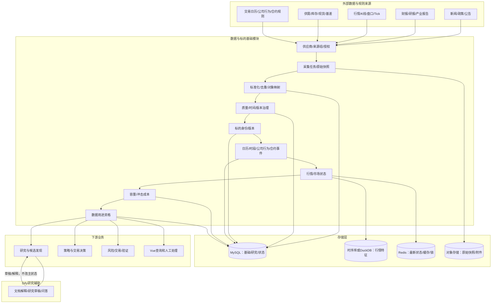
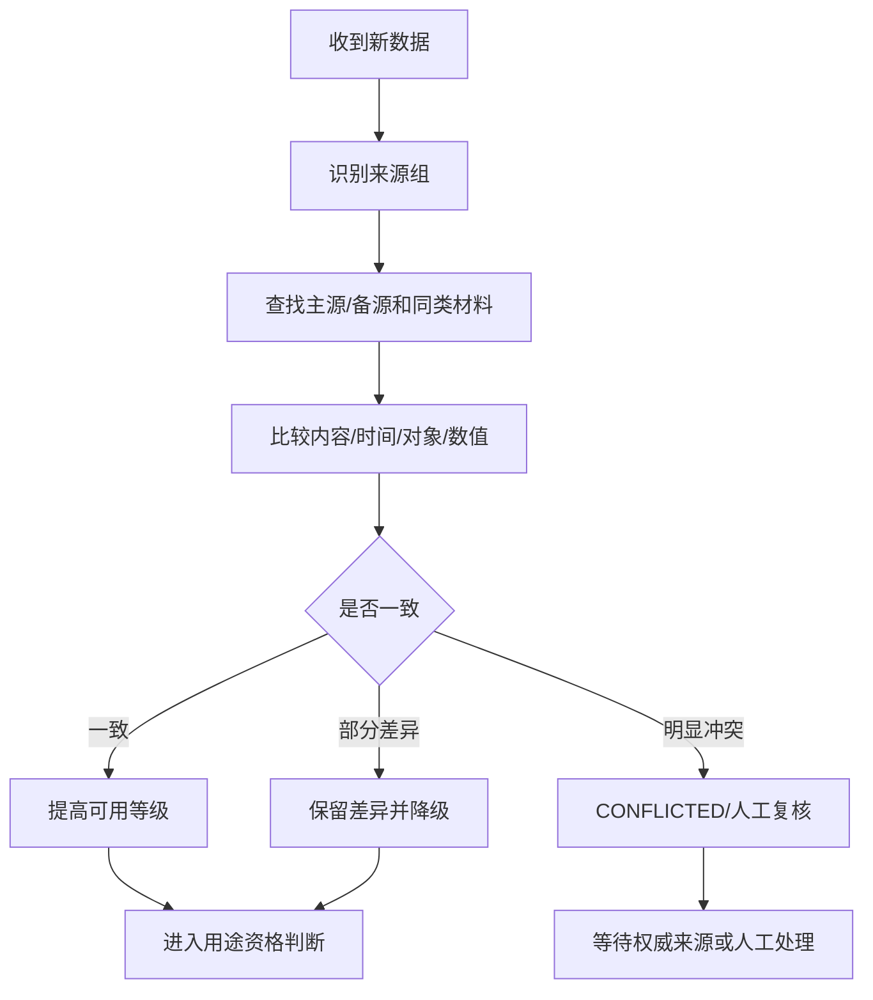
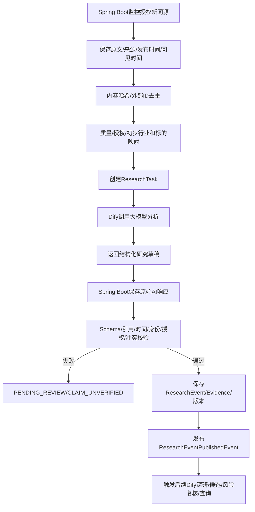
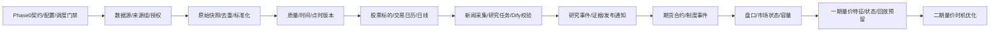

# QuantPF 详设 1：数据与标的基础详细设计方案

| 项目 | 内容 |
|:---|:---|
| 文档名称 | 详设_1_数据与标的基础详细设计方案 |
| 系统 | QuantPF（Quant Portfolio Framework） |
| 文档版本 | V1.4 |
| 编制日期 | 2026-10-23 |
| 所属分级 | 详设模块一：数据与标的基础 |
| 上游总纲 | 《量化交易系统完整设计方案说明书_V4.md》 |
| 上游整体流程 | 《详设_0_整体流程文档.md》 |
| 上游技术分册 | 《总体业务架构及记录落地功能进度.md》 |
| 主要代码模块 | `quantpf-domain`、`quantpf-marketdata`、`quantpf-common`、`quantpf-job`、`quantpf-research` |
| 一期范围 | 研究辅助、候选筛选、机会提示、策略适配、Paper/Shadow、复盘验证 |
| 二期预留 | 量价关系优化发现交易时机、完整盘口/逐笔/订单流、自动实盘前置能力 |

> 本文档定义数据与标的基础模块的业务边界、总体架构、数据生命周期、状态机、跨模块流程、Dify/Spring Boot职责、事件和施工门禁。本文档不展开具体页面布局、前端组件、Java类级设计或最终数据库DDL；这些内容由后续产品设计文档和代码级详设继续展开。

---

## 目录

1. 模块定位与设计目标
2. 设计依据、范围与边界
3. 总体架构
4. 核心业务概念
5. 数据源与供应商管理
6. 来源组与交叉核验
7. 数据采集与原始快照
8. 标准化、去重与数据版本
9. 数据质量、授权与时间可见性
10. 新闻监控到研究事件的跨模块流程
11. 标的身份与版本管理
12. 交易日历、市场时段与制度状态
13. 公司行为与期货合约事件
14. 行情与市场数据基础
15. 交易容量与冲击成本基础评估
16. 数据用途资格与下游输出
17. 状态机总表
18. Dify与Spring Boot功能边界
19. 领域对象与逻辑数据模型
20. API、事件与任务调度
21. 异常、幂等、审计和安全
22. 代码仓映射与施工顺序
23. 二期量价时机优化预留
24. 测试策略与验收门禁
25. 后续子详设和待确认事项

---

## 1. 模块定位与设计目标

### 1.1 模块定位

数据与标的基础是 QuantPF 的确定性数据底座，负责回答：

```text
数据从哪里来？
数据是否被授权？
数据是否真实、完整、及时、一致？
数据在决策时点是否已经可见？
这个股票、期货合约或现货对象到底是什么？
当前是否交易、暂停或处于特殊制度状态？
数据能否用于研究、筛选、回测或Paper？
当前标的的流动性、容量和冲击成本如何？
```

本模块不判断“标的是否值得买”，不生成最终研究结论、策略信号、交易计划或订单；本模块向下游提供可追溯的数据、明确的身份、制度状态和用途资格。

### 1.2 业务目标

建立一套：

```text
可获得
→ 可识别
→ 可追溯
→ 可核验
→ 可回溯
→ 可判断用途
→ 可安全提供给下游
```

的数据基础设施。

### 1.3 用户目标

用户不需要理解每个数据接口和供应商条款。系统应把复杂的数据治理结果转换为清晰状态：

```text
可用
部分可用
延迟
过期
来源冲突
授权不明
历史不足
标的未确认
暂不可用于新开仓
```

每个异常都应说明：

```text
问题是什么
影响哪些功能
用户可以做什么
是否可以继续其他业务
```

---

## 2. 设计依据、范围与边界

### 2.1 设计依据

本模块必须同时遵循：

1. V4 总纲第 5 章关于数据来源、授权、时间可见性和历史回溯的要求；
2. V4 总纲第 7 章关于量价基础数据和一期/二期边界的要求；
3. V4 总纲第 16、23、25 章关于数据采集、事件、研究链和 Dify/Spring Boot 边界的要求；
4. 《详设_0_整体流程文档.md》关于三条业务流、Dify草稿、Spring Boot事实源、事件和Paper门禁的要求；
5. 技术分册第 26～34 章关于模块、数据层、契约、调度和当前代码仓状态的要求。

### 2.2 本模块包含的八个子域

| 子域 | 目标 |
|:---|:---|
| 数据源与供应商 | 管理产品、接口、字段、额度、授权、费用和到期 |
| 来源组与核验 | 管理主源、备源、交叉核验、转载和冲突 |
| 采集与快照 | 采集新闻、公告、行情、财报、规则并保留原始版本 |
| 标准化与质量 | 去重、字段/单位标准化、质量、版本和点时可见性 |
| 标的身份 | 统一股票、期货合约、连续合约和现货对象身份 |
| 日历与事件 | 管理交易日历、时段、公司行为和合约生命周期事件 |
| 行情与市场状态 | 管理K线、盘口摘要、市场状态和数据新鲜度 |
| 容量与用途资格 | 判断流动性、冲击成本和数据能否进入各下游业务 |

### 2.3 一期范围

一期必须支持：

```text
股票和期货基础标的
授权范围内的新闻、公告、财报、研报和产业资料
股票日线和基础行情
期货基础合约和交易规则
交易日历和交易时段
原始快照、去重、质量、时间和点时版本
新闻监控到Dify研究任务的入口
Spring Boot研究事件保存和发布
基础量价状态和观察/预警所需数据
Paper开仓资格判断所需的最新数据和制度状态
```

### 2.4 一期不包含

```text
真实证券/期货行情交易通道
QMT/CTP真实submit/cancel
完整逐笔订单流和高级深度图
自动择时模型
Dify直接写事实、研究事件、行情或交易状态
未经核验的新闻直接形成交易信号
未经授权的数据共享或再分发
用不完整历史证明概率
```

### 2.5 全局硬约束

1. Spring Boot 是本模块的业务事实源和确定性主系统。
2. Dify 只能生成数据文档解释和研究辅助草稿，不改变基础数据状态。
3. 原始数据、结构化数值、点时版本、研究事件和量价特征主记录不放在 Dify 数据库或向量库。
4. 同一数据的“可展示、可研究、可筛选、可回测、可Paper”资格必须分开判断。
5. 来源冲突、授权不清、身份不清和时间不可见不得被静默忽略。
6. 任何数据修订都保留旧版本，不允许静默覆盖历史决策依据。
7. 任何写操作必须幂等、可审计、可回放。
8. 二期量价交易时机优化必须在一期预留数据、特征、状态、标签和回放边界，但一期不实现自动择时。

---

## 3. 总体架构

### 3.1 逻辑架构



### 3.2 数据分层原则

| 层 | 内容 | 权威端 |
|:---|:---|:---|
| 原始层 | 外部响应、文件、网页、附件、原文 | Spring Boot引用和保存 |
| 标准层 | 统一字段、单位、标的ID、时间和来源 | Spring Boot |
| 质量层 | 质量、授权、冲突、修订和用途资格 | Spring Boot |
| 研究入口层 | 新闻材料、研究任务、AI草稿、研究事件 | Spring Boot主记录，Dify辅助生成 |
| 行情层 | K线、盘口、Tick和量价特征 | Spring Boot/时序存储 |
| 缓存层 | 最新行情、市场状态、锁和健康状态 | Redis等 |

---

## 4. 核心业务概念

### 4.1 数据源、来源和材料的区别

```text
供应商：提供数据服务的组织
数据产品：供应商提供的一组能力
接口：具体调用入口
来源：某条数据实际来自的发布主体或页面
原始快照：系统某次获取到的原始响应
研究材料：经过基础治理后可供研究的新闻、公告、财报等材料
```

### 4.2 数据版本与业务事实

```text
原始材料
→ 标准化数据
→ 质量和授权判定
→ 点时版本
→ 研究输入
```

本模块不把“来源返回的内容”自动升级为“业务事实”。只有经过来源、时间、身份、授权和质量检查后，才能作为下游研究输入。新闻分析结果还需经过 Dify 草稿校验和研究事件发布流程。

### 4.3 数据用途资格

同一数据可以有不同用途资格：

```text
DISPLAY_ALLOWED
RESEARCH_ALLOWED
SCREENING_ALLOWED
STRATEGY_ALLOWED
BACKTEST_ALLOWED
PAPER_ALLOWED
RISK_MONITORING_ALLOWED
```

用途资格由确定性规则计算，不由 Dify自由文本决定。

---

## 5. 数据源与供应商管理

### 5.1 供应商登记

每个供应商和产品登记：

```text
供应商名称、产品名称、账号类型、合同/订阅标识
服务周期、费用、到期日
接口清单、字段清单、历史范围、更新频率、延迟
调用额度、并发限制、保存范围、共享范围
个人/团队/商业使用限制
主源/备源关系、健康状态、替代方案
```

年度订阅不等于所有接口、字段、历史、保存和商业使用权限均已获得。Tushare、行情和产业数据必须按具体套餐建立接口—字段—用途清单。

### 5.2 接口和字段目录

供应商管理必须下钻到：

```text
供应商
→ 数据产品
→ 接口
→ 字段
→ 历史范围
→ 更新频率
→ 延迟
→ 授权用途
```

不能只保存“已配置Tushare”或“已配置行情源”这种不可验收的粗粒度状态。

### 5.3 供应商状态

```text
DRAFT
→ PENDING_CONFIRMATION
→ ACTIVE
→ DEGRADED
→ EXPIRING
→ EXPIRED
→ SUSPENDED
→ RETIRED
```

| 状态 | 业务含义 |
|:---|:---|
| `DRAFT` | 已录入但未确认 |
| `PENDING_CONFIRMATION` | 等待授权、合同、字段或连接确认 |
| `ACTIVE` | 可以按用途使用 |
| `DEGRADED` | 部分接口、额度、历史或延迟异常 |
| `EXPIRING` | 即将到期，需要续期或切换 |
| `EXPIRED` | 到期，不得继续使用受限能力 |
| `SUSPENDED` | 人工暂停 |
| `RETIRED` | 不再作为有效来源但保留历史 |

### 5.4 启用流程

```text
录入供应商
→ 选择产品和套餐
→ 登记接口/字段/授权用途
→ 测试连接和样本
→ 配置主源/备源
→ 确认用途和到期提醒
→ 启用
```

连接成功不等于业务可用，必须同时通过授权、字段和用途确认。

---

## 6. 来源组与交叉核验

### 6.1 来源组

| 来源组 | 主来源目标 | 主要用途 | 核验要求 |
|:---|:---|:---|:---|
| 新闻/政策 | 2～3个 | 事件、政策、宏观变化 | 发布时间、原文、转载关系 |
| 公司公告/财报 | 2～3个 | 公告、财报、业绩和风险 | 正式披露优先 |
| 研报/行业报告 | 2～3个 | 预期、观点和反方材料 | 相同转载不算独立证据 |
| 行情/量价 | 1个主源+1个备源 | K线、量价、盘口、持仓 | 价格、时间、交易日和身份一致 |
| 商品供需 | 2～3个 | 库存、供应、需求、利润、现货 | 单位、地区、品级、周期一致 |
| 交易规则 | 交易所/监管/正式规则源 | 日历、时段、合约、保证金 | 规则版本和生效日 |

### 6.2 来源组状态

```text
CONFIGURED
→ HEALTHY
→ PARTIALLY_AVAILABLE
→ CONFLICTED
→ DEGRADED
→ UNAVAILABLE
```

### 6.3 交叉核验流程



### 6.4 重复和转载

识别字段：

```text
external_id
source_id
content_hash
normalized_title_hash
原文链接
发布时间
```

应区分：

```text
完全重复
轻微改写
引用转载
独立来源
评论/观点材料
```

多家转载同一原文不能简单视为多家独立核验来源。

---

## 7. 数据采集与原始快照

### 7.1 采集范围

```text
股票基础信息、行业和状态
期货品种、具体合约和交易规则
现货品级、地区和报价
新闻、政策、公告、财报、业绩预告、问询和研报
日K、分钟K、盘口摘要、Tick、成交量、成交额、持仓量、结算价
库存、供应、需求、开工、利润、现货、基差和期限结构
交易日历、公司行为、合约事件和制度变化
```

### 7.2 原始快照优先

```text
采集响应
→ 原始快照
→ 哈希和外部ID
→ 采集元数据
→ 解析版本
→ 结构化数据
```

不得只保存解析后的字段而丢弃原始材料。

### 7.3 原始快照逻辑字段

```text
snapshotId
sourceId
sourceGroupId
externalId
requestTime
observedAt
publishedAt
availableAt
contentHash
rawContentReference
responseStatus
parserVersion
authorizationStatus
```

### 7.4 采集任务状态

```text
CREATED
→ RUNNING
→ SUCCEEDED
→ PARTIAL_SUCCESS
→ FAILED
→ RETRYING
→ CANCELED
```

`PARTIAL_SUCCESS`必须列出成功范围和失败范围，不得把缺失字段伪装为完整结果。

### 7.5 采集频率原则

频率由数据源、市场时段、用途和供应商额度共同配置，不在业务代码中把所有来源硬编码成统一频率。可配置示例：

```text
新闻/公告：按来源健康和授权配置的轮询或推送
股票日线：交易日盘后增量
分钟行情：交易时段按周期增量
盘口/Tick：一期按可用数据和Paper需求分阶段接入
交易规则：按生效日和定期同步
```

---

## 8. 标准化、去重与数据版本

### 8.1 标准化

统一处理：

```text
字段名称
数值类型
单位
币种
时区
交易所代码
标的代码
日期和时间
复权口径
合约月份
品级和地区
```

### 8.2 数据去重

新闻和文档按：

```text
来源 + 外部ID
来源 + 内容哈希
标准化标题 + 时间窗口
```

行情按：

```text
标的身份 + 周期 + barTime + 来源版本
```

去重命中时更新观测记录或版本关联，不重复创建业务记录。

### 8.3 版本原则

任何修订保留：

```text
旧版本
新版本
修订时间
修订来源
修订原因
受影响对象
是否需要重算研究/指标/回测
```

### 8.4 点时版本

回测、复盘和历史研究必须能够读取：

```text
decisionTime之前已经可见的数据
当时的标的身份和交易规则
当时的研究材料版本
当时的量价和市场状态
```

---

## 9. 数据质量、授权与时间可见性

### 9.1 质量维度

```text
来源可靠性
结构完整性
字段合法性
对象身份
时间有效性
授权状态
历史完整性
多来源一致性
更新及时性
修订状态
```

### 9.2 数据质量状态

```text
AVAILABLE
DELAYED
PARTIAL
CONFLICTED
UNAUTHORIZED
STALE
INVALID
PENDING_REVIEW
```

### 9.3 时间字段

| 字段 | 含义 |
|:---|:---|
| `published_at` | 来源发布时间 |
| `available_at` | 系统可获得时间 |
| `effective_at` | 业务生效时间 |
| `observed_at` | 系统实际观察时间 |
| `revised_at` | 后续修订时间 |
| `snapshot_version` | 点时快照版本 |

### 9.4 用途资格矩阵

| 数据状态 | 展示 | 研究 | 筛选 | 回测 | Paper新开仓 |
|:---|:---:|:---:|:---:|:---:|:---:|
| `AVAILABLE` | 允许 | 允许 | 允许 | 视历史完整性 | 允许 |
| `DELAYED` | 提示 | 限制 | 限制 | 通常禁止 | 禁止 |
| `PARTIAL` | 允许 | 提示 | 限制 | 禁止证明完整概率 | 禁止 |
| `CONFLICTED` | 展示差异 | 可人工研究 | 禁止 | 禁止 | 禁止 |
| `UNAUTHORIZED` | 受限 | 禁止 | 禁止 | 禁止 | 禁止 |
| `STALE` | 历史查看 | 复盘 | 禁止新判断 | 视点时版本 | 禁止 |
| `INVALID` | 显示异常 | 禁止 | 禁止 | 禁止 | 禁止 |
| `PENDING_REVIEW` | 允许查看 | 人工复核 | 禁止 | 禁止 | 禁止 |

### 9.5 数据质量问题生命周期

```text
OPEN
→ ANALYZING
→ WAITING_SOURCE / WAITING_HUMAN
→ RESOLVED
→ VERIFIED
→ CLOSED
```

问题记录必须关联影响数据、业务影响、严重级别、处理人、处理动作、依据和修复版本。

---

## 10. 新闻监控到研究事件的跨模块流程

### 10.1 归属原则

```text
新闻原文、来源、去重、时间、授权和质量
→ 数据与标的基础

Dify摘要、重大程度候选、影响范围、行业/个股关联候选、利多/利空候选
→ 研究辅助草稿

研究事件最终状态、结构化保存、版本、幂等和通知
→ Spring Boot研究与事件主控
```

### 10.2 流程



### 10.3 Dify研究草稿内容

```text
新闻摘要
事件类型候选
影响层级候选：整体/行业/公司/商品
重大程度候选：一般/重要/重大风险
方向候选：利多/利空/中性/双向/不确定
实体和行业候选
事实候选及原文引用
影响变量和传导链草稿
支持证据和反方问题
需要补充的数据
```

这些字段在 Spring Boot 校验之前均属于草稿。

### 10.4 研究事件最终状态

```text
NEW
→ COLLECTED
→ DEDUPLICATED
→ AI_ANALYZED
→ VERIFIED
→ VARIABLE_MAPPED
→ PUBLISHED
→ DISMISSED / EXPIRED / REVISED
```

异常状态：

```text
AI_ANALYSIS_PENDING
SOURCE_UNRESOLVED
CONFLICTED
SUBJECT_UNRESOLVED
AUTHORIZATION_BLOCKED
```

### 10.5 重大新闻处理

重大新闻只产生：

```text
研究事件
风险复核任务
停止新增风险建议
人工确认任务
```

不得由 Dify 直接产生：

```text
全部平仓命令
开仓命令
SELL_OPEN
真实订单
Paper订单副作用
```

### 10.6 查询和通知

Spring Boot 提供研究事件查询和证据查询；Dify只能通过受控接口读取结构化结果。事件通知使用幂等键、`correlationId`、`causationId`和版本，失败可以重试，不重复产生交易副作用。

---

## 11. 标的身份与版本管理

### 11.1 产品类型

```text
STOCK
FUTURE
SPOT
```

Stage 1 主要受理股票和期货；现货以研究价格、库存、合同敞口、基差和套保分析为主。

### 11.2 股票身份

```text
symbol
exchange
companyId
securityName
market
listingStatus
currency
lotSize
priceTick
```

### 11.3 期货具体合约身份

```text
exchange
productCode
contractCode
contractMonth
expiryDate
deliveryMonth
priceTick
contractMultiplier
lotSize
marginRate
tradingSessions
limitRule
```

### 11.4 连续/主力合约

连续合约只用于分析和筛选，不能与具体可交易合约混淆。记录：

```text
continuousType
rollRule
currentUnderlyingContract
previousContract
nextContract
rolloverDate
priceAdjustmentRule
```

### 11.5 现货对象

```text
commodity
grade
region
warehouseOrLocation
priceType
quotedAt
unit
currency
tradeCondition
```

### 11.6 标的状态

```text
DISCOVERED
→ MAPPING_REQUIRED
→ VERIFIED
→ ACTIVE
→ SUSPENDED
→ EXPIRED
→ RETIRED
```

以下对象不得自动合并：不同交易所同代码、同名不同品级、连续合约与具体合约、不同地区现货、不同交割月、不同单位/币种、复权价和非复权价。

### 11.7 标的版本

标的交易属性变化必须有版本：

```text
instrumentVersion
validFrom
validUntil
changeReason
sourceRef
```

适用属性包括最小交易单位、价格最小变动、涨跌停、保证金、交易时段、交割规则、上市/停牌/退市状态。

---

## 12. 交易日历、市场时段与制度状态

### 12.1 设计结论：交易日历不是单表

交易日历属于本模块，但不能只建一张“日期 + 是否开市”的表。系统必须分开建模：

```text
市场/交易所日历定义
→ 市场本地交易日期
→ 交易时段模板和特殊时段
→ 股票/港股/美股/期货/外汇品种绑定
→ 标的/具体合约生命周期
→ 日线数据是否应到、是否已到、是否可用
→ 策略、Paper和回测的日期门禁
```

交易日历的权威结构化事实由 Spring Boot 保存和计算；Tushare 只作为受控外部来源之一。前端可以查询和申请人工覆盖，Dify只能解释已经计算出的结果，不能判断或修改最终交易日、时段、可交易资格或Paper门禁。

### 12.2 Tushare Pro接口与原始字段适配

本方案按官网当前接口定义设计。接口权限、调用频次、单次返回量和字段可能调整，施工时需再次对照实际账号权限及官网文档；未获授权的接口不能列为可用数据源。官方字段结构核对入口：

- [Tushare 通用交易日历 trade_cal](https://tushare.pro/document/2?doc_id=26)
- [Tushare 期货交易日历 fut_trade_cal](https://tushare.pro/document/2?doc_id=467)
- [Tushare 港股交易日历 hk_tradecal](https://tushare.pro/document/2?doc_id=250)
- [Tushare 美股交易日历 us_tradecal](https://tushare.pro/document/2?doc_id=253)
- [Tushare 外汇基础信息 fx_obasic](https://tushare.pro/document/2?doc_id=178)
- [Tushare 外汇日线 fx_daily](https://tushare.pro/document/2?doc_id=179)

| API | 官网输出字段 | 类型/来源语义 | 适配要求 |
|:---|:---|:---|:---|
| `trade_cal` | `exchange, cal_date, is_open, pretrade_date` | 文档化输出字段均为str，`exchange`输出说明列SSE/SZSE；输入`exchange`允许SSE、SZSE、CFFEX、SHFE、CZCE、DCE、INE；`is_open`输入/输出为字符串"0"/"1" | 定位为内地股票日历来源；需2000积分；单次返回量按官网当前说明执行；期货按专用`fut_trade_cal`和目录标注的`trade_cal`能力做账号级验证，字段/数据冲突进入核验流程；北交所按官方说明参考沪深并保留独立编码 |
| `fut_trade_cal` | `exchange, cal_date, is_open, pretrade_date` | `exchange/cal_date/pretrade_date`为str，`is_open`输入/输出为int 0/1；交易所支持SHFE、DCE、CFFEX、CZCE、INE；需2000积分；单次返回量按官网当前说明执行 | 不把整数/字符串混用；该接口的交易所范围不含GFEX，GFEX日历需另找授权来源或人工维护 |
| `hk_tradecal` | `cal_date, is_open, pretrade_date` | 输出`is_open`为整数0/1；筛选参数`is_open`为字符串0/1；单次最多2000条，文档要求相应积分权限 | 内部`calendar_code`固定为HKEX日历；来源结果本身不带`exchange`，由适配器配置补充来源市场身份 |
| `us_tradecal` | `cal_date, is_open, pretrade_date` | 输出`is_open`为整数0/1；筛选参数`is_open`为字符串0/1；5000积分权限，单次最多6000条（以官网现行说明为准） | 内部`calendar_code`采用US通用日历；来源结果不带交易所字段，不据此推导NYSE/NASDAQ单独日历 |
| `fx_obasic` | `ts_code, name, classify, exchange, min_unit, max_unit, pip, pip_cost, traget_spread, min_stop_distance, trading_hours, break_time` | 当前文档说明为FXCM交易商数据；`classify`含FX、INDEX、COMMODITY、METAL、BUND、CRYPTO、FX_BASKET | 这是品种/CFD属性和文字时段字段，不是日历日记录；保留原字段拼写和原文，解析后的规则另行版本化 |
| `fx_daily` | `ts_code, trade_date, bid_open, bid_close, bid_high, bid_low, ask_open, ask_close, ask_high, ask_low, tick_qty, exchange` | `trade_date`输入日期按GMT口径；官网说明比北京时间日期晚一天；当前交易商为FXCM | 用于行情数据日期核验，不反推休市、节假日或通用FX市场日历 |

`trade_cal`和`fut_trade_cal`均为独立接口，不能因为其字段看似相同就合并API调用逻辑；`hk_tradecal/us_tradecal`不返回exchange字段；FX没有与上述交易日历同构的Tushare接口。适配器必须以“源接口+字段Schema版本”为边界，保留每个接口自己的请求/响应结构，再映射到统一内部对象。

Tushare不同市场接口的字段并不完全相同，适配层必须保存原始响应和请求参数，再映射为统一内部模型；不得直接假设所有接口都有相同的 `exchange`、`is_open` 或时段字段。

#### 12.2.1 中国股票/交易所通用日历：`trade_cal`

官网通用交易日历接口的核心输入是交易所和日期范围。其输入参数`exchange`允许SSE、SZSE及部分期货交易所编码；但官网文档的输出`exchange`字段说明列为SSE/SZSE。为避免把入参可选值误当作输出覆盖保证，系统将`trade_cal`定位为A股通用日历来源；期货首选专用`fut_trade_cal`，并按实际账号权限核验Tushare目录所列`trade_cal`期货日历能力。适配时保留：

```text
exchange       文档化输出字段为来源交易所编码（说明列SSE/SZSE）；期货不以此接口作为权威日历
cal_date       市场日历日期
is_open        来源是否开市，按原始类型保存并标准化为布尔值
pretrade_date  来源上一交易日
```

系统内部映射：

| 来源/业务对象 | 内部日历编码 | 说明 |
|:---|:---|:---|
| SSE股票 | `CN_STOCK_SSE` | 上海股票市场日历 |
| SZSE股票 | `CN_STOCK_SZSE` | 深圳股票市场日历 |
| BSE股票 | `CN_STOCK_BSE` | 保留独立编码；一期可引用已核验的内地股票日历，不能把引用当成永久等同 |
| CFFEX | `CN_FUTURE_CFFEX` | 中金所，最终以期货接口和规则来源确认 |
| SHFE | `CN_FUTURE_SHFE` | 上期所 |
| CZCE | `CN_FUTURE_CZCE` | 郑商所 |
| DCE | `CN_FUTURE_DCE` | 大商所 |
| INE | `CN_FUTURE_INE` | 上海国际能源交易中心 |

`trade_cal`返回的交易所参数和市场覆盖以实际账号权限及官网当前文档为准。特别是交易所代码出现在标的接口中，不等于该交易所一定由同一个日历接口完整覆盖；例如广期所应预留 `CN_FUTURE_GFEX`，但在确认接口可用前不能伪造为已由Tushare日历覆盖。

#### 12.2.2 期货日历：`fut_trade_cal`与`trade_cal`的权限/覆盖核验

Tushare专用接口文档列有`fut_trade_cal`；同时，Tushare接口/积分目录对“期货交易日历”的索引名称出现`trade_cal`。因此不能仅凭接口名假定用户账号必然具备`fut_trade_cal`权限，也不能仅凭`trade_cal`的exchange入参接受期货代码就认定其返回覆盖完整。上线前必须以实际账号分别探测接口权限、交换机编码、字段类型、历史范围和重叠日期结果，并把授权/字段验证结果写入DataSource能力配置。

适配优先级建议：有权限且实测结构通过时使用专用`fut_trade_cal`；`trade_cal`可作为兼容或交叉核验来源，只有经字段与样例验证后才启用。来源冲突按CalendarConflict流程处理，不静默择一。`fut_trade_cal`文档输出结构为：

```text
exchange
cal_date
is_open
pretrade_date
```

期货日历的 `is_open=1` 只表示交易所/市场日历开放，不表示所有品种或所有具体合约都可以开仓。`fut_trade_cal`文档列出的交易所为SHFE、DCE、CFFEX、CZCE、INE，不含GFEX；GFEX日历需另找授权来源或人工审核维护。最终资格还必须叠加品种交易时段、合约上市/到期、最后交易日、保证金、交割和限仓规则。

#### 12.2.3 港股日历：`hk_tradecal`

港股使用独立日历编码 `HK_STOCK_HKEX`，适配字段为：

```text
cal_date
is_open
pretrade_date
```

港股不能复用A股日历。香港节假日、半日市、临时安排和市场本地日期必须在港股日历版本中独立管理；如果来源接口没有返回收市原因或时段明细，不能用空值推断为“常规交易日”。

#### 12.2.4 美股日历：`us_tradecal`

美股一期先使用通用日历编码 `US_STOCK_GENERIC`，保留：

```text
cal_date
is_open
pretrade_date
```

美股 `cal_date` 以美国市场本地日期解释，必须同时保存 `market_timezone=America/New_York` 和系统接收时间。不能用北京时间自然日替代美股交易日期。未来若需要分别支持NYSE、NASDAQ、AMEX，应在内部新增交易场所级日历或接入更细粒度的官方/授权来源；不能把通用美股日历冒充交易所级日历。

#### 12.2.5 外汇与海外经纪商品：`fx_obasic`、`fx_daily`

当前Tushare外汇相关数据不能简单等同为一个“外汇交易所交易日历”。外汇基础信息接口提供的是经纪商/海外品种的交易属性，核心需要关注：

```text
ts_code
name
classify
exchange
min_unit / max_unit
pip
pip_cost
traget_spread（源字段原拼写，适配器内部可映射为target_spread）
min_stop_distance
trading_hours
break_time
```

外汇日线接口的 `trade_date` 是数据源定义的交易日期，不能直接当作中国股票交易日；系统必须同时保存来源时区/日期口径。外汇没有统一适用于所有经纪商和品种的Tushare交易日历接口，因此一期采用：

```text
FXInstrument由fx_obasic同步品种分类、交易商、交易时段和休市时段；该接口未提供统一的上市/失效日历字段
→ 结合经纪商/数据源规则生成FXSessionRule
→ 按品种和经纪商计算可交易时段；上市/失效资格由对应标的/合约主数据来源维护
→ fx_daily.trade_date只作为数据日期，不反推完整交易日历
```

外汇品种、指数、商品、金属、BUND国库债券、加密和外汇篮子等分类必须保留 `classify`，不能全部归入 `FOREX`。系统内部建议至少区分：

```text
FX_FOREX
FX_INDEX
FX_COMMODITY
FX_METAL
FX_BUND
FX_CRYPTO
FX_BASKET
```

外汇日历定义为“品种/经纪商时段规则”，而不是简单复用股票 `is_open` 日历。

#### 12.2.6 原始值保留规则

每个Tushare接口适配器必须保存：

```text
source_name = TUSHARE_PRO
endpoint_name = trade_cal / fut_trade_cal / hk_tradecal / us_tradecal / fx_obasic / fx_daily
request_params
response_schema_version（如可获取）
raw_payload_hash
raw_payload_ref
retrieved_at
source_observed_at（如可获取）
account/permission profile（不得保存Token明文）
```

`is_open`、日期、交易所编码和分类字段既保存原始值，也保存标准化值；解析失败时进入 `INVALID`，不能把空值默认转换为开市。

### 12.3 统一日历内部模型

#### 12.3.1 市场日历定义 `TradingCalendar`

```text
calendar_id
calendar_code
market_type: STOCK / FUTURE / FX / SPOT / INDEX...
region_code: CN / HK / US / GLOBAL
venue_code: SSE / SZSE / HKEX / SHFE / ...
timezone
currency
calendar_level: MARKET / EXCHANGE / PRODUCT / INSTRUMENT / BROKER
source_policy
effective_from / effective_to
status
version
```

#### 12.3.2 交易日记录 `TradingCalendarDay`

```text
calendar_id
market_local_date
is_open
day_status: OPEN / CLOSED / SPECIAL_OPEN / SPECIAL_CLOSED / UNKNOWN / CONFLICT
previous_trade_date
next_trade_date
holiday_code
special_reason
source_id
source_record_hash
quality_status
version
valid_from / valid_to
current_flag
```

日期以市场本地日期保存；展示时另行转换为用户时区。美股、港股、期货夜盘等不能直接使用服务器时区。

#### 12.3.3 交易时段模板 `TradingSessionTemplate`

Tushare日历接口的日期字段不能替代完整交易时段。交易时段由规则来源或 `fx_obasic.trading_hours/break_time` 等字段适配生成：

```text
session_template_id
calendar_id
market_timezone
session_type: REGULAR / NIGHT / AUCTION / SPECIAL
sequence_no
start_local_time
end_local_time
crosses_midnight
trading_day_assignment
is_tradable
effective_from / effective_to
version
```

一期虽然只使用日线，但必须预留午休、集合竞价、夜盘、跨自然日夜盘、半日市、提前收市和特殊交易时段。

#### 12.3.4 标的/合约绑定 `InstrumentCalendarBinding`

```text
instrument_id
calendar_id
binding_type: DEFAULT / OVERRIDE
valid_from / valid_to
tradability_status: ACTIVE / SUSPENDED / EXPIRED
source
reason
version
```

最终可交易资格为：

```text
MarketCalendarOpen
AND InstrumentListed
AND NOT InstrumentSuspended
AND NOT InstrumentExpired
AND RuleSetAllows
AND DataReadinessAllows
```

#### 12.3.5 日线就绪 `MarketDataReadiness`

```text
calendar_code
market_local_date
expected_flag
received_flag
validated_flag
strategy_ready_flag
paper_ready_flag
last_valid_snapshot_id
block_reason
version
```

交易日、数据应到、数据已到、数据质量合格、策略可运行、Paper可新增风险必须分开保存。

### 12.4 市场时段状态

```text
HOLIDAY
PRE_OPEN
AUCTION
CONTINUOUS_TRADING
MIDDAY_BREAK
POST_CLOSE
NIGHT_SESSION
SUSPENDED
SPECIAL_SESSION
UNKNOWN
```

股票、期货、外汇和现货必须按市场/交易所/品种/经纪商分别计算，不能使用一个全局“开盘/收盘”标志。期货夜盘需要保存自然时间与交易日归属，例如自然日21:00开始但归属下一交易日。

### 12.5 制度状态影响

制度或日历变化必须触发：

```text
日历版本更新
数据就绪状态重算
标的可交易资格重算
策略可用性检查
交易计划检查
Paper风险检查
回测日历版本固定或重新生成
用户/运维通知
```

## 13. 公司行为与期货合约事件

### 13.1 股票公司行为

```text
除权、除息、分红、配股、增发
停牌、复牌、重组、ST、退市风险、退市
财报披露、业绩预告、问询和回复
```

影响范围：价格复权、候选过滤、策略计算、回测口径、风险提示和研究有效性。

### 13.2 期货合约事件

```text
上市、挂牌、最后交易日、交割月、最后交割日
保证金调整、涨跌停调整、交易时段调整、限仓变化
移仓窗口、合约到期、摘牌
```

### 13.3 事件状态

```text
DISCOVERED
→ VERIFIED
→ SCHEDULED
→ EFFECTIVE
→ EXPIRED
→ SUPERSEDED
```

### 13.4 事件处理要求

例如保证金调整不能只更新合约表，还必须重新计算：

```text
可开仓数量
保证金占用
组合压力测试
交易计划有效性
Paper风险资格
```

---

## 14. 行情与市场数据基础

### 14.1 数据层级

#### 基础行情

```text
open/high/low/close
volume/amount
交易日、周期、复权标记、来源
```

#### 分钟行情

```text
周期、K线时间、OHLCV、成交额、来源
```

#### 盘口摘要

```text
买卖价、买卖量、价差、盘口深度、成交速度、流动性状态
```

#### Tick/逐笔

一期用于实时观察、Paper跟盘、成交质量和风险提示，不作为中长期研究唯一依据。

### 14.2 行情合法性检查

```text
high >= low
high >= open/close
low <= open/close
成交量和成交额非负
时间属于有效交易时段
交易日属于交易日历
标的身份有效
```

### 14.3 K线导入模式

```text
FULL：初始化或明确重建
INCREMENTAL：按标的/周期/barTime增量去重
REPAIR：缺口、错误或来源修订后的局部修复
```

### 14.4 市场状态

```text
TREND_UP
TREND_DOWN
RANGE
HIGH_VOLATILITY
LOW_LIQUIDITY
SYSTEMIC_RISK
DATA_UNAVAILABLE
SPECIAL_RULE
```

市场状态由 Spring Boot 确定性规则产生，Dify只能解释状态原因。

---

## 15. 交易容量与冲击成本基础评估

### 15.1 目标

在候选进入交易计划前判断：

```text
能否成交
预计滑点
止损能否执行
计划规模是否超过容量
涨跌停或流动性不足时是否无法退出
```

### 15.2 股票因素

```text
日均成交额、成交量、价差、换手率、盘口深度
流通市值、涨跌停频率、停牌风险
计划金额占成交额比例
```

### 15.3 期货因素

```text
主力成交量、持仓量、买卖价差、盘口深度
每跳价值、保证金、涨跌停、夜盘流动性
交割临近程度、移仓成本
```

### 15.4 容量状态

```text
SUFFICIENT
LIMITED
HIGH_IMPACT
UNTRADEABLE
UNKNOWN
```

`LIMITED`限制风险规模；`HIGH_IMPACT`只允许观察或低规模Paper；`UNTRADEABLE`和`UNKNOWN`不得生成新开仓计划。

---

## 16. 数据用途资格与下游输出

### 16.1 资格计算输入

```text
dataQualityStatus
authorizationStatus
timeVisibilityStatus
instrumentStatus
marketSessionStatus
capacityStatus
businessUsageStatus
```

### 16.2 下游输出

| 下游 | 输出 |
|:---|:---|
| 研究 | 材料、来源、时间、质量、标的身份、研究事件入口 |
| 候选 | 可用基本数据、对象映射、市场状态、数据限制 |
| 策略 | K线、量价字段、交易时段、市场状态、特征版本 |
| 风险 | 合约规则、保证金/涨跌停、流动性和容量状态 |
| 回测 | 点时数据、标的版本、规则版本、修订链 |
| Paper | 最新行情、交易资格、时段、容量和数据新鲜度 |
| 复盘 | 当时可见版本、原始来源和修订关系 |

### 16.3 本模块事件

```text
DataSourceHealthChangedEvent
DataCollectionCompletedEvent
DataQualityIssueDetectedEvent
DataQualityStatusChangedEvent
PointInTimeSnapshotCreatedEvent
InstrumentVerifiedEvent
InstrumentStatusChangedEvent
TradingCalendarUpdatedEvent
CorporateActionUpdatedEvent
ContractEventUpdatedEvent
MarketSessionChangedEvent
MarketStateChangedEvent
MarketDataReadyEvent
MarketDataStaleEvent
CapacityStatusChangedEvent
ResearchTaskCreatedEvent
AiResearchDraftCompletedEvent
ResearchEventVerifiedEvent
ResearchEventPublishedEvent
QuantFeatureCalculatedEvent
OpportunityTimingStateChangedEvent
```

---

## 17. 状态机总表

### 17.1 数据源

```text
DRAFT / PENDING_CONFIRMATION / ACTIVE / DEGRADED
EXPIRING / EXPIRED / SUSPENDED / RETIRED
```

### 17.2 采集任务

```text
CREATED / RUNNING / SUCCEEDED / PARTIAL_SUCCESS
FAILED / RETRYING / CANCELED
```

### 17.3 数据质量

```text
AVAILABLE / DELAYED / PARTIAL / CONFLICTED
UNAUTHORIZED / STALE / INVALID / PENDING_REVIEW
```

### 17.4 标的身份

```text
DISCOVERED / MAPPING_REQUIRED / VERIFIED / ACTIVE
SUSPENDED / EXPIRED / RETIRED
```

### 17.5 研究事件

```text
NEW / COLLECTED / DEDUPLICATED / AI_ANALYZED
VERIFIED / VARIABLE_MAPPED / PUBLISHED
DISMISSED / EXPIRED / REVISED
```

异常：

```text
AI_ANALYSIS_PENDING / SOURCE_UNRESOLVED / CONFLICTED
SUBJECT_UNRESOLVED / AUTHORIZATION_BLOCKED
```

### 17.6 市场状态和容量

市场状态：`TREND_UP`、`TREND_DOWN`、`RANGE`、`HIGH_VOLATILITY`、`LOW_LIQUIDITY`、`SYSTEMIC_RISK`、`DATA_UNAVAILABLE`、`SPECIAL_RULE`。

容量状态：`SUFFICIENT`、`LIMITED`、`HIGH_IMPACT`、`UNTRADEABLE`、`UNKNOWN`。

---

## 18. Dify与Spring Boot功能边界

### 18.1 Spring Boot必须负责

```text
供应商、来源组和授权配置
采集任务和调度
原始快照、哈希和去重
字段/单位/时间/对象标准化
数据质量、授权、时间可见性和版本
标的身份、交易日历、公司行为、合约事件
行情合法性、市场时段和市场状态
容量、流动性和冲击成本
数据用途资格
研究任务、AI草稿保存和校验
研究事件保存、发布、版本、幂等和通知
量价特征基础和二期接口预留
审计、权限、监控和降级
```

### 18.2 Dify可以负责

```text
供应商/规则文档的语言解释
新闻、公告和研报的摘要
事实候选和原文引用定位
事件类型和影响变量候选
行业/个股/商品关联候选
利多/利空/中性候选
传导链、反方问题和待补充信息
数据质量和量价状态的自然语言说明
```

### 18.3 Dify禁止负责

```text
修改原始数据
确认标的身份和交易日历
决定授权和用途资格
修改数据质量状态
直接写研究事件主表
直接写行情和量价特征主表
生成最终概率、仓位和风险结果
直接创建或取消Paper/真实订单
直接平仓、开仓或触发交易执行
```

### 18.4 向量库边界

向量库只能作为授权文本检索和解释上下文；事实、行情、量价特征、点时版本、事件状态、风险状态和交易状态必须由 Spring Boot 结构化存储。

---

## 19. 领域对象与逻辑数据模型

### 19.1 核心对象

| 对象 | 用途 |
|:---|:---|
| `DataSource` | 供应商、产品、授权和健康 |
| `SourceGroup` | 主源/备源和核验规则 |
| `RawSnapshot` | 原始响应、哈希、抓取和引用 |
| `DataQualityIssue` | 缺失、冲突、延迟和异常 |
| `PointInTimeSnapshot` | 决策时点可见版本 |
| `ResearchMaterial` | 新闻、公告、财报、研报、产业材料 |
| `ResearchTask` | Dify或其他研究任务 |
| `AiResearchDraft` | Dify原始输出、版本和校验状态 |
| `ResearchEvent` | Spring Boot核验后的事件及状态 |
| `EventEvidence` | 事件引用证据和原文片段 |
| `Instrument` | 股票、具体合约、连续对象和现货身份 |
| `InstrumentVersion` | 标的交易属性版本 |
| `TradingCalendar` | 市场/交易所/产品/经纪商日历定义、市场本地时区和版本 |
| `TradingCalendarDay` | 某市场本地日期是否开放、上一/下一交易日和质量状态 |
| `TradingSessionTemplate` | 常规、午休、集合竞价、夜盘、跨日和特殊交易时段 |
| `InstrumentCalendarBinding` | 股票、港股、美股、期货合约或外汇品种与日历/时段规则绑定 |
| `MarketDataReadiness` | 数据是否应到、已到、已校验、策略可用和Paper可用 |
| `CalendarSourceSnapshot` | Tushare/官方/授权来源原始请求、响应哈希和抓取版本 |
| `CalendarConflict` | 来源冲突、人工覆盖申请、处理结论和影响范围 |
| `CorporateAction` | 公司行为 |
| `ContractEvent` | 期货生命周期和制度事件 |
| `MarketData` | K线、盘口、Tick和基础指标 |
| `MarketState` | 趋势、震荡、波动和制度状态 |
| `CapacityAssessment` | 流动性、容量和冲击成本 |
| `QuantFeatureSnapshot` | 一期量价特征和二期预留 |
| `OpportunityTimingState` | 一期观察/预警状态和二期时机优化状态 |

### 19.2 关联主链

```text
DataSource/SourceGroup
→ RawSnapshot
→ ResearchMaterial/MarketData/RuleData
→ DataQuality/PointInTime/InstrumentMapping
→ ResearchTask
→ AiResearchDraft
→ ResearchEvent/EventEvidence
→ 下游研究/策略/风险/回测/Paper
```

### 19.3 建议表范围

对应技术分册建议新增或扩展：

```text
quantpf_data_source
quantpf_data_raw_snapshot
quantpf_data_quality_issue
quantpf_data_point_in_time
quantpf_research_task
quantpf_ai_research_draft
quantpf_research_event
quantpf_event_evidence
quantpf_quant_feature_snapshot
quantpf_instrument_version（如现有表不足则新增版本表）
quantpf_trading_calendar
quantpf_trading_calendar_day
quantpf_trading_session_template
quantpf_instrument_calendar_binding
quantpf_market_data_readiness
quantpf_calendar_source_snapshot
quantpf_calendar_conflict
quantpf_fx_session_rule（外汇/经纪商品时段规则，是否独立成表由子详设确定）
quantpf_corporate_action
quantpf_contract_event
```

具体字段、索引、唯一键和DDL由后续数据治理及标的日历子详设展开，并统一通过 Flyway。

---

## 20. API、事件与任务调度

### 20.1 API分组

```text
/api/quant/data/source/*       数据源、供应商、来源组
/api/quant/data/quality/*      数据质量和问题
/api/quant/data/snapshot/*     原始快照和点时版本
/api/quant/instrument/*        标的、合约和现货身份
/api/quant/calendar/*          交易日历和市场时段
/api/quant/calendar/day/*      交易日开闭市、前后交易日和版本
/api/quant/calendar/session/*  交易时段模板、特殊时段和市场本地时区
/api/quant/calendar/readiness/* 日线数据应到/已到/策略可用/Paper可用
/api/quant/calendar/conflict/* 交易日历冲突和人工覆盖审核
/api/quant/instrument/tradability/* 标的/合约/外汇品种可交易资格
/api/quant/event/*             公司行为和合约事件
/api/quant/market/*            K线、盘口、市场状态和健康
/api/quant/capacity/*          容量、流动性和冲击成本
/api/quant/research/task/*     研究任务和Dify运行状态
/api/quant/research/event/*    研究事件和证据链
```

Dify回调接口只接收研究草稿和运行结果，不直接调用订单服务。查询接口返回结构化状态、来源和用途资格，Dify不得直连数据库。

### 20.2 Dify协作契约

请求至少包含：

```text
requestId
idempotencyKey
researchTaskId
taskType
materialIds/sourceRefs/subjectRefs
snapshotId
publishedAt/availableAt
authorizationStatus
workflowVersion
promptVersion
```

响应至少包含：

```text
requestId
researchTaskId
runId
status
model/workflow/prompt版本
summary
factCandidates
impactScopeCandidate
impactLevelCandidate
directionCandidate
subjectCandidates
citations
counterQuestions
warnings
completedAt
```

Spring Boot 校验结果至少包含校验状态、升级事实/事件ID、拒绝项、警告和下一状态。

### 20.3 事件字段

```text
eventId
eventType
aggregateId
occurredAt
availableAt
schemaVersion
source
idempotencyKey
correlationId
causationId
payload
```

### 20.4 调度任务

在 XXL-JOB 门禁完成后进入 `quantpf-job`：

```text
来源健康检查
基础信息同步
股票/港股/美股/期货/外汇品种基础信息同步
交易日历同步：trade_cal / fut_trade_cal / hk_tradecal / us_tradecal
外汇时段规则同步：fx_obasic，并核对fx_daily.trade_date日期口径
交易日历重叠区间比对和版本发布
交易日历冲突检测与人工覆盖待办
日线数据就绪状态计算
标的/合约与外汇品种绑定同步
公司行为和合约事件同步
新闻/公告/财报/研报采集
行情增量同步
原始快照归档
质量和过期检查
研究任务创建/重试
Dify结果校验补偿
研究事件发布补偿
量价基础特征计算
容量和市场状态更新
```

调度不得双栈运行；任务执行必须有审计和幂等。

---

## 21. 异常、幂等、审计和安全

### 21.1 异常分类

```text
SOURCE_UNAVAILABLE
SOURCE_UNAUTHORIZED
COLLECTION_FAILED
PARTIAL_COLLECTION
DUPLICATE_DATA
DATA_SCHEMA_INVALID
DATA_QUALITY_FAILED
TIME_VISIBILITY_INVALID
SUBJECT_UNRESOLVED
INSTRUMENT_VERSION_CONFLICT
CALENDAR_CONFLICT
CONTRACT_RULE_CONFLICT
AI_TIMEOUT
AI_OUTPUT_INVALID
AI_CLAIM_UNVERIFIED
RESEARCH_EVENT_CONFLICTED
MARKET_DATA_STALE
CAPACITY_UNKNOWN
```

### 21.2 幂等范围

```text
采集入库
原始快照
研究任务
Dify回调
事实/研究事件升级
事件发布
标的同步
日历同步
公司行为同步
合约事件同步
量价特征计算
```

相同幂等键返回原结果；相同键不同参数返回幂等冲突；重试不得创建新研究事件或重复通知下游。

### 21.3 审计字段

```text
requestId
actor/actorType
action
aggregateType/aggregateId
sourceId/sourceVersion
beforeState/afterState
snapshotId
parserVersion
workflowVersion/promptVersion
reason
result
createdAt
```

### 21.4 安全

```text
供应商Token和Dify API Key只存环境变量/密钥系统
Dify回调校验来源或签名
Dify只访问最小权限研究接口
原始数据按授权用途隔离
研究数据、行情数据和交易数据权限分离
一期默认Paper/Virtual
禁止LIVE/QMT/CTP真实submit/cancel
```

---

## 22. 代码仓映射与施工顺序

### 22.1 模块映射

| 模块 | 本详设职责 | 施工原则 |
|:---|:---|:---|
| `quantpf-domain` | 数据源、快照、质量、标的、日历、研究任务/事件、量价特征领域对象 | 只定义领域边界和仓储端口 |
| `quantpf-common` | 时间、来源、版本、质量、授权、事件元数据和公共异常 | 统一枚举和值对象 |
| `quantpf-marketdata` | 外部适配、采集、快照、标准化、行情、质量和市场状态 | 优先股票日线和新闻入口 |
| `quantpf-research` | ResearchTask、Dify适配、草稿校验、ResearchEvent、证据和发布 | 不让AI直接写业务状态 |
| `quantpf-job` | 采集、同步、质量、研究任务和补偿Handler | 调度门禁后接入 |
| `quantpf-strategy` | 量价基础特征、市场状态、候选和二期时机预留 | 一期确定性状态，二期优化 |
| `ruoyi-admin` | 查询、管理、Dify回调和人工处理入口 | 控制器不直接写表 |
| `contract` | OpenAPI、事件、错误码、菜单 | 先契约后代码 |
| `db/migration` | Flyway表、索引、约束和版本 | 禁止直改历史SQL |

### 22.2 施工顺序



### 22.3 第一批实现任务

1. 建立来源、供应商、授权和来源组最小模型；
2. 实现新闻原始采集、快照、哈希去重和时间字段；
3. 实现股票标的和股票交易日历最小闭环；
4. 实现 `ResearchTask`、Dify适配器、AI草稿保存和Schema校验；
5. 实现研究事件、证据、版本和事件发布；
6. 将研究事件接入后续候选流程，但不直接连接订单；
7. 实现基础K线、量价状态和Paper数据资格；
8. 再扩展期货合约、公司行为、容量和盘口。

### 22.4 第一批不做

```text
Dify直接下单或平仓
真实行情交易通道
完整订单流自动择时
只存向量不存结构化数值
用模型置信度决定数据资格
用新闻方向直接生成交易信号
```

---

## 23. 二期量价时机优化预留

### 23.1 二期目标

在研究方向已经形成后，通过量价关系判断：

```text
市场是否开始确认
趋势是否延续
突破是否有效
回调/反弹是否完成
量价是否背离
机会是否已经过去
当前是否等待更优时机
```

### 23.2 一期必须预留

```text
多周期K线
成交量/成交额/持仓量
盘口摘要和流动性字段
价格位置和市场状态
量价特征版本
观察窗口和信号时间
成功/失败标签
成本、滑点和市场状态分组
OpportunityTimingState
QuantFeatureCalculatedEvent
```

### 23.3 二期职责

二期由 Spring Boot 负责：

```text
特征计算
历史样本
点时回放
成本和滑点
基准比较
样本外验证
交易时机状态
策略适配
```

Dify负责：

```text
解释量价状态
解释等待/机会已过的原因
生成用户可读说明
组织反方问题
```

Dify不负责量价指标、统计验证、交易时机计算或订单决策。

---


### 23.4 二期量价主导多资产数据预留

二期量价机会发现以模块一的统一市场数据底座为前提，必须覆盖：

| 资产 | 必须预留的数据与规则 |
|:---|:---|
| A股 | 复权/不复权OHLCV、成交额、停牌、涨跌停、公司行为、行业/指数基准 |
| 港股 | OHLCV、成交额、港股交易日历、港币口径、停牌/公司行为、流动性和相对强弱 |
| 美股 | OHLCV、成交额、复权/公司行为、美东时区、交易日历、美元口径、盘前/盘后标记 |
| 期货 | 具体合约OHLCV、持仓量、基差、期限结构、合约生命周期、换月映射、夜盘归属 |
| 外汇/海外经纪商品 | Bid/Ask OHLC、点差、报价方向、交易时段、休市、经纪商品种、币种和数据日期口径 |

跨资产特征不得直接比较绝对价格或未经标准化的成交量。必须保存：

~~~text
market_local_date、timezone、currency、instrument_id、venue、session_id
return/volatility/relative_strength/volume_percentile等标准化特征
feature_definition_version、source_snapshot_id、point_in_time_id
~~~

一期只完成日线基础、数据质量和特征接口预留；二期再扩展分钟线、Tick、盘中时段和高级订单流。新闻、基本面、供需和大模型上下文属于可选增强，不得成为量价特征落库和回放的必要前置。

建议增加或预留：

~~~text
PriceVolumeFeatureSnapshot
MarketRegimeSnapshot
CrossAssetRelativeStrength
FactorSnapshot
ModelInputSnapshot
OpportunityTimingState
PriceVolumeFeatureCalculatedEvent
OpportunityScanCompletedEvent
~~~

量价特征和因子由Spring Boot计算、版本化和回放；Dify只能消费经过授权的结构化结果并生成解释。


### 23.5 二期特征、因子和模型输入分层

模块一输出必须把以下层次分开保存：

| 层次 | 内容 | 权威计算方 |
|:---|:---|:---|
| 原始市场数据 | OHLCV、Bid/Ask、成交额、持仓量、交易时段和市场状态 | 数据源适配/模块一 |
| 量价特征 | 收益、波动、相对强弱、成交量分位、价格位置、形态状态 | Spring Boot |
| 确定性因子 | 因子值、分组、标准化、版本和有效期 | Spring Boot |
| 模型输入 | 经过授权和点时冻结的特征集合 | Spring Boot |
| 大模型解释 | 对结构化结果的自然语言解释、假设和反方问题 | Dify |

二期模型输入必须覆盖A股、港股、美股、期货和外汇/海外经纪商品的时区、币种、交易日历、交易时段、资产单位和数据质量元数据。大模型不能反向补齐缺失数据或直接计算因子。


## 24. 测试策略与验收门禁

### 24.1 单元测试

```text
来源组优先级
授权用途判断
内容哈希和重复判断
字段/单位/时间标准化
OHLC合法性
时间可见性
质量状态转换
标的身份映射
连续合约与具体合约隔离
Tushare各接口原始字段与标准化字段映射
trade_cal/fut_trade_cal/hk_tradecal/us_tradecal参数和权限失败
fx_obasic交易时段、break_time、品种分类和日期口径
交易日历和时段判断
市场本地日期、时区和服务器时区隔离
上一交易日/下一交易日计算
交易日与日线数据就绪状态分离
标的/具体合约/外汇品种与日历绑定
公司行为/合约事件生效
容量状态计算
Dify引用校验
研究事件状态机
量价特征版本和状态
```

### 24.2 集成测试

```text
来源配置→采集→快照→标准化→质量
新闻→研究任务→Dify草稿→校验→研究事件→发布
标的同步→交易日历→市场时段→Paper资格
行情→点时版本→策略输入→回测输入
合约事件→保证金/到期→风险资格
容量评估→交易计划资格
```

### 24.3 故障测试

```text
主源不可用/备源切换
重复新闻和转载
来源冲突
时间缺失或修订
授权到期
Dify超时/非法JSON/重复回调
标的身份冲突
交易日历冲突
Tushare接口权限不足/额度耗尽/字段变更
外汇经纪商交易时段缺失或日期口径冲突
日历版本修订和历史回放
行情过期
合约事件中断
任务重复执行
```

### 24.4 阶段门禁

本模块不得通过以下情况：

```text
Dify可以修改基础数据状态
Dify可以直接写研究事件主表
新闻结果可以直接变成交易信号
过期/冲突/授权不明数据可以Paper新开仓
连续合约和具体合约身份混淆
回测无法读取点时版本
研究事件重复发布造成下游副作用
一期量价时机优化被当作自动择时能力
```

### 24.5 验收标准

```text
启用数据源有授权、用途、到期和主备状态
原始响应可追溯、重复采集不产生重复事实
质量和时间状态可查询且影响下游资格
股票/期货/现货身份不混淆
交易日历、市场本地时区、市场时段和合约事件可回放
股票/港股/美股/期货/外汇适配器保留原始字段、请求参数和来源快照
交易日与数据应到/已到/策略可用/Paper可用状态可区分
外汇品种按fx_obasic时段规则建模，不伪造统一外汇交易日历
新闻Dify草稿可保存、校验、升级为研究事件并发布
Dify不可用不影响基础采集和确定性链路
一期量价数据、特征、状态、标签和回放接口已预留
```

---


### 24.6 面向普通用户的数据体验

模块一对普通用户输出的是“是否可用、为什么、下一步”，而不是数据工程配置。

| 用户看到的内容 | 系统自动完成 | 用户操作 |
|:---|:---|:---|
| 市场今天是否交易 | 按市场本地日期、时区和版本计算 | 查看 |
| 日线是否已到且合格 | 采集、质量、就绪门禁 | 查看/稍后处理 |
| 标的是否可研究/可模拟 | 身份、合约生命周期、日历和数据资格计算 | 查看原因 |
| 数据异常影响 | 计算受影响的研究、策略和Paper范围 | 查看/提交反馈 |
| Tushare接口、字段、Token和来源冲突 | 专业管理员和系统任务处理 | 普通用户不填写 |

普通用户页面默认显示：

~~~text
当前状态：可以研究/等待数据/暂不生成模拟建议
原因：一句普通语言
系统已完成：采集、校验或等待的步骤
下一步：查看、稍后处理或联系管理员
~~~

交易日历、市场时区、is_open原始类型、来源快照和冲突版本属于专业详情；授权用户可以查看，但不得成为普通用户的必填判断。

#### 24.7 数据模块体验验收

~~~text
普通用户无需选择Tushare接口即可查看日线就绪状态；
交易日历冲突不会要求普通用户自行判断开闭市；
数据未就绪时系统明确阻止下游，而不是显示空白；
管理员修复数据后，普通用户任务可以从原状态继续；
用户看到的市场日期、时区和Paper资格与Spring Boot结果一致。
~~~

## 25. 后续子详设和待确认事项

### 25.1 后续子详设

本详设继续拆分为：

```text
详设_1A_数据源、供应商与授权
详设_1B_数据采集、快照与质量治理
详设_1C_标的身份、交易日历与交易时段
```

### 25.2 必须确认的配置

```text
最终供应商、产品、接口、字段和授权合同
Tushare具体套餐、额度、历史和保存权
新闻/公告/财报/研报主源和备源
Dify部署、Workflow、模型、限额和回调认证
MySQL、Redis、时序库和对象存储选型
股票/港股/美股/期货/外汇品种范围及Tushare权限
各Tushare接口的实际字段、额度、保存权和来源授权
市场时段、外汇经纪商规则和交易规则来源
Paper行情、滑点和容量口径
量价特征的具体字段和二期研究范围
XXL-JOB迁移窗口和任务执行器配置
```

### 25.3 文档维护

数据源、质量、标的、日历、事件、用途资格或二期预留发生变化时，应同步：

```text
本详设
详设_0
V4总纲
技术实现分册
OpenAPI/事件/错误码契约
Flyway迁移
测试用例
落地进度台账
```

## 文档结论

数据与标的基础模块的完整链路为：

```text
供应商和来源组配置
→ 授权和用途确认
→ 新闻/行情/规则等数据采集
→ 原始快照和哈希去重
→ 字段/单位/时间/标的标准化
→ 质量、冲突、授权和点时治理
→ 标的身份、A股/港股/美股/期货日历、外汇品种时段规则、公司行为和合约事件
→ 市场本地日期/时区、日线数据就绪、市场状态、容量和用途资格
→ 新闻研究任务和Dify分析草稿
→ Spring Boot校验、保存研究事件和发布通知
→ 向研究、策略、风险、回测和Paper提供合格输入
```

最终职责边界：

```text
Spring Boot：采集、保存、核验、版本、身份、Tushare原始字段适配、交易日历、时段规则、外汇品种规则、质量、事件、状态和下游通知
Dify：理解授权材料、生成研究草稿、解释结构化状态和辅助问答
Vue：配置、查询、确认、处理冲突和接收告警
```

一期只实现确定性数据底座和量价基础预留；二期基于点时数据、历史样本、成本和样本外验证，在A股、港股、美股、期货、外汇/海外经纪商品上建设量价主导机会发现与交易时机优化能力。新闻和大模型属于可选增强，不替代量价事实、因子计算或验证引擎。
