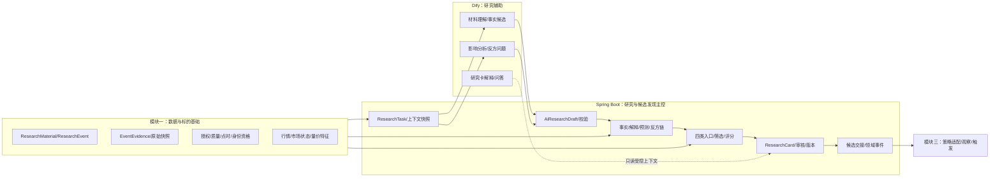
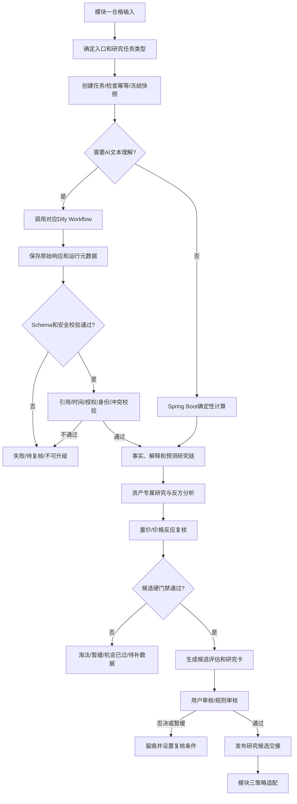
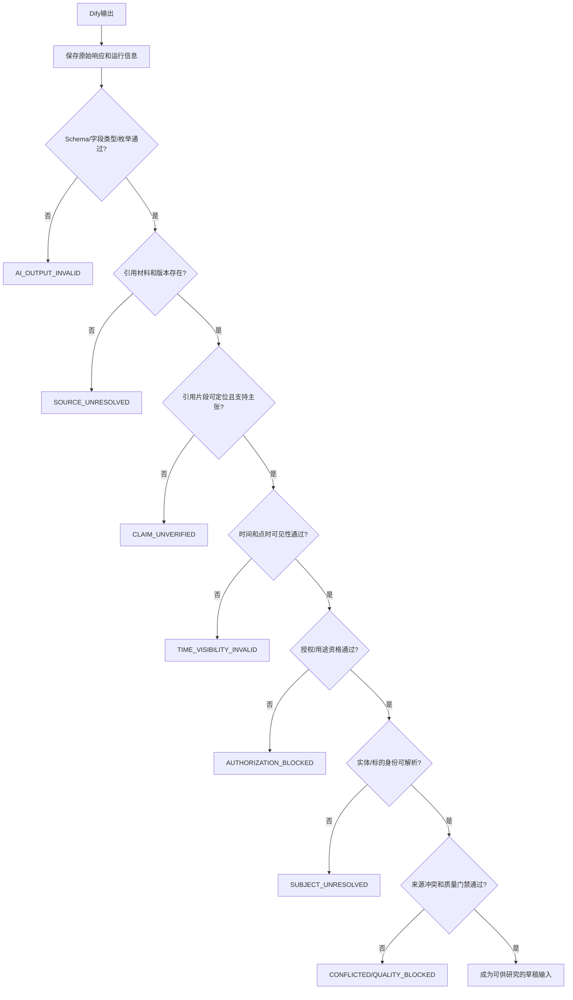
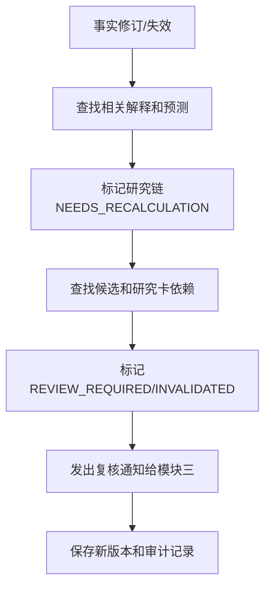
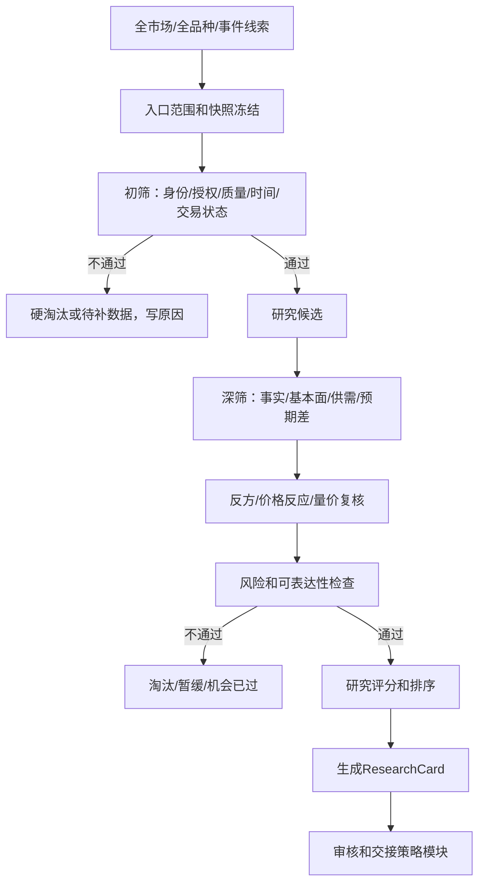
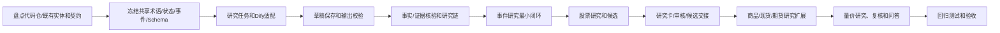
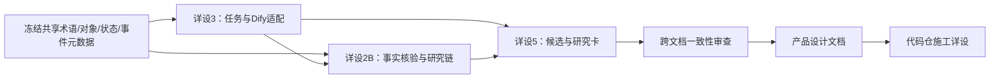

# QuantPF 详设 2：研究与候选发现详细设计方案

| 项目 | 内容 |
|:---|:---|
| 文档名称 | 详设_2_研究与候选发现详细设计方案 |
| 系统 | QuantPF（Quant Portfolio Framework） |
| 文档版本 | V1.3 |
| 编制日期 | 2026-10-23 |
| 所属分级 | 详设模块二：研究与候选发现 |
| 上游总纲 | 《量化交易系统完整设计方案说明书_V4.md》 |
| 上游整体流程 | 《详设_0_整体流程文档.md》 |
| 上游数据基础 | 《详设_1_数据与标的基础详细设计方案.md》 |
| 上游技术分册 | 《总体业务架构及记录落地功能进度.md》 |
| 主要代码模块 | `quantpf-domain`、`quantpf-research`、`quantpf-marketdata`、`quantpf-strategy`、`quantpf-job`、`ruoyi-admin` |
| 一期范围 | 研究任务、Dify研究草稿、事实核验、研究链、四类候选、研究卡和策略模块交接 |
| 二期预留 | 量价关系优化发现交易时机；高级盘口/逐笔/订单流研究及验证接口 |

> 本文档定义研究与候选发现模块的业务流程、领域边界、状态、Dify/Spring Boot职责、接口事件方向、用户操作原则、实施顺序和验收门禁。本文档是详设 2A、2B、2C 及后续产品设计文档的上级基线，不替代这些子详设；不展开具体页面布局、前端组件、Java类级实现或最终数据库DDL。

---

## 目录

1. 文档目的与使用方式
2. 设计依据与需求追踪
3. 模块定位、目标和边界
4. 核心原则与术语
5. 与模块一、三、四的职责边界
6. 总体架构与领域对象关系
7. 端到端研究主流程
8. 研究任务与触发入口
9. Dify Workflow 与协作契约
10. AI草稿校验与安全门禁
11. 事实核验与证据链
12. 解释、预测和反方研究
13. 四类候选发现入口
14. 股票、期货和现货差异化研究
15. 初筛、深筛和候选准入
16. 研究评分、排序与淘汰
17. 研究决策卡
18. 用户审核、覆盖和交接策略模块
19. 状态机与版本管理
20. 自然语言问答与研究助手
21. 领域对象与逻辑数据模型
22. API、领域事件与任务调度
23. 异常、幂等、审计、权限和降级
24. 代码仓职责与施工顺序
25. 产品设计文档承接要求
26. 测试策略与验收门禁
27. 子详设拆分、依赖和待确认事项
28. 文档结论

---

## 1. 文档目的与使用方式

### 1.1 文档目的

将总纲中“研究与候选发现”业务目标细化为可指导产品设计和代码仓施工的模块方案：

```text
详设1提供已治理数据、材料、事件和标的身份
→ Spring Boot创建研究任务并冻结输入时点
→ Dify按需理解材料并返回结构化研究草稿
→ Spring Boot校验引用、事实、时间、授权和身份
→ 建立事实-解释-预测-反方研究链
→ 按资产类型进行研究并执行候选筛选
→ 形成研究决策卡并完成必要审核
→ 将合格研究候选交给模块三进行策略适配
```

### 1.2 本文档的读者和用途

| 读者 | 使用方式 |
|:---|:---|
| 产品设计人员 | 将业务状态、用户任务、审核动作和异常反馈转化为页面与交互设计 |
| 后端设计/开发人员 | 设计领域对象、应用服务、API、事件、持久化和任务处理 |
| Dify流程设计人员 | 设计受控Workflow、输入上下文、输出Schema和失败处理 |
| 测试人员 | 按状态、门禁、跨模块流程和异常场景建立测试用例 |
| 项目维护人员 | 追踪模块边界、版本、待确认项及代码落地状态 |

### 1.3 文档层级

本文档是模块二总详设。其子文档按总纲索引编制：

```text
详设 2A：研究任务与 Dify 适配
详设 2B：事实核验与研究链
详设 2C：候选池与研究决策卡
```

产品设计文档再把本方案转化为页面信息结构、核心操作、权限、异常提示及API/Workflow映射。代码实现细节应以子详设、正式契约和代码仓现状为准。

---

## 2. 设计依据与需求追踪

### 2.1 上游依据

1. 总纲第 4 章：业务模块和模块职责边界；
2. 总纲第 5 章：新闻、财报、研报、数据使用、时效和机会判断；
3. 总纲第 6 章：新闻事件、股票基本面、商品供需、量价四类候选入口；
4. 总纲第 7 章：量价分析、状态、指标、一期/二期边界；
5. 总纲第 8 章：事实—解释—预测和反方研究；
6. 总纲第 9、10 章：股票、期货、现货差异和研究卡/策略边界；
7. 总纲第 11、12、14 章：筛选、等待、验证、人机协同和问答要求；
8. 总纲第 18、20、21、22、23、24、25 章：状态机、表单、股票/商品研究要求、端到端流程、成功标准和技术边界；
9. 《详设_0_整体流程文档.md》：端到端流程、Dify输出校验、事实链、候选筛选、状态机、事件和阶段门禁；
10. 《详设_1_数据与标的基础详细设计方案.md》：材料、ResearchEvent、EventEvidence、快照、用途资格、标的、行情及量价基础；
11. 《总体业务架构及记录落地功能进度.md》：现有代码模块、正式契约方式和当前未施工状态。

### 2.2 需求追踪摘要

| 总纲/上游要求 | 本详设对应章节 |
|:---|:---|
| 新闻/事件、股票、商品、量价四类候选入口 | 第 13 章 |
| 事实、解释、预测和反方研究分层 | 第 11、12 章 |
| 股票基本面、盈利质量和预期差 | 第 14.1 章 |
| 商品供需、现货、基差和期限结构 | 第 14.2、14.3 章 |
| 候选筛选、评分和淘汰原因 | 第 15、16 章 |
| 研究卡、策略适配和等待机制 | 第 17、18 章 |
| Dify/Spring Boot职责边界 | 第 5、9、10 章 |
| 自然语言问答与可解释体验 | 第 20、25 章 |
| 研究流、交易流、验证流分离 | 第 5、7、18 章 |
| 二期量价时机优化预留 | 第 13.4、14.4、27 章 |

### 2.3 上游规则冲突处理

当总纲、详设 0、详设 1 和本文存在冲突时，不由实现人员自行选择：

```text
识别冲突和影响范围
→ 暂停受影响契约或施工项
→ 确认应更新的上级文档
→ 记录决策和版本
→ 同步子详设、契约和测试
```

本详设不改变总纲定义的资产范围、风险原则、Paper边界及Dify/Spring Boot职责。

---

## 3. 模块定位、目标和边界

### 3.1 模块定位

研究与候选发现模块把经过数据治理的信息转成有证据、有反方、有时间范围、可复核的研究结论和候选对象。它是“信息和数据”到“策略适配”的研究层，不是自动交易决策层。

### 3.2 模块目标

```text
快速发现值得研究的对象
验证事实和引用是否可靠
解释事实如何传导到公司/行业/商品变量
区分研究方向与当前交易机会
形成可比较、可解释的候选和淘汰原因
将结构化研究结果安全交给策略模块
保留当时信息、规则和分析版本以便回放
```

### 3.3 成功结果

模块输出应允许用户清楚回答：

```text
为什么这个对象进入研究？
哪些事实支持结论？
哪些信息只是AI草稿或研究假设？
研究方向和周期是什么？
有哪些反方证据和失效条件？
为什么入选、淘汰、暂缓或机会已过？
下一步由用户还是策略模块处理？
```

### 3.4 一期范围

```text
事件/新闻研究任务和Dify适配
事实、解释、预测和反方研究链
股票基本面、商品供需、现货/基差/期限结构研究
量价状态对研究方向的支持/冲突判断
四类候选入口和初筛/深筛
版本化研究卡、人工审核和候选交接
自然语言问答和研究说明
```

### 3.5 一期不包含

```text
Dify直接确认事实或直接写业务主记录
LLM自报概率作为正式概率、评分或仓位输入
研究候选直接创建策略信号、交易计划或订单
高级订单流自动择时和自动交易
真实证券/期货委托及QMT/CTP submit/cancel
用AI文本或向量库代替结构化事实和指标存储
模块二维护授权、标的身份、日历和行情主数据
```

### 3.7 二期量价主导机会发现

二期将量价/价格行为入口提升为独立且可先于新闻研究运行的机会发现流，覆盖A股、港股、美股、期货、外汇/海外经纪商品。新闻、基本面、供需和研报不再是量价机会发现的必需前置，而是可选解释和增强证据。

~~~text
量价扫描 → 特征/市场状态 → 因子过滤/排序 → 点时样本验证
→ Dify解释/假设/反方问题 → 可选新闻/基本面/供需增强
→ ResearchCandidate/Waiting → 模块三策略适配
~~~

Spring Boot负责量价特征、因子、机会扫描、验证标签、样本外和候选状态；Dify负责把结构化结果转换为普通用户可理解的解释，并提出需要核验的假设。Dify不得计算特征、修改分数或直接生成交易计划。


### 3.6 二期量价时机研究预留

一期必须引用并保留详设 1 中以下数据及接口：

```text
多周期K线、成交量、成交额、持仓量
盘口摘要和流动性字段
量价特征及版本
市场状态、观察窗口、信号时间
成功/失败标签、成本/滑点和点时回放
机会状态及与研究卡、候选、观察流程的关联
```

一期仅能给出确定性量价状态、观察、预警、等待和机会已过研究结论。二期的统计优化由 Spring Boot/验证体系负责，Dify仅负责解释，不负责时机计算或交易执行。

---

## 4. 核心原则与术语

### 4.1 规范性用语

| 用语 | 含义 |
|:---|:---|
| 必须 | 验收和实现不可省略 |
| 不得 | 明确禁止 |
| 应 | 默认要求，变更需说明理由 |
| 可以 | 允许的实现选择 |

### 4.2 核心业务区分

```text
Dify事实候选 ≠ VERIFIED_FACT
VERIFIED_FACT ≠ 研究解释
研究解释 ≠ 统计预测
研究方向 ≠ 候选合格
候选合格 ≠ 策略匹配
策略匹配 ≠ 策略触发
策略触发 ≠ 交易计划获批
交易计划 ≠ Paper订单
```

### 4.3 研究结论层次

| 层次 | 描述 | 权威维护方 |
|:---|:---|:---|
| 原始材料 | 外部来源的文本、结构化数据或行情 | 模块一 |
| 事实候选 | AI或规则提出、尚待核验的主张 | 模块二草稿区 |
| 核验事实 | 可追溯到来源和时点的已核验主张 | Spring Boot研究域，关联模块一证据 |
| 解释/假设 | 事实与经济变量之间的因果或关联解释 | 模块二 |
| 预测 | 带周期、成立条件和失效条件的前瞻判断 | 模块二记录；统计部分来自验证域 |
| 候选 | 通过模块二研究门禁的标的/工具研究对象 | 模块二 |
| 策略信号 | 满足策略匹配或触发规则的策略对象 | 模块三 |

### 4.4 研究周期

```text
SHORT：约2周，关注事件后价格反应、入场条件和短期风险
MEDIUM：约3个月至1年，关注盈利、行业/供需和趋势持续性
LONG：约半年至3年，关注产业结构、竞争力和周期
```

周期定义存在重叠，应分别说明研究问题，不得以短期K线推断长期基本面。期货中长期研究须明确商品/产业逻辑、具体合约、换月和期限结构影响。

---

## 5. 与模块一、三、四的职责边界

### 5.1 职责矩阵

| 能力 | 模块一：数据与标的基础 | 模块二：研究与候选发现 | 模块三：策略与交易决策 | 模块四：风险、交易与验证 |
|:---|:---|:---|:---|:---|
| 来源、授权、原始材料、时间和质量 | 权威负责 | 读取并引用 | 读取 | 读取 |
| 标的/合约/现货身份和交易日历 | 权威负责 | 引用，不改写 | 引用 | 引用 |
| K线、基础量价和市场状态 | 权威数据/计算 | 研究解释 | 策略计算和触发 | 回测/成交/风控使用 |
| Dify研究任务和草稿 | 提供受控材料入口 | 创建/编排/保存 | 不负责 | 不负责 |
| 事实核验和研究链 | 提供来源证据 | 负责研究域事实、解释、预测版本 | 读取 | 验证结果关联 |
| 候选筛选和研究卡 | 提供基础资格 | 权威负责 | 接收研究候选 | 读取风险/验证状态 |
| 策略匹配、观察池和预警 | 不负责 | 提供研究条件 | 权威负责 | 风险约束 |
| 交易计划、仓位、Paper订单 | 不负责 | 不负责 | 提交合格策略对象 | 风控、模拟执行和账务 |
| 概率、回测和复盘事实 | 提供点时数据 | 引用结果 | 提供策略版本 | 权威计算和保存 |

### 5.2 量价能力分层

```text
模块一：行情与基础量价数据、特征快照和时间资格
模块二：判断量价证据是否支持研究方向、是否已反映或出现背离
模块三：策略形态、触发条件、等待和预警
模块四：成本后回测、概率验证、执行和归因
```

模块二不得把 `BREAKOUT_CONFIRM`、`DIVERGENCE` 等量价状态直接转换为订单动作。

### 5.3 研究评分与交易评分分离

总纲候选评分中的策略匹配、执行、风险收益等跨模块维度，必须按归属拆开：

| 评分 | 责任方 | 用途 |
|:---|:---|:---|
| `ResearchScore` | 模块二 | 研究候选排序和解释 |
| `StrategyFitScore` | 模块三 | 策略适配参考 |
| `ExecutionScore` | 模块三/四 | 流动性、成本和执行条件 |
| `RiskScore` | 风险域 | 风险门禁与风险状态 |
| `DecisionScore` | 后续决策编排 | 仅在定义正式规则后形成综合决策参考 |

不得将一个不透明的AI综合分作为业务事实。研究评分不是概率、仓位或订单授权。

---

## 6. 总体架构与领域对象关系

### 6.1 逻辑架构



### 6.2 领域对象主链

```text
ResearchMaterial / ResearchEvent / EventEvidence / PointInTimeSnapshot
→ ResearchTask
→ AiResearchDraft
→ ResearchClaim / ResearchFactLink
→ ResearchThesis / PredictionDraft / CounterEvidence
→ CandidateAssessment / ScreeningRun
→ ResearchCard / ResearchReview
→ CandidateHandoff
→ 模块三策略适配
```

模块二引用模块一的材料、事件、证据、行情和身份记录，不复制其权威主记录。

### 6.3 模块二内部子域

| 子域 | 职责 | 主要输出 |
|:---|:---|:---|
| 研究任务 | 接收事件、用户、扫描和复核触发 | 任务、输入快照、运行状态 |
| Dify适配 | 请求构建、调用、原始响应、Schema校验 | `AiResearchDraft`和校验结果 |
| 事实核验 | 主张、引用、冲突和人工复核 | 核验状态和事实关联 |
| 研究链 | 变量、传导、预测和反方 | 版本化研究结论 |
| 资产研究 | 股票、商品、现货和量价解释 | 资产专属研究结果 |
| 候选筛选 | 初筛、深筛、门禁、排序、淘汰 | `CandidateAssessment` |
| 研究卡 | 聚合结论、证据、风险和时点 | `ResearchCard` |
| 交接 | 向策略模块发布研究候选 | `CandidateHandoff`/事件 |

---

## 7. 端到端研究主流程

### 7.1 标准主流程

1. 详设 1 发布可研究的材料、研究事件、行情或基础量价状态；
2. 由规则、用户或调度任务创建 `ResearchTask`；
3. Spring Boot 按研究时点构建最小必要上下文并保存快照引用；
4. 对需要语言理解的任务调用 Dify；纯确定性计算不依赖 Dify；
5. Spring Boot 保存原始 AI 响应并按 Schema、引用、时间、授权、身份和冲突校验；
6. 校验通过的主张进入事实核验和研究链；未通过内容进入复核或停止升级；
7. 构建解释、预测条件、反方证据和失效条件；
8. 按股票、商品、现货或量价入口执行资产专属研究；
9. 先执行硬门禁，再计算研究维度和排序；
10. 形成研究决策卡，按规则或人工审核；
11. 合格候选以版本和快照引用交给模块三；
12. 模块三负责策略匹配、观察池、等待、预警和触发。

### 7.2 端到端流程图



### 7.3 成功、暂缓和失败结果

研究任务不应只有成功/失败两态。至少区分：

```text
完成并形成研究结论
完成但未形成候选
等待数据或来源确认
等待人工复核
研究逻辑冲突
当前机会已过
研究结论失效
Dify临时失败，可重试
不可重试的Schema/授权/身份失败
```

---

## 8. 研究任务与触发入口

### 8.1 任务触发来源

```text
ResearchEventPublishedEvent
用户主动研究请求
日/周股票扫描任务
商品供需数据更新
行情或量价状态变化
重要财报/公告发布
已核验事实修订
候选或研究卡到期复核
用户要求补充分析或重新研究
自然语言问答中的按需查询任务
```

### 8.2 任务类型

| 类型 | 目标 | Dify使用原则 |
|:---|:---|:---|
| `EVENT_FACT_EXTRACTION` | 提取事件事实候选和引用 | 调用 |
| `EVENT_IMPACT_ANALYSIS` | 生成变量/传导链草稿 | 调用 |
| `STOCK_FUNDAMENTAL_RESEARCH` | 解释股票材料和提出核验问题 | 可调用，数值由后端提供 |
| `COMMODITY_SUPPLY_DEMAND` | 解释供需材料和反方逻辑 | 可调用，结构化指标由后端提供 |
| `SPOT_BASIS_TERM_STRUCTURE` | 解释现货、基差和期限结构 | 可调用，计算由后端负责 |
| `PRICE_VOLUME_RESEARCH` | 解释量价状态和研究方向一致性 | 只解释后端指标 |
| `CANDIDATE_SCREENING` | 候选初筛/深筛 | Spring Boot规则主控 |
| `RESEARCH_CARD_EXPLANATION` | 把结构化研究卡转为易懂说明 | 可调用，只能解释已批准结果 |
| `RESEARCH_QA` | 回答用户研究问题 | 查询由Spring Boot执行，Dify组织答案 |
| `REVALIDATION` | 新数据后的研究复核 | 后端识别依赖，Dify可辅助重析 |
| `REVIEW_SUMMARY` | 研究/交易复盘摘要 | Dify生成摘要草稿，事实由后端维护 |

### 8.3 任务创建前检查

Spring Boot 创建任务前必须检查：

```text
输入材料/标的是否存在
输入是否已去重或有明确版本
授权范围是否允许当前研究用途
质量和时间资格是否符合任务要求
身份映射是否达到当前任务所需精度
是否已有相同输入、相同任务类型的未完成任务
是否需要当前行情快照及其时间是否有效
是否已存在可复用的有效研究结果
```

前置条件不足时可创建 `WAITING_FOR_INPUT` 类任务，但不得标为已完成研究或有效候选。

### 8.4 输入快照

研究任务必须记录可重现输入，不必重复复制大体量原始数据，但必须保存不可歧义的引用：

```text
materialRefs及版本
researchEventRefs及版本
sourceRefs
subjectRefs和instrumentRefs
marketSnapshotId/quantFeatureSnapshotId
publishedAt/availableAt/asOfTime
authorization/quality/useEligibility结果
规则版本、Workflow版本、Prompt版本
研究周期和研究问题
```

---

## 9. Dify Workflow 与协作契约

### 9.1 Dify Workflow 拆分

不采用一个可自主决定交易动作的“大而全 Agent”。按任务职责拆分：

| Workflow | 输入 | 结构化输出 |
|:---|:---|:---|
| 事件事实抽取 | 新闻、公告、政策及引用位置 | 事件类型、事实候选、实体候选、引用、冲突提示 |
| 事件影响分析 | 已核验事实、结构化上下文 | 变量、传导链、受益/受损候选、反方问题 |
| 股票研究解释 | 财务、业务、同行、估值及事件数据 | 业务解释、盈利质量问题、预期差假设和反方 |
| 商品研究解释 | 供需、库存、现货、基差、期限结构、量价 | 多空链路、矛盾项、合约风险问题 |
| 量价状态解释 | 后端已计算特征和状态 | 普通语言解释、支持/冲突理由草稿 |
| 研究卡说明 | 已生成结构化研究卡 | 结论摘要、证据说明、下一步解释 |
| 自然语言问答 | 用户问题和后端查询结果 | 证据化答复草稿 |
| 复盘摘要 | 已保存的研究和交易结果 | 归因说明草稿、改进问题 |

### 9.2 Dify输入契约

每次调用至少传递：

```text
requestId、idempotencyKey、researchTaskId、taskType
materialRefs/sourceRefs/subjectRefs/instrumentRefs
snapshotId、publishedAt、availableAt、asOfTime
authorizationStatus、qualityStatus、useEligibility
researchQuestion、researchPeriod
workflowVersion、promptVersion、schemaVersion
```

输入上下文遵循最小化原则：不传交易凭据、不传无关个人信息；账户或持仓相关问答仅传经授权、去标识化的必要摘要。

### 9.3 Dify输出契约

返回至少包含：

```text
requestId/researchTaskId/runId/status
modelName/modelVersion/workflowVersion/promptVersion/schemaVersion
summary/eventCandidate/factCandidates
subjectCandidates/impactVariables/transmissionChain
predictionDraft/counterQuestions/followUpDataRequired
citations/warnings/completedAt
```

示例：

```json
{
  "requestId": "req-001",
  "researchTaskId": "task-001",
  "runId": "run-001",
  "status": "SUCCEEDED",
  "workflowVersion": "event-research-v1",
  "promptVersion": "event-prompt-1.0",
  "summary": "政策提出支持相关产业发展",
  "eventCandidate": {
    "eventType": "INDUSTRY_POLICY",
    "impactScope": "INDUSTRY",
    "impactLevel": "IMPORTANT",
    "directionCandidate": "POTENTIALLY_BULLISH"
  },
  "factCandidates": [
    {
      "claimId": "claim-001",
      "statement": "政策提出支持相关产业发展",
      "sourceRef": "source-001",
      "quote": "原文引用片段",
      "certainty": "EXPLICIT"
    }
  ],
  "subjectCandidates": [
    {"rawMention": "相关产业", "subjectType": "INDUSTRY", "normalizedSubjectHint": "industry-001"}
  ],
  "impactVariables": [
    {"name": "行业政策支持强度", "direction": "POSITIVE", "horizon": "MEDIUM_TERM"}
  ],
  "transmissionChain": ["政策支持增强", "行业投资预期改善", "企业盈利预期可能变化"],
  "counterQuestions": ["市场是否已提前交易该预期？"],
  "followUpDataRequired": ["政策执行细则", "实际订单数据"],
  "warnings": [],
  "completedAt": "2026-10-21T10:00:00+08:00"
}
```

其中：

```text
directionCandidate不是正式交易方向
normalizedSubjectHint不是正式标的身份
certainty不是核验结论
model confidence不是统计概率
predictionDraft不是交易信号
```

### 9.4 输出保留

必须保留：

```text
原始响应文本
解析后的结构化响应
模型/Workflow/Prompt/Schema版本
输入快照引用
运行时长和结束时间
校验状态、错误和警告
人工复核结果及前后状态
```

原始响应为审计和排障依据，不得作为业务事实主表直接查询或参与筛选。

---

## 10. AI草稿校验与安全门禁

### 10.1 校验顺序



### 10.2 校验原则

1. 引用必须绑定详设 1 管理的材料版本和可定位原文/结构化字段；
2. 引用内容不足以支持主张时，不升级事实；
3. 发布时间、系统可见时间和有效时点必须分别处理；
4. 转载多篇不能自动当成多个独立来源；
5. AI置信度不能替代来源权威性、交叉核验或人工复核；
6. 未确认标的映射不得用于标的候选排序；
7. 校验失败保留草稿，但阻断有效候选和交易链路；
8. 对来源冲突、重大事件和高影响研究应支持人工复核。

### 10.3 草稿处置

| 校验结果 | 处理 |
|:---|:---|
| Schema错误 | 保存原响应，标为无效，不自动盲重试 |
| 引用缺失 | 标记待核验，不能升级相关主张 |
| 时间错误/未来可见 | 阻断当前时点使用，记录时间问题 |
| 授权不足 | 阻断相应用途并提示授权原因 |
| 实体未解析 | 进入人工映射或补充数据流程 |
| 来源冲突 | 保存各版本并进入冲突处理 |
| 全部通过 | 进入事实核验/研究链，不等于自动确认所有主张 |

---

## 11. 事实核验与证据链

### 11.1 事实定义

事实只描述可追溯、可复核的已发生内容，如公告披露、库存变化、财务数据或一段时间内的行情状态。事实不得直接写成必然方向或买卖动作。

### 11.2 事实主张对象

逻辑字段至少包括：

```text
claimId
claimType
statement
subjectRef
sourceRef/materialRef/materialVersion
quoteText/quoteLocation/structuredFieldRef
publishedAt/availableAt/validFrom/validTo
verificationStatus
qualityStatus/authorizationStatus/conflictStatus
verificationMethod/verifier/reviewReason
dataSnapshotId/version/createdAt
```

### 11.3 事实状态

```text
PENDING_VERIFICATION
VERIFIED
CONFLICTED
REVISED
INVALIDATED
EXPIRED
```

状态流转不得由 Dify 直接执行。由 Spring Boot 的校验流程、规则和必要的人工审核推进。

### 11.4 事实核验门禁

核验为 `VERIFIED` 前至少满足：

```text
来源和材料版本存在
引用可定位且语义支持主张
时间字段符合任务时点
授权允许当前用途
实体和标的映射达到所需确定性
来源冲突已解决或明确标记为未解决
质量状态符合使用要求
```

不同事实类型可配置不同核验策略。公司披露数值、媒体转述、分析观点和模型推断不得使用同一核验等级。

### 11.5 证据类型

```text
PRIMARY_SOURCE：监管、交易所、公司、政府等一手来源
INDEPENDENT_SECONDARY：独立二手来源
DERIVED_DATA：由结构化数据确定性计算的结果
AI_EXTRACTED：AI抽取候选，未完成确认
USER_ANNOTATION：用户备注或判断
```

证据记录需要区分来源权威性、独立性、时间、版本和用途资格。用户备注和 AI 内容不得伪装成外部来源证据。

---

## 12. 解释、预测和反方研究

### 12.1 解释层

解释连接事实与经济/业务变量，至少包含：

```text
thesisId
relatedClaimIds
impactVariables（变量/方向/强度/期限）
transmissionChain
directBeneficiaries/potentialLosers
supportEvidence/counterEvidence
reverseTransmission
unknownItems/followUpDataRequired
status/version/asOfTime
```

解释示例：

```text
库存上升
→ 供应暂时高于需求
→ 现货压力增加
→ 基差可能走弱
→ 远月期货盈利预期承压
```

这是一条待验证研究链，不是事实的自动含义。每个箭头应标注依据、假设和可验证指标。

### 12.2 预测层

预测至少包含：

```text
direction
forecastHorizon
conditions
invalidatingConditions
expectedPath
sampleResultRef
probabilityStatus
sampleCount/confidenceInterval（若可用）
costAdjustedExpectation/maxAdverseExcursion（若可用）
dataSnapshotId/ruleVersion/version
```

Dify只可给方向和条件草稿。正式概率和历史结果必须来自点时数据、已定义成功标签、成本模型、基准比较及样本外验证。缺少这些条件时显示“样本不足，无法验证”。

### 12.3 反方研究

每个重要研究对象必须保留：

```text
支持证据
反方证据
关键未知信息
最可能错误的传导环节
关键证伪条件
替代解释
替代标的/工具或不参与理由
```

Dify可生成反方问题和证据候选；引用及其可信状态由 Spring Boot 管理。不能只存反方问题而没有响应状态，应能记录“已核查/未核查/无法核查/反证成立”。

### 12.4 版本和失效传播

事实修订后，相关解释、预测、候选和研究卡必须被识别并标记为需复核；不得静默覆盖旧版本。



---

## 13. 四类候选发现入口

### 13.1 入口总表

| 入口 | 核心链路 | 主要候选 |
|:---|:---|:---|
| 事件/新闻 | 事实→影响变量→映射→预期差→价格反应 | 行业/公司/商品/合约候选 |
| 股票基本面 | 业务真实性→盈利质量→同行→估值/预期差→量价 | 股票买多研究候选 |
| 商品供需 | 供需/库存/利润→现货/基差/期限结构→具体合约 | 期货多头/空头、套保/价差研究候选 |
| 价格/量价 | 趋势/动量/波动→量价结构→基本面/供需复核 | 待研究线索或候选 |

### 13.2 入口 A：事件和新闻

```text
已治理的新闻/公告/政策/财报
→ 事件事实核验
→ 事件类型/重大程度/影响层级
→ 影响变量和传导链
→ 行业/公司/商品/合约暴露映射
→ 市场原有预期和新增信息
→ 消息前后价格、成交、波动和量价状态
→ 机会状态判断
→ 候选/等待/机会已过/失效/数据不足
```

事件结果至少区分事实是否成立与交易机会是否存在：

```text
FACT_VALID_ACTIONABLE：事实有效，尚有进一步研究价值
FACT_VALID_OPPORTUNITY_PASSED：事实有效，但价格已运行、赔率不足
FACT_VALID_WAIT_PULLBACK：等待回调或反弹失败
FACT_VALID_WAIT_BREAKOUT：等待突破/破位及确认
FACT_WEAKENED：影响减弱或传导暂未兑现
FACT_INVALIDATED：事实被否定或关键假设失效
DATA_INSUFFICIENT：数据/来源/时间不足
```

“ACTIONABLE”在模块二只表示可进入后续研究/策略评估，不表示已经批准建仓。

### 13.3 入口 B：股票基本面和预期差

```text
股票范围
→ ST/停牌/身份/授权/数据/流动性硬过滤
→ 主营业务真实性和收入利润暴露
→ 盈利质量、现金流和财务趋势
→ 行业地位及同行比较
→ 盈利预期变化和估值分位
→ 事件敏感度和市场原有预期
→ 量价、行业相对强度和市场状态
→ 股票买多研究候选/淘汰/待补充
```

必须回答：

```text
公司是否真正从相关业务获得收入和利润？
利润是否有现金流支持？
财务变化是否可持续，是否需要解释异常？
事件对公司利润或估值的暴露是否有证据？
市场是否已经充分定价？
价格和量价是否支持，还是与研究逻辑冲突？
如不立即进入策略评估，后续检查什么条件？
```

股票一期默认研究买多。利空研究可形成风险提示、回避或持仓复核输入，但不能生成无权限裸空表达。

### 13.4 入口 C：商品供需、现货和期货

```text
品种池
→ 供应/需求/库存/利润/季节性
→ 现货价格和口径
→ 基差和期限结构
→ 宏观及产业链关系
→ 具体可交易合约映射
→ 价格/成交量/持仓量确认
→ 流动性/交割/移仓/逼空风险
→ 多头/空头/套保/价差研究候选
```

研究必须区别产业判断、价格判断和交易表达：

```text
产业判断：供需、利润和库存方向
价格判断：现货、期货、基差和期限结构表现
工具表达：具体合约、方向、到期、移仓和风险限制
```

研究输出不得把连续/主力合约当成具体交易合约。模块一维护身份及生命周期，模块二引用其数据进行研究。

### 13.5 入口 D：价格和量价线索

```text
全市场行情
→ 趋势/动量/波动率/相对强弱
→ 量价结构和市场状态
→ 生成待研究线索
→ 搜索新闻/基本面/供需/制度解释
→ 形成支持/反方假设
→ 进入研究候选或仅保留线索
```

可以解释的量价状态包括总纲定义的低位承接候选、突破确认/偏弱、趋势延续、健康回调、派发候选、破位确认、衰竭候选、背离、流动性风险和无明确信号。其本身不构成买卖命令。

### 13.6 一期和二期界线

一期：基础量价状态、研究支持/冲突、等待或机会已过判断、结构化展示和预警输入。

二期：基于历史点时样本对突破持续性、回调确认、推进效率、背离和盘口/订单流特征开展时机优化和样本外验证。不得在一期把二期能力写为已实现功能。

---


### 13.7 二期量价主导候选发现

二期第五类候选入口不是“先新闻后量价”，而是“先量价发现，再按需解释”：

~~~text
A股/港股/美股/期货/外汇价格与量价数据
→ 多周期特征、市场状态、跨资产相对强弱
→ 因子过滤和候选排序
→ 历史点时条件验证、样本外/滚动验证
→ Dify解释、反方问题和假设清单
→ 可选关联新闻、财报、供需、基差、期限结构和制度事件
→ 形成候选、等待、机会已过或数据不足状态
~~~

各资产必须使用自己的交易日历、时区、币种、交易时段、流动性和数据质量门禁。因子必须保存定义、版本、输入快照和计算结果；大模型输出只作为解释或待核验假设，不作为正式评分、概率、仓位或订单依据。

普通用户看到“为什么出现机会、风险是什么、还缺什么、下一步做什么”，不需要手动判断新闻是否利多/利空或自行计算量价指标。


### 13.8 新闻不是量价机会的必需前置

在二期量价主导入口中，新闻、财报、研报、供需和大模型解释属于可选增强：

~~~text
量价候选可以在没有近期新闻时成立
新闻存在时用于解释、增强证据或提出反方问题
新闻与量价冲突时保留冲突，不由大模型强行统一
证据缺失时降低证据完整性并标记未知风险
~~~

候选状态必须区分：PRICE_VOLUME_DISCOVERED、FACTOR_FILTERED、CONTEXT_ENHANCED、CONTEXT_MISSING、REQUIRES_REVIEW。这些状态不等于策略触发或订单授权。


## 14. 股票、期货和现货差异化研究

### 14.1 股票研究维度

至少覆盖：

```text
主营业务和分部收入
相关业务收入/利润占比和证据类型
盈利质量、现金流、利润持续性
应收、存货、毛利率、负债和审计风险
同行/行业景气和竞争地位
盈利预期修正、估值分位和预期差
事件敏感度及估算方法
股东/监管/退市/ST等风险引用
市场状态、行业相对强度和量价支持
```

指标口径、披露时点和复权/财务版本必须使用点时数据。衍生估算结果标识为 `DISCLOSED`、`CALCULATED`、`MODELLED` 或 `INFERRED`，不能冒充公司披露事实。

### 14.2 商品供需研究维度

至少覆盖：

```text
供应、需求、库存及季节性
产能、开工、检修、进口和出口
生产利润及成本曲线
现货品级、地区、交付和时间口径
基差、期限结构和跨期关系
期货价格、成交量、持仓量及变化
持仓拥挤、逼空、涨跌停、交割和移仓风险
数据频率、发布时间和历史完整性
```

单一数据点不能独立产生候选方向。至少说明一个供需/产业依据和一个价格/现货确认依据；冲突时应进入待核验或双向/不确定研究状态。

### 14.3 现货敞口和表达方式

研究时要记录是否存在现货、库存、采购合同、销售合同或生产经营敞口：

| 情形 | 可形成的研究表达 |
|:---|:---|
| 有库存 | 去库/补库、价格风险、套保或期现研究 |
| 有采购合同 | 采购成本风险、买入套保、远期表达研究 |
| 有销售合同 | 销售价格风险、卖出套保研究 |
| 无现实敞口 | 商品方向研究、期货候选或不参与，不产生现货空单 |
| 研究价差 | 双腿身份、相关性、流动性、保证金和交割条件均需确认 |

### 14.4 量价研究维度

研究侧引用模块一提供的特征，至少能够说明：

```text
价格位置和趋势
成交量/持仓量是否配合
突破/破位是否确认或失败
放量但推进不足/缩量回调/量价背离
行业/指数/相关商品相对强弱
基差、期限结构和市场状态是否冲突
消息发布前后价格是否已大幅运行
```

---

## 15. 初筛、深筛和候选准入

### 15.1 候选对象分层

```text
RESEARCH_LEAD：待研究线索
RESEARCH_CANDIDATE：值得进入研究的对象
VERIFIED_RESEARCH_CANDIDATE：关键事实和对象身份可用
RESEARCH_CARD_READY：已形成研究卡
RESEARCH_READY：可交给策略模块评估
WATCHLIST：模块三拥有的观察池对象
TRADE_READY：策略/风险门禁完成后的交易准备状态
```

后四项中的 `WATCHLIST` 和 `TRADE_READY` 不能由模块二作为权威状态维护。模块二只可记录交接回执或研究侧建议。

### 15.2 初筛与深筛



### 15.3 硬门禁

硬门禁不参与加权平均，任一项失败即不得输出 `RESEARCH_READY`：

```text
当前用途授权不允许或不明确
关键数据过期、冲突或在研究时点不可见
标的身份/合约/现货对象不明确
关键主张没有证据或引用不能支持主张
研究链没有清晰的变量联系或明确标注为假设
缺少研究周期、成立条件或失效条件
重大反方问题未处理且风险不可界定
具体研究表达不存在或违反一期资产边界
股票/商品的关键风险或合约制度风险不可控
```

流动性、组合风险、最终策略触发和交易权限可能属于下游硬门禁。模块二应传递已有资格结果，不得越权宣布最终可交易。

### 15.4 结果类型

候选筛选应支持以下结果，不以二元“入选/淘汰”代替全部情况：

```text
PASS：研究门禁通过
REJECT：研究条件失败，记录原因
DEFER：等待数据、事件或人工复核
OPPORTUNITY_PASSED：逻辑仍有效但当前价格空间不足
NO_MATCH：研究方向可保留，暂不适合交易表达
INVALIDATED：关键事实或假设已失效
EXPIRED：超过有效期
```

---

## 16. 研究评分、排序与淘汰

### 16.1 评分结构

总纲第 18.3 节已经定义候选 100 分评分卡及初始权重。为避免本模块另造一套相互竞争的权重，本文按责任模块拆解并保留总纲权重：

| 总纲维度 | 权重 | 责任模块 | 本模块处理方式 |
|:---|---:|:---|:---|
| 事件可信度与新颖性 | 15 | 模块二 | 来源、独立核验、新增信息和价格是否已反映 |
| 行业传导链 | 20 | 模块二 | 暴露直接性、影响变量、持续期和可证伪性 |
| 标的质量/供需质量 | 20 | 模块二 | 股票财务/业务质量或商品供需质量 |
| 估值/预期差 | 15 | 模块二 | 点时估值、预期修正、盈利弹性或周期状态 |
| 策略匹配 | 15 | 模块三 | 由策略适配服务计算，模块二只提供研究条件 |
| 执行和流动性 | 5 | 模块三/四 | 根据行情、盘口、容量、滑点和交易制度判断 |
| 风险收益比 | 10 | 模块四/风险域 | 根据验证结果、成本、止损、相关性和尾部风险计算 |

模块二负责的研究评分子项合计为 **70 分**；总评分的其余 30 分由策略、执行和风险职责模块产生。总纲中的 70 分观察和 80 分 Paper 计划阈值，只能在完整总评分、对应门禁和适用阶段全部具备后评估，不得将模块二的 70 分子项直接当成总分或策略放行条件。具体阈值仍需按总纲的回测、样本外和 Paper 验证路线确认。

评分必须保存分项得分、证据和规则版本。权重属于可验证的初始规则，不是永久参数；评分不得宣称为收益概率，也不得直接决定仓位或生成订单。

### 16.2 评分输出

```text
researchScore
scoreVersion
dimensionScores
dimensionEvidenceRefs
hardGateResults
penalties
unknownOrMissingDimensions
rankWithinRun
scoreExplanation
```

缺失数据不能默认为中性或满分，应标明缺失并按规则降低可比较性或阻断候选。

### 16.3 淘汰和暂缓原因码

```text
DATA_INSUFFICIENT
DATA_STALE
AUTHORIZATION_BLOCKED
SOURCE_CONFLICT
FACT_UNVERIFIED
SUBJECT_UNRESOLVED
BUSINESS_QUALITY_FAILED
SUPPLY_DEMAND_CONFLICT
EXPECTATION_ALREADY_PRICED
PRICE_REACTION_TOO_LARGE
VOLUME_CONFIRMATION_FAILED
LIQUIDITY_OR_CAPACITY_RISK
CONTRACT_OR_DELIVERY_RISK
NO_VALID_EXPRESSION
NO_STRATEGY_MATCH
THESIS_UNSUPPORTED
THESIS_INVALIDATED
WAITING_FOR_DATA
WAITING_FOR_REVIEW
WAITING_FOR_PULLBACK
WAITING_FOR_BREAKOUT
OPPORTUNITY_PASSED
EXPIRED
USER_REJECTED
```

原因码应关联用户可读说明、受影响门禁、是否可重试、所需补充条件和责任模块。

### 16.4 筛选运行记录

每次筛选必须记录：

```text
screeningRunId/入口/资产范围
筛选条件和参数
数据快照和可见时点
规则、评分及特征版本
候选结果和排序
淘汰/暂缓对象及原因
开始/完成时间和操作者/任务来源
```

筛选规则变化时新建版本，不回写旧运行结果。

---

## 17. 研究决策卡

### 17.1 定位

研究卡是结构化研究快照，不是交易计划或订单。Spring Boot 形成结论状态、数值、证据引用和版本；Dify只可生成说明文字草稿。

### 17.2 逻辑字段

#### 基础信息

```text
cardId/cardVersion
assetType/subjectRef/instrumentRef
researchEntry/researchTaskId/candidateId
direction/researchPeriod
createdAt/asOfTime/validUntil
```

#### 结论和机会状态

```text
researchConclusion
researchStatus
messageValidity
priceReactionStatus
opportunityStatus
handoffStatus
```

建议机会状态：

```text
ACTIONABLE_FOR_RESEARCH
WAIT_PULLBACK
WAIT_BREAKOUT
OPPORTUNITY_PASSED
OBSERVE_ONLY
BLOCKED
DATA_INSUFFICIENT
INVALIDATED
NO_OPPORTUNITY
```

`ACTIONABLE_FOR_RESEARCH` 表示研究侧允许继续评估，不等同于策略触发或获准交易。

#### 事实、逻辑和风险

```text
factRefs/eventRefs/sourceRefs/citations
publishedAt/availableAt/quality/authorization/conflictStatus
marketExpectation/newInformation
impactVariables/transmissionChain
fundamentalOrSupplyDemandAnalysis
valuation/basis/termStructureAnalysis
supportEvidence/counterEvidence/unknownItems
falsificationConditions/alternativeExplanation
```

#### 量价、概率和后续条件

```text
marketState/pricePosition/volumeState/openInterestState
quantFeatureSnapshotRef/priceSupportsThesis
sampleResultRef/sampleCount/probability/confidenceInterval
costAdjustedExpectation/maxAdverseExcursion/outOfSampleStatus
satisfiedConditions/unsatisfiedConditions/nextCheckConditions
strategyEvaluationHints/expiryTime
```

概率字段只能引用验证域结果；没有经过验证时必须使用明确状态而非空值伪装。

#### 版本和审核

```text
dataSnapshotId/ruleVersion/workflowVersion/promptVersion
previousCardVersion
reviewAction/reviewer/reviewReason/reviewedAt
overrideFields/overrideReason/overrideExpiry（如允许）
```

### 17.3 用户阅读层次

```text
第一层：普通语言结论和下一步
第二层：专业指标、分项得分和假设解释
第三层：原始数据、引用、时间、版本和计算依据
```

产品设计应允许从每个结论追溯证据，明确标注“事实”“系统计算”“研究解释”“AI草稿”“未知/待确认”。

---

## 18. 用户审核、覆盖和交接策略模块

### 18.1 审核要求

以下事项应支持人工确认、否决、延期或要求补充：

```text
重大新闻和异常财报
AI与原文不一致或引用不稳定
研究事实存在来源冲突
股票最终研究候选
期货最终方向/合约表达
现货数据用于交易表达
数据授权、延迟或历史完整性问题
候选进入观察/策略评估
评分规则或研究逻辑版本变更
```

### 18.2 审核动作

```text
CONFIRM：确认研究侧结论或允许交接
REJECT：否决并记录理由
DEFER：暂缓，设置复核时间/条件
REQUEST_MORE：要求补证据、数据或分析
OVERRIDE：有理由调整研究状态、排序、备注或有效期
EXPIRE：研究卡/候选到期
```

人工覆盖不得突破授权、标的身份、数据质量、交易权限、硬风控和Paper门禁。覆盖必须写明操作者、原因、作用字段、有效期和原状态。

### 18.3 策略模块交接

交接内容至少包括：

```text
candidateId/cardId/cardVersion
subjectRef/instrumentRef/assetType
direction/researchPeriod/opportunityStatus
researchScore及分项说明
事实/解释/反方证据引用
成立/失效条件和待观察条件
dataSnapshotId/quantFeatureSnapshotId
有效期、审核结果、交接原因
correlationId/causationId/idempotencyKey
```

模块三可以接受、拒绝或要求补充。接受交接只代表策略模块拥有后续评估任务，不代表候选进入策略触发或交易计划。

### 18.4 交接状态

```text
HANDOFF_PENDING
HANDOFF_VALIDATING
HANDED_OFF
HANDOFF_REJECTED
HANDOFF_EXPIRED
HANDOFF_INVALIDATED
```

重复交接必须幂等；交接时发现研究卡过期、事实失效或基础资格变化，应拒绝或要求重新研究。

---

## 19. 状态机与版本管理

### 19.1 总纲状态机按模块归属拆分

总纲端到端状态不能由单模块独占。建议映射如下：

| 总纲状态段 | 责任模块 |
|:---|:---|
| `EVENT_NEW` → `EVENT_VERIFIED` | 模块一数据事件流程及研究域核验协作 |
| `THESIS_DRAFTED` → `INDUSTRY_MAPPED` | 模块二研究链 |
| `CANDIDATES_SCREENED` → `FUNDAMENTALS_CHECKED` | 模块二候选与资产研究 |
| `TECHNICAL_CONFIRMED` | 模块三策略/市场状态流程，模块二仅提供研究支持状态 |
| `PLAN_APPROVED` | 交易计划/审核模块 |
| `PAPER_EXECUTED` → `REVIEWED` | Paper/持仓/验证复盘模块 |

### 19.2 研究任务状态

```text
CREATED
→ CONTEXT_PREPARED
→ QUEUED
→ RUNNING
→ DRAFT_RECEIVED（若需Dify）
→ VALIDATING
→ RESEARCHING
→ COMPLETED
```

异常状态：

```text
WAITING_FOR_INPUT
RETRYABLE
NEEDS_REVIEW
FAILED
CANCELLED
EXPIRED
```

### 19.3 AI草稿状态

```text
RECEIVED
→ SCHEMA_VALIDATED
→ CITATION_VALIDATED
→ TIME_VALIDATED
→ AUTHORIZATION_VALIDATED
→ SUBJECT_VALIDATED
→ READY_FOR_RESEARCH
```

异常：

```text
SCHEMA_INVALID
SOURCE_UNRESOLVED
CLAIM_UNVERIFIED
TIME_VISIBILITY_INVALID
AUTHORIZATION_BLOCKED
SUBJECT_UNRESOLVED
CONFLICTED
REJECTED
```

### 19.4 事实、研究链、候选和卡片状态

事实、解释和预测状态见第 11、12 章。候选和交接状态见第 15、18 章。状态转换由 Spring Boot 应用服务执行，保存操作者/任务、时点、前后状态、规则版本和原因。

### 19.5 版本原则

以下变化应形成新版本或新运行记录：

```text
输入材料或点时快照变化
事实核验结论变化
研究假设/方向/周期变化
评分规则或硬门禁变化
Dify Workflow/Prompt/Schema变化
研究卡结论或候选状态变化
人工覆盖或用户确认
```

不能通过覆盖数据库当前字段抹除历史输入、结论、淘汰理由或审核动作。

---

## 20. 自然语言问答与研究助手

### 20.1 问答流程

```text
用户提问
→ Dify识别意图、对象、资产类型和研究周期
→ Spring Boot做权限校验并执行结构化查询
→ 返回候选/研究卡/来源/质量/量价/风险门禁结果
→ Dify基于查询结果组织回答并引用证据
→ 保存必要的问答审计和引用
```

Dify不得自行拼接未查询到的数据，不得直连数据库或绕过服务权限。

### 20.2 一期问答类型

```text
今天是否有股票/期货研究候选？
某行业/商品最近有哪些重大新闻？
某股票财报、业务质量、估值和风险如何？
某商品供需、现货、基差和期限结构如何？
新闻是否已被价格反映？
当前是等待、机会已过还是数据不足？
某候选为什么被纳入、暂缓或淘汰？
研究卡的主要反方证据和证伪条件是什么？
```

### 20.3 回答结构

```text
先给当前结论
列关键事实、来源和时间
区分事实/计算/解释/预测/未知
说明价格和量价是否支持
说明反方证据及风险
说明短期/中期/长期条件式预期
给出等待条件、失效条件和下一步检查项
没有符合条件对象时明确说明原因
```

问答的“可建仓”等词必须符合详设 0 的条件式建议和交易门禁要求。模块二问答只提出研究建议或模块交接建议，不创建订单。

---

## 21. 领域对象与逻辑数据模型

### 21.1 核心对象

| 对象 | 用途 | 权威边界 |
|:---|:---|:---|
| `ResearchTask` | 研究工作单、类型、输入快照和运行状态 | 模块二 |
| `ResearchTaskRun` | 每次执行、重试和运行结果 | 模块二 |
| `AiResearchDraft` | Dify原始/结构化响应及校验信息 | 模块二，非事实主表 |
| `ResearchClaim` | 对材料或结构化数据的研究主张 | 模块二，关联模块一证据 |
| `ResearchEvidenceLink` | 主张与来源、引用和版本的关联 | 模块二引用，源材料归模块一 |
| `ResearchThesis` | 影响变量、传导链、方向和期限 | 模块二 |
| `ResearchPrediction` | 条件式预测和验证结果引用 | 模块二/验证域边界 |
| `CounterEvidence` | 反方证据、未知项和证伪条件 | 模块二 |
| `ScreeningRun` | 某次筛选的范围、规则、输入和结果 | 模块二 |
| `CandidateAssessment` | 单对象门禁、分项分数、状态和原因 | 模块二 |
| `ResearchCard` | 聚合某一研究版本的结构化结果 | 模块二 |
| `ResearchReview` | 人工审核、否决、延期和覆盖记录 | 模块二审计 |
| `CandidateHandoff` | 发往模块三的研究交接及回执 | 模块二/三契约 |

### 21.2 关联原则

```text
ResearchTask引用ResearchMaterial/ResearchEvent/PointInTimeSnapshot
AiResearchDraft归属ResearchTask和具体Dify run
ResearchClaim引用材料、事实证据和时间版本
ResearchThesis关联一个或多个ResearchClaim及证据
ResearchPrediction关联ResearchThesis和验证结果引用
CandidateAssessment引用研究链、行情/量价快照和规则版本
ResearchCard固化候选在某一时点的研究输出
CandidateHandoff引用ResearchCard版本，不复制交易状态
```

### 21.3 持久化建议范围

供后续逻辑模型和DDL详设评估的对象/表范围：

```text
quantpf_research_task（复用详设1已有目标对象，避免重复建表）
quantpf_research_task_run
quantpf_ai_research_draft（复用详设1已有目标对象，按职责扩展）
quantpf_research_claim
quantpf_research_evidence_link
quantpf_research_thesis
quantpf_research_prediction
quantpf_research_counter_evidence
quantpf_screening_run
quantpf_candidate_assessment
quantpf_research_card
quantpf_research_review
quantpf_candidate_handoff
```

实际建表前须盘点已有契约和实体；若详设 1 已覆盖 `ResearchTask`、`AiResearchDraft`、`ResearchEvent`、`EventEvidence`，应扩展同一权威对象，不得按名字重复创建另一套主记录。

---

## 22. API、领域事件与任务调度

### 22.1 API分组建议

以下为逻辑资源分组，最终路径和字段以 `contract/openapi` 为准：

```text
/api/quant/research/tasks/*          任务创建、查询、重试、取消
/api/quant/research/dify/*           Dify回调、run和草稿查询
/api/quant/research/claims/*         主张、核验、证据和修订
/api/quant/research/theses/*         研究假设、重算和失效
/api/quant/research/screening/*      筛选运行、规则版本和结果
/api/quant/research/candidates/*     候选查询、复核和交接
/api/quant/research/cards/*          研究卡查询、版本和审核动作
/api/quant/research/qa/*             受控问答上下文和查询编排
```

写接口不得由控制器直接写表，应调用应用服务；所有人工动作要校验权限、期望版本、理由和幂等键。

### 22.2 事件建议

```text
ResearchTaskCreatedEvent
ResearchTaskCompletedEvent
AiResearchDraftReceivedEvent
AiResearchDraftRejectedEvent
ResearchClaimVerifiedEvent
ResearchClaimRevisedEvent
ResearchThesisBuiltEvent
ResearchThesisInvalidatedEvent
ResearchChainReadyEvent
CandidateDiscoveredEvent
CandidateRejectedEvent
CandidateDeferredEvent
ResearchCardCreatedEvent
ResearchCardReviewedEvent
ResearchCandidateReadyEvent
ResearchCandidateInvalidatedEvent
CandidateHandoffCompletedEvent
```

事件最少包含：

```text
eventId/eventType/schemaVersion
aggregateId/aggregateVersion
occurredAt/availableAt
requestId/idempotencyKey
correlationId/causationId
source/payload
```

`ResearchCandidateReadyEvent` 只表示研究候选已可供下游评估，不表示策略触发、交易计划审批或Paper授权。

### 22.3 任务调度

调度接入必须遵循技术分册的调度迁移和阶段门禁，不在模块内另行引入第二套调度框架。任务类型包括：

```text
事件材料研究任务创建
定期股票和商品初筛
研究任务超时监控和有限重试
Dify结果校验补偿
候选/研究卡过期检查
事实修订后关联研究复核
问答和研究运行审计归档
```

定时筛选应固定范围、规则版本和数据时点，重跑创建新的 `ScreeningRun`，不覆写历史运行。

---

## 23. 异常、幂等、审计、权限和降级

### 23.1 异常分类

| 类别 | 示例 | 默认处理 |
|:---|:---|:---|
| 输入资格错误 | 授权、质量、身份或时间不通过 | 阻断任务升级，给出责任和修复方向 |
| AI输出错误 | 非法JSON、缺少必需字段、枚举越界 | 保存原响应，不盲重试 |
| 引用错误 | 来源不存在、引用不支持主张 | 标记待核验，不升级事实 |
| 业务冲突 | 来源相互矛盾、研究链矛盾 | 进入复核并保留双方版本 |
| 运行异常 | 网络超时、Dify临时不可用 | 有限重试，同一任务和幂等键 |
| 状态冲突 | 候选版本过期、审核版本不一致 | 拒绝写入并要求刷新/复核 |
| 下游交接失败 | 模块三拒绝、重复交接 | 重试发布或记录拒绝原因，不创建订单副作用 |

### 23.2 幂等范围

必须支持幂等：

```text
ResearchTask创建和重试
Dify回调和AiResearchDraft保存
事实核验升级
研究链生成/重算
ScreeningRun启动和候选创建
ResearchCard创建和审核动作
候选交接和事件发布
```

规则：

```text
相同幂等键且参数相同：返回既有结果
相同幂等键但参数不同：返回幂等冲突
重复回调：不得重复生成事实、候选或通知
重复交接：返回原交接回执
```

### 23.3 审计字段

关键操作记录：

```text
requestId/operator/operatorType/action
aggregateType/aggregateId
beforeState/afterState/reason
source/materialRefs/snapshotId
workflowVersion/promptVersion/ruleVersion
runId/idempotencyKey/correlationId
result/errorCode/createdAt
```

### 23.4 权限建议

```text
research:view
research:task:create
research:task:retry
research:claim:verify
research:candidate:review
research:card:confirm
research:card:reject
research:card:defer
research:card:override
research:handoff
research:audit:view
research:admin
```

权限最终接入底座权限体系；Dify使用独立最小权限身份，只能访问授权研究上下文和提交草稿，不获取交易凭据、不直连数据库、不调用订单/账户服务。

### 23.5 降级矩阵

| 故障 | 可继续 | 应阻断/降级 |
|:---|:---|:---|
| Dify不可用 | 原始数据、确定性指标、已有研究和候选查询 | 新AI依赖的主张升级和文本分析 |
| Dify Schema错误 | 保存和查看运行记录 | 事实、候选和研究卡升级 |
| 市场数据过期 | 历史研究和历史回放 | 当前机会状态和新候选确认 |
| 来源冲突 | 展示来源差异、保留版本 | 方向性候选升级 |
| 身份未解析 | 保留线索并请求处理 | 标的候选和下游交接 |
| 候选事件投递失败 | 候选卡可查、待补偿 | 视交接状态，不重复产生副作用 |

---

## 24. 代码仓职责与施工顺序

### 24.1 代码模块映射

| 模块 | 本模块职责 | 边界 |
|:---|:---|:---|
| `quantpf-domain` | 研究任务、主张、研究链、候选、研究卡、交接对象 | 仅领域定义和仓储端口 |
| `quantpf-research` | 研究编排、Dify适配、草稿校验、研究链、筛选、卡片和交接 | 不让AI直接写业务状态 |
| `quantpf-marketdata` | 提供行情、量价、市场状态及质量资格查询 | 不生成研究结论 |
| `quantpf-strategy` | 接收研究候选并执行策略匹配、观察和触发 | 不回写研究事实 |
| `quantpf-job` | 任务调度、扫描、超时、有限重试和补偿 | 遵循统一调度门禁 |
| `ruoyi-admin` | API、回调、审核入口和权限 | 控制器不直接写表 |
| `contract` | OpenAPI、事件、错误码、菜单/权限契约 | 先契约后代码 |
| `db/migration` | Flyway版本化迁移 | 不直接改历史迁移 |

具体模块和目录必须以代码仓现状为准；技术分册中相关能力目前记录为未施工，文档设计完成不能写成代码已落地。

### 24.2 推荐施工顺序



实现优先以股票日线、新闻/财报和事件研究形成可回放最小闭环，再扩展商品和期货复杂研究。不得绕过 Phase 0、正式契约、Flyway、调度迁移和密钥配置门禁。

### 24.3 第一批不做

```text
Dify自主循环调用交易服务
Dify直接写ResearchClaim最终状态或ResearchCard最终状态
AI自报概率参与仓位
复杂自主多Agent协作
把完整行情/量价数值只存向量库
完整订单流自动择时
真实行情交易通道或LIVE能力
候选一键直达订单
无审计的人工覆盖
```

---

## 25. 产品设计文档承接要求

### 25.1 产品文档不重新定义业务规则

产品文档必须继承本文档和详设 0/1，重点说明用户如何完成任务、查看状态、审核结果、处理异常和追溯证据；不可只根据原型自行推导研究规则。

### 25.2 建议的产品设计拆分

| 产品设计主题 | 必须承接的详设内容 |
|:---|:---|
| 研究任务与Dify运行 | 任务类型、输入快照、运行状态、校验失败、重试和审计 |
| 事实与研究链 | 原文/引用、事实状态、变量、传导链、反方、版本和失效 |
| 候选池 | 四类入口、筛选运行、分项评分、硬门禁、原因和有效期 |
| 研究决策卡 | 结论、证据、风险、量价、统计、审核和历史版本 |
| 候选交接 | 交接内容、策略模块回执、拒绝和补充信息流程 |
| 研究助手问答 | 查询边界、证据来源、研究周期和无候选解释 |

### 25.3 用户体验原则

用户操作上应：

```text
先看到结论，再查看依据
能区分事实、计算、研究解释、AI草稿和未知项
能从结论回到来源、原文、时间和版本
看到为什么入选、淘汰、暂缓或机会已过
知道自己可以执行的下一步
知道哪些门禁不能人工绕过
没有合格候选时显示原因，而非空白或虚构机会
```

本文不定义页面布局、按钮位置、组件和视觉规范，这些由产品设计文档完成。

---

## 26. 测试策略与验收门禁

### 26.1 单元测试

```text
任务类型和任务状态流转
Dify Schema/枚举/引用校验
时间可见性和用途资格门禁
事实证据关联和冲突状态
解释/预测版本和失效传播
股票、商品、现货研究规则
候选硬门禁、评分和原因码
研究卡字段完整性
人工审核和版本冲突
幂等键和重复回调处理
候选交接状态和重复事件
```

### 26.2 集成测试

```text
新闻→ResearchEvent→ResearchTask→Dify草稿→校验→研究链
股票扫描→数据资格→基本面研究→候选→研究卡
商品供需→现货/基差/期限结构→具体合约候选
量价线索→研究解释→反方复核→候选或线索保留
研究卡审核→ResearchCandidateReady→模块三交接回执
事实修订→相关研究链/候选/卡片复核通知
问答→权限过滤查询→证据化回答
```

### 26.3 故障测试

```text
Dify超时、不可用、Schema错误、重复回调
引用不存在、引用不支持主张、材料版本改变
授权失效、来源冲突、身份未解析、数据过期
行情服务异常、筛选任务重复、候选状态并发更新
审核版本冲突、交接超时、事件重复投递
事实修订后旧卡未被覆盖、新卡创建失败
```

### 26.4 验收标准

1. 用户能从候选/研究卡追溯到材料、证据、可见时间和版本；
2. Dify草稿与核验事实在数据模型和界面语义上明确区分；
3. 四类候选入口能够形成不同的资产专属研究结果；
4. 每次筛选均能回放范围、数据时点、规则版本、入选和淘汰原因；
5. 研究方向、机会状态和策略/交易状态不会混淆；
6. 事实变更能够触发关联研究、候选和卡片复核；
7. Dify不可用不会污染事实、评分、候选和交易状态；
8. 样本不足时不输出伪精确概率；
9. 人工覆盖不能突破授权、身份、质量和风险硬门禁；
10. 候选只能交给模块三评估，不能直达Paper或LIVE订单；
11. 一期量价研究仅为确定性状态与研究支持，不宣称具备二期自动择时；
12. 研究和候选链路可审计、幂等、可重试、可回放。

### 26.5 禁止通过项

发现以下任一情况，禁止进入下一实施阶段：

```text
Dify能够修改核验事实或候选状态
Dify能够直接创建/修改研究卡最终状态
AI置信度作为概率或仓位依据
未经验证的新闻直接变成交易信号
候选可直接进入订单服务
研究服务可绕过详设1授权/身份/质量资格
事实修订覆盖旧研究版本
没有合格候选时系统强行制造机会
研究模块写入策略触发、账户或订单状态
```

---


### 25.4 面向普通用户的研究任务体验

普通用户研究入口采用快捷任务和自然语言入口，不直接暴露完整研究表单。核心输入最多包括：研究对象/材料、想了解的问题、研究周期或资产范围；能从上下文推导的来源、时间、标的、行业、影响变量和研究模板由系统补齐。

系统自动生成：

~~~text
新闻摘要、事实候选、引用位置、行业/标的关联候选
利多/利空候选、影响变量、传导链、反方问题
证据完整性、研究方向、研究周期、候选评分和淘汰原因
~~~

普通用户只做：

~~~text
查看结论和依据、确认关注、加入观察、暂缓或不再提醒
~~~

审核用户才执行事实确认、冲突标记、研究卡审核和交接退回。专业字段、Workflow版本、Schema、原始响应和评分分项采用渐进披露。

### 25.5 研究卡的普通语言契约

每张面向普通用户的研究卡必须包含：

| 区域 | 必须回答的问题 |
|:---|:---|
| 结论 | 现在发生了什么？ |
| 状态 | 观察、等待、机会已过、数据不足还是不建议参与？ |
| 原因 | 为什么系统这样判断？ |
| 风险 | 哪些情况会让判断失效？ |
| 下一步 | 用户可以查看、关注、等待还是不操作？ |
| 详细依据 | 来源、时间、证据、版本和反方问题 |

不得用“AI推荐”作为唯一结论，不得把研究候选直接表述为可以买入/卖出。

### 26.5 研究体验验收补充

~~~text
普通用户不填写完整事件研究表；
普通用户不需要自行判断新闻利多/利空、行业关联或候选评分；
系统没有合格候选时，显示原因而不是空列表；
研究卡可从普通语言结论展开到证据和版本；
审核用户的复核动作不要求其重算系统指标。
~~~

## 27. 子详设拆分、依赖和待确认事项

### 27.1 子详设拆分

#### 详设 2A：研究任务与 Dify 适配

重点细化：

```text
任务类型、创建触发和输入快照
Dify Workflow和调用模式
请求/响应Schema及版本兼容
原始响应存储和校验
回调、签名、权限和网络安全
重试、超时、幂等、取消和补偿
任务监控、错误码、测试和部署参数
```

#### 详设 2B：事实核验与研究链

重点细化：

```text
ResearchClaim和证据关系
事实类型与核验级别
来源独立性和冲突处置
事实/解释/预测模型和状态
传导链、反方问题和证伪条件
版本、时点、修订和失效传播
人工核验权限、审计、API和测试
```

#### 详设 2C：候选池与研究决策卡

重点细化：

```text
四类入口及筛选运行模型
股票/商品/现货资产专属规则
硬门禁、评分和排序规则
候选状态、淘汰/暂缓原因码
研究卡字段和生成/版本规则
用户审核、覆盖和有效期
策略模块交接、事件/API和验收
```

### 27.2 编制依赖和顺序



推荐按 2A→2B→2C 编制和评审。共用术语/对象契约先冻结；详设 2A、2B 在共享契约稳定后可并行细化，但详设 2C 依赖两者输出，最后完成。

### 27.3 信息确认清单

#### 已由上游确定，不应重新讨论

```text
Spring Boot为确定性业务主系统和结构化事实源
Dify仅研究辅助和语言交互
四类候选发现入口
事实-解释-预测分层和反方研究要求
股票/期货/现货差异化研究
研究流、交易流、验证流分离
一期Paper边界及二期量价时机预留
```

#### 详设阶段需要固化

```text
对象关系、状态名、状态责任方
研究卡必需字段和版本策略
任务类型、输入输出Schema和错误码
候选硬门禁和初始评分规则
人工审核动作和覆盖边界
模块三交接契约和回执状态
```

#### 产品/实现前需要确认

```text
Dify实际版本、部署、调用和回调方式
启用模型、Workflow配额和超时限制
实际数据供应商字段、授权和历史覆盖
股票财务指标、商品数据和量价特征具体口径
权限编码与用户角色
数据库/Redis/时序存储实际选型
调度迁移完成情况
现有代码仓实体、契约和模块目录
```

未确认项应标记为“待确认”“建议默认值”或“实现前必须确认”，不得写成已定事实；它们不阻塞当前业务架构详设。

### 27.4 跨文档一致性检查

三份子详设完成后必须共同检查：

```text
同一对象是否有唯一权威维护模块
状态是否同名同义且只由一个主控写入
API/事件字段是否一致
Dify草稿是否均未被描述为事实
筛选是否使用了正确快照和规则版本
模块二是否越权管理观察池/策略/订单
异常、幂等、审计和权限是否覆盖写操作
产品操作是否可映射到明确业务状态
验收项是否覆盖真实端到端路径
```

### 27.5 文档维护

模块目标、流程、边界、状态和事件发生变更时应同步：

```text
本详设
详设_0_整体流程文档.md
详设_1_数据与标的基础详细设计方案.md（如影响数据输入）
详设2A/2B/2C
总纲V4文档索引
技术实现分册（仅落地状态变化时更新）
contract/openapi、事件和错误码
Flyway迁移和自动化测试
```

---

## 28. 文档结论

研究与候选发现模块的完整职责链为：

```text
详设1提供已治理材料、事件、标的和市场数据
→ Spring Boot创建ResearchTask并固定时点上下文
→ Dify按需生成结构化研究草稿
→ Spring Boot校验Schema、引用、时间、授权、身份和冲突
→ 形成可追溯事实、解释、预测条件和反方研究
→ 通过事件、股票、商品和量价四类入口研究
→ 执行硬门禁、初筛/深筛和可解释研究排序
→ 生成版本化ResearchCard
→ 用户/规则审核并保存审计记录
→ 发布ResearchCandidateReady并交给模块三
→ 模块三接管策略匹配、观察、等待、预警和触发
```

最终职责边界：

```text
Spring Boot：任务、校验、事实状态、研究链、结构化计算、候选、评分、研究卡、版本、审核、事件和审计
Dify：材料理解、事实/实体候选、变量和传导链草稿、反方问题、研究卡说明和受控问答
模块一：数据来源、授权、质量、时间、身份、行情和量价基础权威记录
模块三：策略适配、观察池、等待、预警和触发
模块四：组合风险、Paper执行、回测验证、概率和复盘事实
```

本模块一期聚焦可靠研究和可解释候选；二期增加以量价/价格行为为主入口的多资产机会发现，覆盖A股、港股、美股、期货、外汇/海外经纪商品。新闻、基本面、供需和大模型作为可选增强。系统不以AI生成交易指令，不越权进入策略触发或交易执行；二期能力必须经过点时回放、因子验证、样本外/滚动验证和Paper验证后放行。
