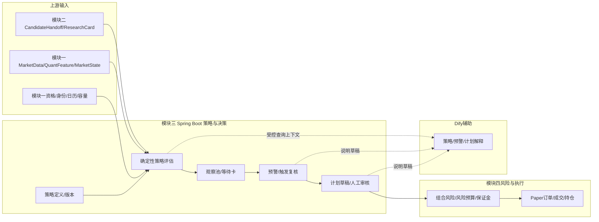
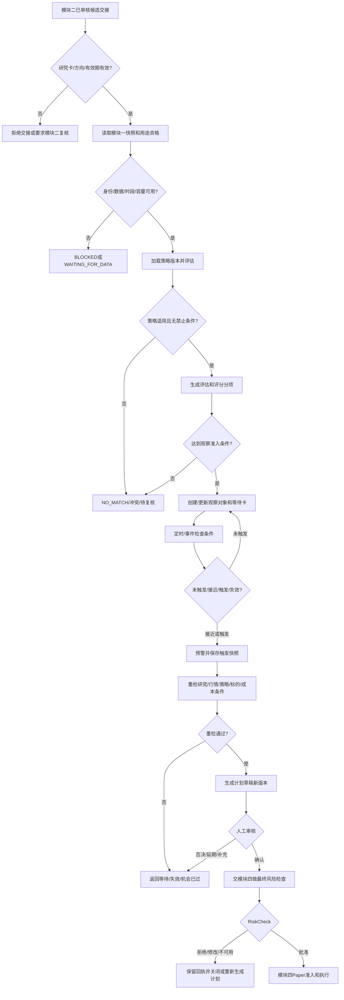

# QuantPF 详设 3：策略与交易决策详细设计方案

| 项目 | 内容 |
|:---|:---|
| 文档名称 | 详设_3_策略与交易决策详细设计方案 |
| 系统 | QuantPF（Quant Portfolio Framework） |
| 文档版本 | V1.3 |
| 编制日期 | 2026-10-23 |
| 所属分级 | 详设模块三：策略与交易决策 |
| 上游总纲 | 《量化交易系统完整设计方案说明书_V4.md》 |
| 上游整体流程 | 《详设_0_整体流程文档.md》 |
| 上游数据基础 | 《详设_1_数据与标的基础详细设计方案.md》 |
| 上游研究模块 | 《详设_2_研究与候选发现详细设计方案.md》 |
| 上游技术分册 | 《总体业务架构及记录落地功能进度.md》 |
| 主要代码模块 | `quantpf-domain`、`quantpf-strategy`、`quantpf-marketdata`、`quantpf-research`、`quantpf-risk`、`quantpf-job`、`ruoyi-admin` |
| 一期范围 | 策略定义与适配、观察池、等待卡、预警、触发复核、交易计划草稿和人工审核/风险交接 |
| 二期预留 | 通过量价关系优化发现交易时机；高级盘口/逐笔特征的策略验证接口 |

> 本文档定义策略与交易决策模块的业务流程、职责边界、策略生命周期、观察和预警规则、计划审核、状态机、接口事件方向、代码仓映射和验收门禁，作为模块三产品设计和子详设的基线。本文不展开页面布局、前端组件、Java类级实现、最终DDL或具体策略参数的最终值。策略计划由模块三产生并审核；最终组合风险批准、Paper订单、成交、账务和持仓由模块四负责。

---

## 目录

1. 文档目的与使用方式
2. 设计依据与需求追踪
3. 模块定位、目标与范围
4. 核心术语与不可混淆状态
5. 与模块一、二、四的职责边界
6. 总体架构和领域对象关系
7. 端到端业务流程
8. 策略定义、生命周期和版本治理
9. 量价、市场状态与策略输入
10. 策略评估、匹配、冲突与触发
11. 总纲100分评分的模块分工与门槛
12. 观察池与等待卡
13. 预警和触发后的重新检查
14. 交易计划草稿与人工审核
15. 股票、期货、现货和价差差异
16. 市场状态、风险事件和策略失效
17. Dify与Spring Boot功能边界
18. 领域对象与逻辑数据模型
19. 状态机、版本和一致性
20. API、领域事件与任务调度
21. 异常、幂等、审计、安全与降级
22. 代码仓映射和施工顺序
23. 产品设计文档承接要求
24. 测试策略与验收门禁
25. 子详设拆分、依赖和待确认事项
26. 文档结论

---

## 1. 文档目的与使用方式

### 1.1 文档目的

本详设把总纲和详设0中的策略与交易决策流程，转成可供产品设计、接口设计、代码施工和测试使用的共同基线：

```text
详设2交接研究候选和研究卡
→ 详设1提供当时有效的行情、量价、市场状态、标的/合约和资格
→ Spring Boot按策略版本做确定性适配和条件评估
→ 对合格对象建立观察、等待和预警
→ 条件触发后重检研究、价格、量价、市场和工具状态
→ 生成交易计划草稿并完成模块三人工审核
→ 交模块四做组合风险、资金/保证金和Paper准入
```

### 1.2 文档读者与用途

| 读者 | 使用方式 |
|:---|:---|
| 产品设计人员 | 设计策略管理、观察池、预警、复核和交易计划审核流程 |
| 后端设计/开发人员 | 设计领域对象、服务、API、事件、状态和持久化 |
| Dify流程设计人员 | 设计策略解释、问答和计划说明的受控输入输出 |
| 测试人员 | 覆盖条件评估、门禁、状态、重试、并发和端到端闭环 |
| 维护人员 | 管理策略版本、阶段门禁、待确认配置和代码落地状态 |

### 1.3 子详设索引

```text
详设 3A：量价指标与策略引擎
详设 3B：观察池与预警
详设 3C：交易计划与人工审核
```

三份子详设必须遵守本方案，并引用详设0、详设1和详设2。模块四详设继续负责风险预算、最终风险批准、Paper执行、回测验证和复盘事实。

---

## 2. 设计依据与需求追踪

### 2.1 上游依据

1. 总纲第7章：量价目标、量价状态、股票/期货规则及二期时机优化；
2. 总纲第9、10章：资产差异、策略职责、策略状态和适用范围卡；
3. 总纲第11章：观察池、等待、预警、复核和复盘；
4. 总纲第13章：组合选择、硬过滤和风险预算归属；
5. 总纲第14、15章：人机协同、用户功能和权限要求；
6. 总纲第16至20章：策略、风控、交易状态机、表单和领域对象；
7. 总纲第21至24章：股票/期货/现货交易要求、成功标准和实施路线；
8. 总纲第25章：Spring Boot确定性策略与交易底座、Dify辅助边界；
9. 详设0：三条业务流、Paper门禁、预警复核、人工审核、幂等和阶段门禁；
10. 详设1：行情、量价快照、市场状态、容量、身份、交易时段和用途资格；
11. 详设2：`ResearchCandidateReady`、研究卡、方向、有效期、成立和失效条件；
12. 技术分册：代码模块现状、现有Paper/风险/执行能力和施工门禁。

### 2.2 需求追踪摘要

| 上游要求 | 本详设章节 |
|:---|:---|
| 策略不决定标的价值，只选交易方式和时机 | 第3、5、10章 |
| 策略适用范围卡、状态及版本 | 第8、10、19章 |
| 策略基于K线、量价、波动率和市场状态 | 第9、10章 |
| 无匹配策略时不得强行交易 | 第10、12、24章 |
| 观察池和等待卡防止研究正确但时机错误 | 第12章 |
| 预警触发后必须重新检查 | 第13章 |
| 交易计划需确认、拒绝、延期或受限覆盖 | 第14章 |
| 总纲100分候选评分和70/80分初始门槛 | 第11章 |
| 硬门禁不能被评分或人工覆盖 | 第11、14、16、24章 |
| 一期仅Paper/Shadow，不开放真实委托 | 第5、14、17、24章 |
| 二期量价时机能力一期预留 | 第9、17、22、25章 |

### 2.3 规则冲突处理

若总纲、详设0/1/2和本文的状态、权限或字段不一致：

```text
记录冲突和影响范围
→ 暂停受影响契约/施工项
→ 更新更高层基线或形成明确决策
→ 同步模块详设、OpenAPI、事件和测试
```

不得通过代码“兼容两套互相冲突的状态定义”。

---

## 3. 模块定位、目标与范围

### 3.1 模块定位

模块三是研究结果与风险/执行之间的交易决策层。它把“研究方向和候选”转为“适配策略、条件等待、触发复核和交易计划草稿”，但不负责最终风险批准和订单执行。

### 3.2 模块目标

```text
选择与研究方向和市场状态相符的策略
准确说明条件已满足、未满足或禁止使用
将不成熟机会放入有期限、有条件的等待流程
在条件发生变化时生成可追溯预警
触发后重新校验研究、行情、策略和工具状态
形成有价格、止损、退出和有效期的交易计划草稿
确保人工审核和模块四风险检查处于执行前
```

### 3.3 一期范围

```text
策略定义、参数版本和启停
股票和期货基础策略的确定性评估
研究候选到策略适配的交接
观察池、等待卡和预警
触发后快照与重新检查
交易计划草稿、人工审核及风险模块交接
策略状态和机会状态的可解释查询
二期量价时机优化的数据/版本/回放接口预留
```

模块三向模块四提交的计划支持两种一期平台内部模拟执行模式：

```text
PAPER_MANUAL：用户逐笔确认后进入模拟资金账户和内部Paper撮合
PAPER_AUTO：用户预先授权账户、策略、品种、允许动作、运行时段和风险限额后，由确定性策略信号触发内部模拟委托
```

两种模式均不接入交易所、券商或期货公司委托通道，不使用真实资金；每笔开仓、平仓和移仓步骤仍须经过模块四最新行情、账户/组合风险、资金/保证金、交易时段、标的/合约和幂等检查。`SHADOW`只跟踪行情和策略结果，不创建Paper订单；`BACKTEST`只使用历史点时数据并与实时Paper账户隔离。

### 3.4 一期不包含

```text
数据授权、原始行情、标的身份和日历主记录
研究事实、研究方向和候选资格的创建/修改
最终组合风险预算和风险批准
最终仓位/账户资金/保证金核算
Paper订单、成交、持仓和账务的实现（由模块四执行，但属于一期范围；模块三只负责计划交接）
真实证券/期货委托、QMT/CTP submit/cancel
依赖高级订单流的自动择时
LLM自由生成策略参数、入场价、止损或仓位
```

### 3.5 成功标准

用户应能回答：

```text
为什么该候选匹配/不匹配这个策略？
哪些条件已满足、仍缺哪些条件？
为什么等待，等待到何时，什么情况下失效？
预警依据哪个时点的数据触发？
触发后为什么继续、拒绝或判定机会已过？
交易计划的方向、价格、止损、退出和有效期是什么？
是否已人工确认？模块四风险检查结果是什么？
```

---

## 4. 核心术语与不可混淆状态

```text
研究候选 ≠ 策略匹配
策略匹配 ≠ 策略触发
策略触发 ≠ 交易计划确认
交易计划确认 ≠ 风险批准
风险批准 ≠ Paper订单已创建
Paper订单已创建 ≠ 已成交
```

| 术语 | 含义 | 权威对象 |
|:---|:---|:---|
| 策略定义 | 规则名称、资产范围、条件和版本 | `StrategyDefinition` |
| 策略评估 | 对一个候选在一个策略版本下执行一次的可回放判断 | `StrategyEvaluation` |
| 策略匹配 | 适用范围通过，但触发条件未必满足 | 评估结果 |
| 策略触发 | 指定触发规则在指定快照上满足 | `StrategyTrigger`/评估版本 |
| 观察对象 | 对候选、标的、方向和周期的观察聚合 | `WatchlistItem` |
| 预警 | 提醒用户或系统重新检查的事件 | `Alert` |
| 交易计划草稿 | 经策略复核后形成的执行方案，尚待审核/风险检查 | `TradePlanDraft` |
| 风险批准 | 模块四对计划的权威风险结果 | `RiskCheckResult` |

---

## 5. 与模块一、二、四的职责边界

### 5.1 职责矩阵

| 能力 | 模块一：数据基础 | 模块二：研究候选 | 模块三：策略决策 | 模块四：风险交易验证 |
|:---|:---|:---|:---|:---|
| 授权、行情、标的身份、市场日历 | 权威负责 | 读取 | 读取，不改写 | 读取 |
| 量价特征和市场状态 | 权威数据/基础计算 | 研究解释 | 按策略计算和评估 | 回测/风险/执行使用 |
| 研究事实和方向 | 提供输入基础 | 权威负责 | 只读并发现冲突 | 读取 |
| 候选和研究卡 | 提供数据资格 | 权威负责 | 接收并适配策略 | 读取 |
| 策略、观察、等待、预警 | 提供特征 | 提供研究条件 | 权威负责 | 读取风险相关状态 |
| 交易计划草稿和模块三审核 | 提供行情/工具状态 | 提供研究结论 | 权威负责 | 接收计划做风险检查 |
| 最终组合、风险预算、保证金 | 提供容量/合约数据 | 提供研究引用 | 调用/读取，不计算最终权威值 | 权威负责 |
| Paper订单、成交、持仓和账务 | 提供行情 | 不负责 | 不负责 | 权威负责 |
| 回测、概率和复盘事实 | 提供点时数据 | 提供研究版本 | 引用策略版本/信号 | 权威计算和持久化 |

### 5.2 评分责任

总纲100分评分卡保持原权重：

| 维度 | 分值 | 负责模块 |
|:---|---:|:---|
| 事件可信度与新颖性 | 15 | 模块二 |
| 行业传导链 | 20 | 模块二 |
| 标的质量/供需质量 | 20 | 模块二 |
| 估值/预期差 | 15 | 模块二 |
| 策略匹配 | 15 | 模块三 |
| 执行和流动性 | 5 | 模块四计算，模块一供给容量数据 |
| 风险收益比 | 10 | 模块四/风险域 |

模块三只计算策略匹配维度，不重复计算研究分、执行分和风险收益分。

### 5.3 量价职责分层

```text
模块一：保存行情、基础量价特征、点时版本和市场状态
模块二：说明量价是否支持研究方向、价格是否已经反映
模块三：计算策略条件、匹配、等待、预警和触发
模块四：成本后回测、概率验证、风险、Paper执行和归因
```

模块三不得更改原始或基础量价事实；若有自身策略派生特征，必须标明算法版本和输入快照，并与模块一事实特征区分。

---

## 6. 总体架构和领域对象关系

### 6.1 总体逻辑



### 6.2 对象主链

```text
CandidateHandoff/ResearchCard
→ StrategyEvaluation（strategyVersion + inputSnapshot）
→ WatchlistItem/WaitingCard
→ Alert/RecheckSnapshot
→ TradePlanDraft/TradePlanVersion
→ TradePlanReview
→ RiskCheckRequest / RiskCheckResult（模块四）
→ PaperOrder（仅模块四）
```

### 6.3 对象唯一归属

模块三对象不复制模块一和二的事实主记录；模块四的风险结果、订单、成交和持仓也不由模块三建立为权威状态。模块三保存外键/稳定引用、输入版本和交接回执。

---

## 7. 端到端业务流程

### 7.1 标准流程

1. 接收模块二已审核的候选交接和研究卡版本；
2. 校验研究卡有效期、方向、研究周期、成立/失效条件；
3. 读取模块一的最新可用行情、量价、市场状态、身份、日历、容量和用途资格；
4. 选择当前 `ACTIVE` 且版本有效的策略；
5. 按固定顺序校验适用范围、必要条件、缺失条件和禁止条件；
6. 形成可解释的策略评估结果；
7. 按准入规则创建/更新观察对象和等待卡；
8. 定时或事件驱动评估等待条件并产生去重预警；
9. 条件触发后保存新快照，重新检查研究、行情、策略和工具；
10. 通过后生成交易计划草稿；未通过则等待、失效或判定机会已过；
11. 进行模块三人工审核；
12. 将确认后的计划版本提交模块四风险检查；
13. 只有模块四风险批准后才可进入 Paper 订单流程。

### 7.2 总流程图



---

## 8. 策略定义、生命周期和版本治理

### 8.1 策略适用范围卡

每个策略必须结构化定义：

```text
strategyId / strategyName / strategyVersion
assetTypes / direction / researchHorizons
marketStates / pricePositions / barPeriods
requiredInputs / optionalInputs
requiredConditions / optionalConditions / forbiddenConditions
triggerRule / invalidationRule / expiryRule
entryReferenceRule / stopReferenceRule / exitReferenceRule
cooldown / maxWaitingDuration
parameterSchema / defaults / allowedRanges
validationResultRefs / approval / enabled / validFrom / validTo
```

策略条件需能判定为 `PASS`、`FAIL`、`MISSING` 或 `NOT_APPLICABLE`，并说明所需数据字段、比较算子、窗口、阈值、时点和边界值处理。自然语言条件不可直接作为生产规则。

### 8.2 生命周期

```text
DRAFT
→ BACKTEST_PENDING
→ VALIDATION_PENDING
→ APPROVED
→ ACTIVE
→ SUSPENDED
→ RETIRED
```

发布、暂停、恢复和退役均需权限、原因、操作者、生效时间和审计记录。`ACTIVE` 版本不可原地改规则；改动创建新版本。

### 8.3 存量对象对版本变化的处理

策略新版本发布或旧版本暂停时，必须配置存量处置策略：

```text
既有等待卡：继续绑定旧版本但禁止新增评估；或迁移到新版本并重新评估
既有预警：关闭旧预警或创建新版本预警，不混用版本
既有计划草稿：策略版本变化则标记REVIEW_REQUIRED，不能静默沿用
已提交模块四计划：由模块四依据其状态和风险规则决定后续处理
```

不得只更新配置表导致历史评估失去可解释性。

### 8.4 一期策略范围

接受已讨论的首批范围：

```text
低位横盘突破
趋势回调
放量突破/破位确认
期货趋势跟踪
```

缠论一买/二买/三买、复杂多周期共振、依赖完整订单流的策略、复杂基差多腿交易，先作为实验/研究能力。只有完成形式化定义、回测、样本外验证、Paper观察和人工批准后才可发布为生产策略。

---

## 9. 量价、市场状态与策略输入

### 9.1 输入范围

策略评估按需引用：

```text
OHLCV、成交额、复权口径
ATR、波动率、价格位置、相对强弱
相对成交量、成交量Z分数、收盘位置
OBV/VWAP/MFI/CMF（若数据和口径已确认）
期货持仓量及变化、基差、期限结构、合约剩余天数
盘口价差/深度/流动性状态（一期按可用范围）
市场状态、交易日历、交易时段和制度状态
数据质量、可见时间、标的身份和容量状态
```

特征来自模块一时保存 `quantFeatureSnapshotId` 和算法版本；模块三自己的派生值须保存计算定义、版本和原始输入引用，不能覆盖模块一数据。

### 9.2 市场状态适配

| 市场状态 | 策略处理原则 |
|:---|:---|
| `TREND_UP` | 评估顺势回调、有效突破等；不因研究看多自动触发 |
| `TREND_DOWN` | 评估适用空头/反弹失败策略；股票空头受资产许可约束 |
| `RANGE` | 只评估经验证的区间边界；区间中部不强行交易 |
| `HIGH_VOLATILITY` | 需有专门规则，否则暂停普通参数策略并复核 |
| `LOW_LIQUIDITY` | 通常阻断新计划或仅保留观察 |
| `SYSTEMIC_RISK` | 阻断新增方向性风险并通知模块四；不自行平仓 |
| `DATA_UNAVAILABLE` | 不产生新的有效触发 |
| `SPECIAL_RULE` | 先核验制度变化，不能沿用普通规则 |

市场状态切换应触发评估和通知，不直接产生订单动作。

### 9.3 一期/二期边界

一期只做确定性基础特征、策略评估、观察、等待和预警；二期量价时机优化所需的多周期特征、窗口、标签、点时回放和成本分组按详设1预留。二期时机优化须经单独回测/样本外/Paper验证；Dify不能计算时机或生成订单。

---

### 9.3 二期量价主导策略输入

二期策略可由量价机会扫描直接触发，不要求先存在新闻、财报或研究事件。适用资产包括A股、港股、美股、期货、外汇/海外经纪商品；模块三必须读取模块一的资产专属交易日历、时区、币种、交易时段、流动性和数据质量状态。

策略输入分层：

~~~text
量价事实：OHLCV、Bid/Ask、成交额、持仓量、相对强弱、波动和价格位置
确定性因子：趋势、动量、波动、流动性、相对强弱、跨资产关系、市场状态
研究增强：新闻/基本面/供需/基差/期限结构的已核验结果（可选）
大模型增强：解释、假设、反方问题和普通语言说明（不可写入触发条件）
~~~

量价和因子满足策略触发条件后，新闻缺失不能自动否决机会；但新闻、基本面或供需缺失应在计划中标记证据范围和未知风险。大模型不得修改策略条件、分数、数量、止损或计划状态。

跨资产策略不得复用未经标准化的绝对价格和成交量阈值；策略版本必须记录特征定义、资产类型、市场时区、币种、交易日历、输入快照和验证版本。


### 9.4 量价主导信号的资产适配

二期策略引擎不能把A股、港股、美股、期货和外汇的绝对价格/成交量阈值直接复用。策略输入必须通过资产适配器转换为：

~~~text
本地交易日和时区
币种和单位
收益率/波动率/分位数
相对强弱和市场状态
流动性、点差、涨跌停/保证金/杠杆约束
~~~

量价候选的新闻上下文可以为空；当上下文存在时只作为可选增强或冲突标记，不能修改已计算的量价事实和确定性触发条件。


## 10. 策略评估、匹配、冲突与触发

### 10.1 评估前置门禁

下列检查优先于评分：

```text
候选交接和研究卡版本仍有效
研究方向、周期、标的/合约身份完整
数据授权、质量、可见时间和新鲜度符合用途
行情和特征快照可用且时点不晚于评估时点
市场时段和制度状态可识别
策略版本为ACTIVE且适用于资产/方向/周期
具体期货合约可交易，不误用连续合约作执行标的
容量状态不是UNTRADEABLE或UNKNOWN（除非策略明确定义只观察）
```

前置失败产生明确 `BLOCKED` 或 `WAITING_FOR_DATA`，不得由高分补偿。

### 10.2 评估顺序

```text
1. 校验研究卡和策略版本
2. 校验输入快照、字段、数据时点和用途资格
3. 校验资产、方向、周期和市场状态适用范围
4. 计算必要条件
5. 计算可选条件和缺失条件
6. 检查禁止条件和研究/策略冲突
7. 计算可解释的策略适配分
8. 产生匹配、等待、接近触发、触发或不匹配结果
9. 保存输入、条件结果、解释、版本和有效期
```

### 10.3 评估结果

```text
evaluationId
candidateId / researchCardId / cardVersion
strategyId / strategyVersion
inputSnapshotIds / asOfTime / evaluatedAt
status
satisfiedConditions / failedConditions / missingConditions
forbiddenConditions / conflictRefs
strategyFitScore / scoreVersion
triggerRuleResult / invalidationRuleResult
validUntil / reasonCodes / auditMetadata
```

### 10.4 状态含义

```text
MATCHED：适用范围和基础条件通过，未触发
WAITING：方向/策略可用，但必要触发条件尚未满足
NEAR_TRIGGER：接近触发阈值，仍需等待确认
TRIGGERED：本次评估的触发规则满足，需要进入触发后复核
NO_MATCH：没有适用策略
CONFLICTED：研究方向、策略方向或多个规则发生冲突
BLOCKED：数据、身份、资格或硬门禁阻断
INVALIDATED：策略或研究前提失效
EXPIRED：评估结果/策略有效期结束
```

`TRIGGERED` 仅代表条件在该快照上满足，不代表计划确认或风险批准。

### 10.5 策略冲突

- 多策略同时匹配：保存各评估结果；按经批准的主/备策略规则或人工选择处理，不进行方向“投票”。
- 研究方向与策略方向冲突：标记 `CONFLICTED`，不生成交易计划；退回模块二复核或等待。
- 多周期信号冲突：分别保存周期和用途，短周期策略不得覆盖中长期研究结论。
- 多个候选竞争组合风险：模块三不分配账户风险，由模块四组合模块判断。

### 10.6 首批策略业务条件摘要

**低位横盘突破**：阶段整理、波动收缩、卖压减弱、收盘突破区间上沿、相对成交量和收盘位置确认；无量突破、快速回落、重大事件冲高或研究逻辑失效时禁用。

**趋势回调**：主趋势清晰、回调不破主结构、回调量能收缩、恢复趋势时确认；趋势不明、震荡中部、结构破坏时禁用。

**放量突破/破位**：关键结构被收盘价突破/跌破、量能和市场状态配合，并考虑后续确认；单日异常量、过度偏离、无法设置可执行止损时阻断。

**期货趋势跟踪**：均线/趋势规则只能是形式化输入之一；还须校验成交量、持仓量、基差/期限结构、具体合约、保证金/交割风险（最终风险由模块四批准）。均线金叉/死叉不能单独作为无条件交易指令。

阈值、窗口和参数均为实现前待验证配置，不在总体详设中固化为已验证常数。

---

## 11. 总纲100分评分的模块分工与门槛

### 11.1 评分责任

总纲权重保持不变：模块二70分（可信度/新颖性15、传导链20、标的/供需质量20、估值/预期差15）；模块三计算策略匹配15分；模块四计算执行流动性5分和风险收益10分。

模块三保存 `StrategyFitScore` 的构成、证据、条件结果和规则版本。该分数不是概率，也不能单独触发策略或生成计划。

### 11.2 70/80分初始门槛

- 总分≥70：满足“可评估进入观察”的分数条件；仍须通过全部硬门禁，并按观察准入规则决定是否进入正式观察池。
- 总分≥80：仅满足“可考虑形成Paper计划”的分数条件；还必须策略触发后复核通过、人工确认、模块四风险批准。
- 总分缺项：标记 `SCORE_INCOMPLETE`；不得默认缺失维度满分或把模块二70分直接当作总分。
- 任何分数都不能覆盖授权、数据质量、身份、合约、流动性、账户熔断和风险硬否决。

阈值为总纲给出的初始规则，正式上线策略前仍需基于样本外和Paper结果确认，不宣称固定收益保证。

---

## 12. 观察池与等待卡

### 12.1 观察对象和准入

观察对象建议按以下聚合键去重：

```text
subjectRef + instrumentRef + direction + researchHorizon
```

同一对象可关联多个策略评估，但不能因每个策略产生重复观察主体。不同具体期货合约、方向或研究周期可单独建对象。

进入正式观察池至少要求：

```text
模块二交接有效且研究卡未过期
研究方向和工具表达可识别
模块一资格和行情状态满足观察用途
至少一个活动策略匹配或有明确等待复核规则
触发、失效、最长等待时间和下次检查时间明确
观察准入所需评分和人工审核满足配置
```

### 12.2 等待卡字段

```text
watchlistItemId / candidateId / researchCardId及版本
subjectRef / instrumentRef / direction / researchHorizon
strategyId / strategyVersion / evaluationId
观察原因、已满足条件、未满足条件、接近触发条件
正式触发条件、触发后复核项
研究失效条件、策略失效条件
最长等待时间、expiresAt、nextCheckAt
market/quant snapshot引用、创建来源和审核记录
```

### 12.3 观察状态

```text
PENDING_REVIEW
→ WATCHING
→ WAITING
→ NEAR_TRIGGER
→ TRIGGERED_RECHECK
→ PLAN_PENDING
→ HANDED_OFF_TO_RISK
```

终止/阻断状态：

```text
NO_MATCH / PAUSED / DATA_BLOCKED / THESIS_CONFLICT
STRATEGY_CONFLICT / OPPORTUNITY_PASSED / INVALIDATED
EXPIRED / REJECTED / CLOSED
```

一期可自动生成观察建议；正式观察池自动准入范围按风险等级配置。重大事件、期货空头、价差和高风险对象默认需人工复核。观察状态不等于交易状态。

### 12.4 到期与恢复

研究卡、策略版本、观察卡、事件窗口或具体合约可交易窗口任一过期，均应暂停策略触发并要求重检。恢复时创建新评估版本，不把旧条件自动顺延。

---

## 13. 预警和触发后的重新检查

### 13.1 预警类型

```text
PRICE / TECHNICAL / VOLUME / OPEN_INTEREST
BREAKOUT / BREAKDOWN / PULLBACK
NEWS / FUNDAMENTAL / SUPPLY_DEMAND
BASIS / TERM_STRUCTURE
STRATEGY_NEAR_TRIGGER / STRATEGY_TRIGGERED
MARKET_STATE_CHANGE / LIQUIDITY_OR_CAPACITY
CONTRACT_EXPIRY / ROLLOVER / WATCHLIST_EXPIRY
```

预警只提示重新检查，不自动创建交易计划或订单。

### 13.2 预警对象与状态

预警至少包含对象、策略版本、条件定义、阈值和实际值、触发快照、触发/可见时间、等级、有效期、冷却时间、去重键、允许动作、复核问题和通知状态。

```text
ACTIVE → TRIGGERED → ACKNOWLEDGED → RECHECK_PENDING
→ RESOLVED / CLOSED / EXPIRED
```

同一对象、策略版本、条件、方向和有效窗口使用幂等去重键；支持重复合并、冷却、计数升级和人工关闭。

### 13.3 触发后复核

触发时保存输入快照，然后重新检查：

```text
研究卡/事实和事件是否有效
行情、特征、时间、质量和用途资格是否有效
价格是否过度运行，机会是否已过
市场状态、量价和策略版本是否仍匹配
标的/具体合约、交易时段、制度和容量是否可用
入场到止损空间、成本、滑点和最大等待时间是否仍可接受
是否已有同对象/同方向有效计划，是否存在重复风险请求
```

结果为继续等待、机会已过、返回模块二复核、策略失效或生成计划草稿之一，不得直接下单。

---

## 14. 交易计划草稿与人工审核

### 14.1 计划边界

模块三负责结构化 `TradePlanDraft`、模块三人工审核和提交模块四风险检查；模块四负责 `RiskCheckResult`、最终风险批准和Paper准入。计划草稿、用户确认、风险批准、订单创建是不同状态。模块四的Paper执行支持 `PAPER_MANUAL` 和经授权的 `PAPER_AUTO`，均只调用平台内部Paper适配器和模拟撮合，不调用真实交易网关。

### 14.2 计划字段

```text
tradePlanId / version / status
candidateId / researchCardId及版本
strategyId / strategyVersion / evaluationId
assetType / subjectRef / instrumentRef / accountRef
researchDirection / strategyDirection / plannedAction / openClose
signalTime / createdAt / validFrom / validUntil
entryCondition / entryPriceRange / triggerReference
stopCondition / stopPriceReference / exitRule / targetRule
maxHoldingPeriod / invalidatingConditions / forbiddenConditions
expectedCost / slippage / capacityRef / sessionRef
dataSnapshotId / quantFeatureSnapshotId / marketStateSnapshotId
supportEvidenceRefs / counterEvidenceRefs
reviewer / reviewStatus / reviewReason / overrideAudit
riskHandoffId / riskResultRef（模块四回执）
```

模块三可以计算计划参考价、止损距离和单位风险输入；账户数量、最终仓位、保证金和组合风险由模块四决定。不得用Dify置信度或策略匹配分推导仓位。

### 14.3 计划状态与模块责任

```text
DRAFT
→ STRATEGY_CONFIRMED
→ PRICE_CONFIRMED
→ INSTRUMENT_VALIDATED
→ HUMAN_REVIEW
→ RISK_PENDING（已交模块四）
→ RISK_APPROVED（仅接受模块四结果）
→ PAPER_PENDING（仅模块四执行域）
→ PAPER_SUBMITTED / PAPER_PARTIAL_FILL / PAPER_FILLED（仅模块四执行域）
```

失败/终态：

```text
REJECTED_BY_USER / DEFERRED / REJECTED_DATA
REJECTED_PRICE / REJECTED_TOOL / REJECTED_RISK
REQUIRES_MODIFICATION / EXPIRED / INVALIDATED / HALTED
```

`PLAN_APPROVED` 在端到端总状态中仅能在必要审核和风险检查通过后表达；模块三用户确认不可单独伪装为最终风险批准。

### 14.4 人工审核

`PAPER_MANUAL` 模式下，一期每笔新增开仓计划必须人工确认后提交模块四风险检查；`PAPER_AUTO` 模式下，不要求每笔订单逐笔人工点击，但必须由用户预先启用自动模式并授权账户、策略版本、品种、允许动作、运行时段和风险限额。自动策略信号须生成不可变计划/订单请求并逐笔通过模块四最新风险检查，之后才可进入内部Paper撮合。自动模式启用、授权范围或风险限额变更、策略版本切换、熔断后的恢复及重大异常解除，必须重新人工确认。审核动作：

```text
CONFIRM / REJECT / DEFER / REQUEST_RECHECK / OVERRIDE（受限）
```

覆盖须记录操作者、原因、字段、原值、新值、时间和有效期。修改方向、工具、策略、入场、止损或退出等关键字段时创建新版本并重新审核；不得覆盖模块一资格或模块四风险硬门禁。

### 14.5 风险交接与回退

模块四回执：

```text
RISK_APPROVED
REJECTED_RISK
REQUIRES_MODIFICATION
REQUIRES_NEW_SNAPSHOT
RISK_CHECK_UNAVAILABLE
```

- `RISK_APPROVED`：计划可按模块四流程进入Paper准入；按已授权的 `PAPER_MANUAL` 或 `PAPER_AUTO` 模式执行，模块三不创建订单。
- `REJECTED_RISK`：保存原因，计划拒绝/关闭；不得自动重提。
- `REQUIRES_MODIFICATION`：新建计划版本，重新人工确认和风险检查。
- `REQUIRES_NEW_SNAPSHOT`：旧计划失效，拉取新行情并重评策略。
- `RISK_CHECK_UNAVAILABLE`：保持待检查/延期，不视为批准。

盘后生成的计划不得自动变成次日订单；下一交易时段必须用最新数据重检并重新确认必要条件。

---

## 15. 股票、期货、现货和价差差异

### 15.1 股票

计划评估需纳入标的状态、ST/停牌、T+1、涨跌停、复权口径、流动性和无法成交风险。一期默认股票买多；利空信号不能自动生成裸空计划。非交易时段形成的计划是待复核草稿。

### 15.2 期货

必须使用具体合约而非连续合约作为计划工具。计划引用合约乘数、tick、保证金规则、夜盘、涨跌停、交割月、到期和移仓信息；检查持仓量、基差、期限结构、流动性和逼空/跳空风险。具体风险批准和开平手数由模块四负责。

### 15.3 现货、套保和价差

必须记录库存/采购/销售/经营敞口及其证据。无现实敞口不能形成现货空单。套保和价差计划要明确工具腿、方向、比例依据、基差风险、两腿流动性、资金/保证金和交割条件；模块三不执行多腿订单。

---

## 16. 市场状态、风险事件和策略失效

### 16.1 市场状态变化

模块一市场状态变化应触发相关评估和告警。`HIGH_VOLATILITY`、`LOW_LIQUIDITY`、`SYSTEMIC_RISK`、`DATA_UNAVAILABLE`、`SPECIAL_RULE`下，普通策略默认暂停新触发，除非存在经批准的专用策略。对已有计划和持仓的处置交由模块四。

### 16.2 研究/策略冲突

```text
研究方向LONG + 策略仅满足SHORT规则
→ THESIS_STRATEGY_CONFLICT
→ 不生成相反方向计划
→ 退回模块二复核或保留不参与
```

多策略方向冲突不通过“策略投票”解决。按版本化主/备策略规则或人工判断；未解决时不生成计划。

### 16.3 重大风险事件

模块三可以暂停新策略触发、提高预警、标记等待对象待复核并向模块四发送风险复核请求；不得自动平仓、撤单、开仓或触发Kill Switch。风险事件等级和Paper风险动作由模块四规则控制。

---

## 17. Dify与Spring Boot功能边界

| 能力 | Spring Boot | Dify |
|:---|:---|:---|
| 策略定义、参数、版本、审批 | 权威负责 | 不负责 |
| 指标、市场状态、容量和策略条件 | 确定性读取/计算 | 仅解释结果 |
| 匹配、触发、冲突和失效 | 权威负责 | 不得改状态 |
| 观察池、等待、过期和预警 | 权威负责 | 仅生成说明 |
| 交易计划字段、版本和审核状态 | 权威负责 | 说明草稿，不写主记录 |
| 仓位、组合风险、保证金 | 模块四负责 | 不负责 |
| Paper订单和持仓 | 模块四负责 | 禁止调用 |
| 策略/预警/计划问答 | 提供授权结构化结果 | 组织用户可读答案 |

Dify 只接收最小必要上下文，不直连数据库、不接触交易凭据。其解释结果不参与策略条件、分数、风险或计划状态计算。

---

## 18. 领域对象与逻辑数据模型

### 18.1 核心对象

| 对象 | 作用 | 权威模块 |
|:---|:---|:---|
| `StrategyDefinition` | 策略元数据和适用范围 | 模块三 |
| `StrategyVersion` | 不可变规则/参数版本 | 模块三 |
| `StrategyValidationRef` | 回测/样本外/Paper验证引用 | 模块四验证域 |
| `StrategyEvaluation` | 单候选/策略版本评估结果 | 模块三 |
| `StrategyConditionResult` | 条件逐项计算及原因 | 模块三 |
| `StrategyConflict` | 研究/策略或多策略冲突 | 模块三 |
| `WatchlistItem` | 观察对象聚合 | 模块三 |
| `WaitingCard` | 等待和失效条件 | 模块三 |
| `Alert` | 预警和处理状态 | 模块三 |
| `RecheckSnapshot` | 触发时评估输入快照引用 | 模块三引用模块一/二 |
| `TradePlanDraft` | 交易计划草稿 | 模块三 |
| `TradePlanVersion` | 不可变计划版本 | 模块三 |
| `TradePlanReview` | 模块三人工审核记录 | 模块三 |
| `RiskCheckRequest/Result` | 风险交接与回执 | 模块四权威 |
| `PaperOrder/Position` | Paper执行状态 | 模块四权威 |

### 18.2 持久化建议范围

最终表名需盘点代码仓后确定，建议评估：

```text
quantpf_strategy_definition
quantpf_strategy_version
quantpf_strategy_validation_ref
quantpf_strategy_evaluation
quantpf_strategy_condition_result
quantpf_strategy_conflict
quantpf_watchlist_item
quantpf_waiting_card
quantpf_alert
quantpf_recheck_snapshot_ref
quantpf_trade_plan_draft
quantpf_trade_plan_version
quantpf_trade_plan_review
quantpf_risk_handoff（若现有风险域无可复用对象）
```

不得在模块三重复建立风险结果、Paper订单、成交、资金、持仓或账务主表。数据库变更使用Flyway新迁移，不改历史迁移。

---

## 19. 状态机、版本和一致性

### 19.1 聚合状态分离

以下对象各自维护状态，不共用一个总状态字段：

```text
StrategyDefinitionLifecycle
StrategyEvaluationStatus
WatchlistStatus
AlertStatus
TradePlanStatus
RiskCheckStatus（模块四）
PaperOrderStatus（模块四）
```

### 19.2 版本原则

候选卡、行情/特征快照、策略版本或参数、评估规则、观察条件、计划字段任一变化都要形成新的评估或版本。历史对象保留当时规则、数据输入、状态迁移和用户操作；不得静默刷新为最新规则。

### 19.3 幂等和并发

策略评估、观察创建/更新、预警触发、计划创建/审核/风险交接必须使用幂等键。相同键不同参数返回冲突。观察、预警和计划写操作需使用期望版本或乐观锁；审核时版本已变化则拒绝旧版本写入并要求用户重新确认。

---

## 20. API、领域事件与任务调度

### 20.1 API逻辑分组

```text
/api/quant/strategy/definitions/*
/api/quant/strategy/versions/*
/api/quant/strategy/evaluations/*
/api/quant/watchlist/*
/api/quant/alerts/*
/api/quant/trade-plans/*
/api/quant/trade-plans/*/risk-handoff
```

实际路径和Schema以 `contract/openapi` 为准。控制器不得直接写表；审核、覆盖、版本发布和风险交接均校验权限、幂等键、expectedVersion和理由。

### 20.2 领域事件

```text
StrategyVersionActivatedEvent
StrategyVersionSuspendedEvent
StrategyEvaluationCompletedEvent
StrategyMatchedEvent
StrategyNoMatchEvent
StrategyTriggeredEvent
StrategyInvalidatedEvent
StrategyConflictDetectedEvent
WatchlistCreatedEvent
WatchlistStatusChangedEvent
WaitingConditionChangedEvent
AlertTriggeredEvent
AlertAcknowledgedEvent
AlertResolvedEvent
RecheckRequiredEvent
TradePlanDraftCreatedEvent
TradePlanReviewedEvent
TradePlanRiskHandoffEvent
TradePlanRiskRejectedEvent
TradePlanRiskApprovedEvent
TradePlanExpiredEvent
```

统一元数据：`eventId`、`eventType`、`schemaVersion`、`aggregateId`、`aggregateVersion`、`occurredAt`、`availableAt`、`requestId`、`idempotencyKey`、`correlationId`、`causationId`、`source`、快照引用和`payload`。

### 20.3 调度任务

按技术分册统一调度框架实施：

```text
盘后策略扫描
观察池条件评估
数据/市场状态变化后的复评
预警触发、冷却和升级
研究卡/策略/等待卡/计划有效期检查
期货到期和移仓窗口提醒
策略版本切换后的存量对象复核
失败任务补偿和事件投递重试
```

每次运行固定 `strategyVersion`、`asOfTime`、数据快照和任务批次。重复运行不能重复创建有效观察、预警、计划或通知。

---

## 21. 异常、幂等、审计、安全与降级

### 21.1 异常处理

| 异常 | 默认处理 |
|:---|:---|
| 行情/特征过期 | 阻断触发和计划，要求新快照 |
| 研究卡过期/失效 | 标记待模块二复核 |
| 合约身份/状态异常 | 阻断计划 |
| 策略版本停用 | 暂停新评估，存量对象复核 |
| 市场状态转高风险 | 暂停普通策略触发，通知模块四 |
| 风险服务不可用 | 保持风险待检查，不视作批准 |
| 风险要求修改 | 新建计划版本并重新审核 |
| 审核版本过期 | 拒绝旧版本写入，要求刷新 |
| Dify不可用 | 确定性策略链继续，解释待补 |

### 21.2 审计字段

记录操作者/系统任务、动作、聚合对象、前后状态、策略版本、研究卡版本、行情/特征快照、逐项条件结果、理由、错误码、风险请求/回执、幂等和关联ID、时间及结果。

### 21.3 权限建议

```text
strategy:view
strategy:version:create
strategy:version:approve
strategy:activate
strategy:suspend
watchlist:view
watchlist:review
alert:ack
tradeplan:view
tradeplan:confirm
tradeplan:reject
tradeplan:defer
tradeplan:override
tradeplan:handoff-risk
strategy:audit:view
```

策略发布和计划覆盖权限应分离；服务端必须执行权限校验，不能仅靠前端隐藏操作。

---

## 22. 代码仓映射和施工顺序

### 22.1 代码仓映射

| 模块 | 职责 | 边界 |
|:---|:---|:---|
| `quantpf-domain` | 策略、评估、观察、预警、计划领域对象 | 不含Paper权威状态 |
| `quantpf-strategy` | 策略生命周期、评估、观察、预警、计划编排 | 不复制研究事实和风险算法 |
| `quantpf-marketdata` | 行情、量价、时段、市场状态和容量查询 | 不生成交易决策 |
| `quantpf-research` | 候选、研究卡、方向和研究有效性查询 | 模块三只读 |
| `quantpf-risk` | 最终风险、组合、预算、保证金和压力测试 | 模块四权威 |
| `quantpf-execution` | Paper订单、撮合、成交、持仓和账务 | 模块四权威，复用已落地能力 |
| `quantpf-backtest` | 点时回放、bar+1、成本和验证 | 引用策略版本 |
| `quantpf-job` | 扫描、复评、预警、过期和补偿 | 统一调度门禁 |
| `ruoyi-admin` | API、审核入口和权限 | 控制器不直接写表 |
| `contract`/`db/migration` | OpenAPI、事件、错误码和Flyway | 先契约后代码 |

### 22.2 推荐实施顺序

```text
盘点代码仓、Paper和风险现有接口
→ 冻结共享对象/状态/API/事件/幂等
→ 策略定义与版本管理
→ 接入模块二候选和模块一行情快照
→ 先实现一个可回放股票日线策略
→ 观察池、等待卡和预警去重
→ 触发后复核与交易计划草稿
→ 人工审核和模块四RiskCheck交接
→ 接通现有Paper服务（不改其核心事务）
→ 扩展期货和其他策略
→ 端到端验收
```

Phase 0、正式契约、Flyway、统一调度和密钥门禁必须先通过。设计文档完成不等于代码能力已实现。

### 22.3 第一批不做

```text
Dify自主决定策略或触发条件
策略信号绕过模块四RiskCheck直接创建Paper订单
策略分/模型置信度直接计算仓位
一期复杂订单流自动择时
未经形式化和验证的缠论策略自动触发
模块三重复计算组合风险/保证金
真实交易通道及LIVE能力
将PAPER_AUTO误当真实自动实盘或绕过逐笔Paper风险闸门
```

---

## 23. 产品设计文档承接要求

产品设计文档应将业务规则转为用户任务，不重新发明策略规则，至少覆盖：

1. 策略目录、策略卡、版本差异、验证状态、审批和启停；
2. 单候选策略评估详情，展示条件逐项结果、缺失数据和禁止条件；
3. 观察池聚合、策略关联、等待卡、有效期和复核操作；
4. 预警中心的触发快照、去重合并、冷却、升级和处理结果；
5. 触发后重新检查的结论和“等待/机会已过/失效/生成计划”分支；
6. 交易计划草稿和版本比较，展示方向、入场、止损、退出、有效期、成本和证据；
7. 人工确认/否决/延期/受限覆盖流程及权限；
8. 模块四风险交接、拒绝原因、要求修改和批准回执；
9. 过期、行情异常、市场状态切换、无策略匹配等异常状态。

用户界面需说明为何等待、还缺什么、何时检查、何时过期；不能只显示“未触发”。

---


### 23.4 面向普通用户的策略体验

普通用户不直接选择策略编码、填写指标周期、修改阈值或编写条件表达式。模块三根据研究方向、资产类型、研究周期、市场状态、日线数据和已发布策略版本自动匹配策略，并生成解释后的结果。

普通用户看到：

~~~text
系统匹配的策略类型
为什么匹配
已经满足的条件
仍在等待的条件
失效条件和主要风险
系统建议的下一步
~~~

系统自动生成并预填：

~~~text
观察期限、等待条件、触发条件、参考价格区间、数量建议、止损/退出条件、计划有效期
~~~

高级字段只对审核/专业用户展开。用户修改关键字段后必须创建新版本并重新执行策略评估和RiskCheck，不得覆盖系统原建议。

### 23.5 交易计划确认责任

| 内容 | 系统 | 普通用户 | 策略审核用户 |
|:---|:---|:---|:---|
| 策略选择和参数计算 | 负责 | 不填写 | 查看/审核版本 |
| 触发、等待、失效判断 | 负责 | 查看 | 审核例外 |
| 交易计划字段 | 生成并预填 | 查看并确认 | 退回/确认 |
| 人工修改 | 重新计算 | 默认不修改 | 按权限修改并说明 |

### 24.6 策略体验验收补充

~~~text
无合适策略时系统保留NO_MATCH，不要求用户强行选择；
普通用户不输入策略参数仍可完成观察和Paper计划确认；
策略解释使用普通语言，专业规则可展开；
计划过期、数据过期或策略停用时系统明确说明，不自动顺延。
~~~

## 24. 测试策略与验收门禁

### 24.1 单元测试

```text
策略适用范围、条件运算、边界值和禁止条件
策略版本生命周期和存量对象处置
市场状态映射和数据资格
方向冲突和多策略冲突
总评分门槛、评分缺项和硬门禁
观察聚合键、并发更新和状态迁移
等待到期、恢复和重新评估
预警去重、冷却、合并和升级
计划版本、人工审核和覆盖权限
RiskCheck交接、拒绝、修改和服务不可用
幂等、重复任务和重复事件
```

### 24.2 集成测试

```text
ResearchCandidateReady → StrategyEvaluation → Watchlist/WaitingCard
条件变化 → Alert → RecheckSnapshot → 交易计划草稿
人工确认 → RiskCheckRequest → 模块四RiskCheckResult
风险批准 → 模块四已有Paper流程
研究卡/行情/市场状态失效 → 阻断或重新评估
策略版本升级 → 存量观察和计划复核
```

### 24.3 关键故障测试

```text
行情过期/缺字段/时间错位
Dify不可用或返回低质量解释
研究卡被修订或过期
策略版本在等待期间停用
同条件连续触发、任务并发和重复回调
用户审核时计划版本已经变化
RiskCheck超时/拒绝/要求新快照
期货合约临近到期、涨跌停或低流动性
盘后计划跨交易日
```

### 24.4 验收标准

1. 策略可配置、版本化、可停用，运行结果能用原始输入回放；
2. 研究方向、策略匹配、触发、计划确认、风险批准和Paper订单有独立状态；
3. 70/80分门槛使用完整评分且不能绕过硬门禁；
4. 无适配策略时保留 `NO_MATCH`，不强行生成计划；
5. 每个观察对象有等待、失效、到期和复核条件；
6. 预警重复运行幂等，触发时有不可歧义的快照引用；
7. 触发后必定复查研究、数据、价格、市场状态和交易工具；
8. 交易计划修改产生新版本，过期计划不自动顺延；
9. 模块四未批准或不可用时，不能进入Paper订单；
10. Dify不可用不影响确定性评估，也不能直接改变策略状态；
11. 股票/期货/现货规则不混用，连续合约不作为执行工具；
12. 一期无真实交易、QMT/CTP submit/cancel路径。

---

## 25. 子详设拆分、依赖和待确认事项

### 25.1 详设3A：量价指标与策略引擎

进一步固化策略卡、条件表达、版本审批、输入快照、适配和触发状态、冲突规则、`StrategyFitScore`、验证准入标准、API/事件/错误码和回放测试。

### 25.2 详设3B：观察池与预警

进一步固化观察去重键、观察准入、等待状态、检查频率、预警等级/去重/冷却、触发快照、过期/暂停/恢复和人工处理流程。

### 25.3 详设3C：交易计划与人工审核

进一步固化草稿字段、计划版本、总分80分门槛、方向/工具校验、人工审核权限、有效期、RiskCheck请求/回执、失败回退和Paper交接禁区。

### 25.4 编制依赖


### 25.5 已接受的设计基线

```text
一期首批：低位横盘突破、趋势回调、放量突破/破位确认、期货趋势跟踪
缠论先实验，不作为默认自动触发策略
模块三负责计划草稿和模块三人工审核
模块四负责最终风险、仓位/保证金和Paper执行
PAPER_MANUAL模式的一期新开仓计划需人工确认后交风险检查；PAPER_AUTO模式需先完成自动模式授权，逐笔信号仍交模块四RiskCheck
总纲100分拆分：研究70、策略15、执行5、风险收益10
观察准入可按风险等级配置，高风险场景需人工复核
计划过期不自动顺延
二期量价主导机会发现和交易时机数据/回放能力一期预留，覆盖A股、港股、美股、期货、外汇/海外经纪商品；不提前承诺自动择时
```

### 25.6 待实现前确认项

下列事项不阻塞总体详设，但进入子详设/代码前必须定值或标注配置来源：

```text
首批期货品种和交易所范围
各策略窗口、阈值、止损/退出和最大等待期
策略发布所需最小样本、样本外和Paper验证门槛
正式观察池自动准入的风险分级阈值
盘中数据频率、时延和策略覆盖范围
缠论形式化定义及是否进入生产策略
Dify版本/模型/权限（只影响解释和问答，不影响规则计算）
风险模块API、回执Schema及现有Paper调用边界
```

所有阈值均不得以本总体详设中的示例替代经验证的正式参数。代码仓现状、接口和Paper事务必须施工前复核。

### 25.7 文档维护

策略边界、评分、状态、接口和事件变化时，同步本详设、详设0、相关详设1/2、详设3A/3B/3C、模块四风险/执行详设、总纲索引、技术分册（仅状态变化时）、OpenAPI、事件、错误码、Flyway和测试。

---

## 26. 文档结论

模块三完整职责链为：

```text
模块二候选/研究卡交接
→ 模块一提供当时可用行情、量价、市场状态、身份和资格
→ Spring Boot按版本化规则评估策略
→ 观察池/等待卡/预警
→ 触发快照和研究/策略/价格/工具重检
→ 交易计划草稿和模块三人工审核
→ 模块四执行最终组合风险和RiskCheck
→ 风险批准后由模块四进入Paper订单/成交/持仓流程
```

最终边界：

```text
模块一：数据、身份、行情、基础特征、市场状态和容量事实
模块二：研究事实、方向、候选、证据和研究卡
模块三：策略定义/评估、观察、等待、预警、交易计划草稿和人工审核
模块四：最终风险、组合、资金/保证金、Paper订单/执行、回测/验证/复盘
Spring Boot：所有确定性状态和业务记录的权威主控
Dify：解释、问答和文字草稿，不写策略/观察/计划/订单状态
```

模块三一期的目标是可解释、可回放、受人工审核的策略决策闭环；不是自动交易。二期先由量价/价格行为发现机会，再叠加确定性因子和可选新闻/基本面/供需增强；须完成多资产点时回测、样本外/滚动验证和Paper验证后再设计与放行。
