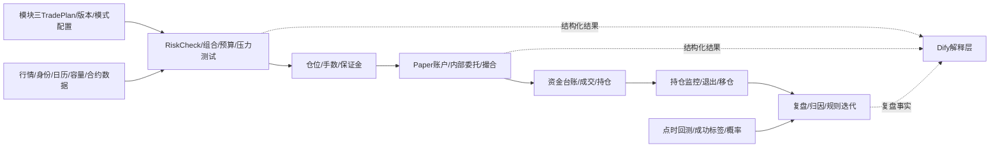
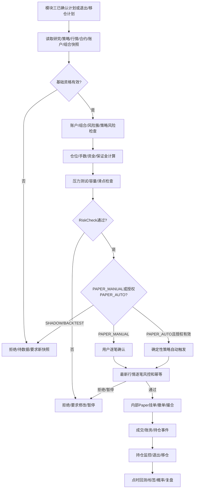

# QuantPF 详设 4：风险、交易与验证详细设计方案

| 项目 | 内容 |
|:---|:---|
| 文档名称 | 详设_4_风险、交易与验证详细设计方案 |
| 系统 | QuantPF（Quant Portfolio Framework） |
| 文档版本 | V1.3 |
| 编制日期 | 2026-10-23 |
| 所属分级 | 详设模块四：风险、交易与验证 |
| 上游总纲 | 《量化交易系统完整设计方案说明书_V4.md》 |
| 上游整体流程 | 《详设_0_整体流程文档.md》 |
| 上游数据基础 | 《详设_1_数据与标的基础详细设计方案.md》 |
| 上游研究模块 | 《详设_2_研究与候选发现详细设计方案.md》 |
| 上游策略模块 | 《详设_3_策略与交易决策详细设计方案.md》 |
| 上游技术分册 | 《总体业务架构及记录落地功能进度.md》 |
| 主要代码模块 | `quantpf-domain`、`quantpf-risk`、`quantpf-execution`、`quantpf-finance`、`quantpf-backtest`、`quantpf-marketdata`、`quantpf-job`、`ruoyi-admin` |
| 一期范围 | 组合风险、风险预算、仓位/保证金、压力测试、平台内部模拟实盘、Paper/Shadow、账户/资金/订单/成交/持仓、期货移仓、回测/概率验证和复盘 |
| 二期预留 | A股/港股/美股/期货/外汇量价主导机会发现、因子增强、多资产执行适配、时机优化验证和高级订单流验证 |

> 本文档定义模块四的整体业务流程、风险和执行边界、Paper_MANUAL/Paper_AUTO双模式、SHADOW/BACKTEST隔离、状态机、领域对象、接口事件、代码仓映射和验收门禁。本文是详设 4A、4B、4C、4D及后续产品设计文档的上级基线，不替代子详设；不展开最终页面布局、Java类级实现或最终DDL。

---

## 目录

1. 文档目的与使用方式
2. 设计依据与需求追踪
3. 模块定位、目标和范围
4. 核心术语与运行模式
5. 与模块一、二、三的职责边界
6. 总体架构和对象主链
7. 端到端风险、交易与验证流程
8. 风险检查和硬门禁
9. 组合选择、风险簇与风险预算
10. 仓位、手数、资金与保证金
11. 压力测试和熔断
12. 一期平台内部模拟实盘
13. 订单、撮合、成交、账务和持仓
14. 期货合约、开平和移仓
15. 持仓监控、退出和重大风险事件
16. 回测、成功标签与概率验证
17. 复盘、归因和规则迭代
18. Dify与Spring Boot功能边界
19. 状态机、版本和一致性
20. 领域对象与逻辑数据模型
21. API、事件和任务调度
22. 异常、幂等、审计、安全和降级
23. 代码仓映射与施工顺序
24. 产品设计文档承接要求
25. 测试策略与验收门禁
26. 子详设拆分、依赖和待确认事项
27. 文档结论

---

## 1. 文档目的与使用方式

### 1.1 文档目的

将总纲和详设0中的风险、交易和验证目标转化为可指导产品设计、接口契约、代码施工和测试的整体方案：

```text
模块三输出已确认交易计划
→ 模块四读取数据、标的、合约、账户和组合快照
→ 执行确定性风险、资金、保证金和压力检查
→ 计算允许的计划数量/手数和风险边界
→ 按PAPER_MANUAL或授权PAPER_AUTO进入平台内部模拟执行
→ 完成挂单/撤单、开仓/建仓、平仓、成交、账务和持仓
→ 管理持仓退出、风险事件和期货移仓
→ 使用点时数据做回测、成功标签、概率验证和校准
→ 对已交易、未交易和失败机会复盘并提出版本化规则改进
```

### 1.2 本文档读者

| 读者 | 用途 |
|:---|:---|
| 产品设计人员 | 设计风险、账户、Paper、持仓、回测和复盘操作流程 |
| 后端设计/开发人员 | 设计领域对象、事务、API、事件、任务和持久化 |
| 测试人员 | 建立风险阻断、订单撮合、点时回放和复盘验收用例 |
| Dify流程设计人员 | 设计风险解释、执行摘要和复盘说明的受控输入输出 |
| 项目维护人员 | 追踪一期模拟交易边界、代码落地状态和二期真实接入前置条件 |

### 1.3 子详设拆分

```text
详设 4A：组合风险与仓位管理
详设 4B：Paper执行与持仓管理
详设 4C：回测与概率验证
详设 4D：复盘与规则迭代
```

---

## 2. 设计依据与需求追踪

### 2.1 上游依据

1. 总纲第13章：组合选择、风险预算、风险簇、容量和再平衡；
2. 总纲第16至18章：风控、交易执行、模拟撮合、状态机、硬否决和幂等；
3. 总纲第19、21、22章：股票、期货、现货和移仓差异；
4. 总纲第23章：研究到交易、订单动作和三条业务流分离；
5. 总纲第24、25章：成功标准、验证、Spring Boot确定性主系统和Dify边界；
6. 详设0：Paper/Shadow流程、风险事件、移仓、回测、概率验证、复盘和阶段门禁；
7. 详设1：行情、身份、合约事件、容量、用途资格、点时数据和市场状态；
8. 详设2：研究卡、证据、方向、预测、候选和研究失效状态；
9. 详设3：交易计划、人工审核、RiskCheck交接和PAPER_MANUAL/PAPER_AUTO模式；
10. 技术分册：现有Paper账户/订单/成交/账务/持仓/风险/跟盘/审计能力和未施工模块。

### 2.2 需求追踪摘要

| 上游要求 | 本详设章节 |
|:---|:---|
| 风险硬闸门和熔断 | 第8、11、15章 |
| 组合选择、风险簇和预算 | 第9章 |
| 仓位、保证金和压力测试 | 第10、11章 |
| Paper/Shadow模拟交易 | 第12、13章 |
| 期货开平、到期和移仓 | 第14章 |
| 持仓退出和重大风险事件 | 第15章 |
| 点时回测、成功标签和概率 | 第16章 |
| 复盘和规则迭代 | 第17章 |
| Dify/Spring Boot边界 | 第18章 |
| 一期平台内部模拟实盘 | 第4、7、12、25章 |

### 2.3 规则冲突处理

模块四的风险、账户、订单、成交和持仓状态必须有唯一权威维护方。发生冲突时：

```text
保留原状态和审计
→ 标记对账/复核状态
→ 禁止猜测性修复
→ 通过事务、补偿或人工对账恢复
→ 同步契约、测试和进度台账
```

不得让Dify、前端或策略模块直接修改资金、订单、成交或持仓主记录。

---

## 3. 模块定位、目标和范围

### 3.1 模块定位

模块四是从“已确认交易计划”到“可控模拟执行和验证反馈”的确定性主控模块。它既负责阻断不可接受风险，也负责在一期平台内部使用模拟资金完成策略驱动的模拟实盘闭环。

### 3.2 一期目标

```text
风险可计算、可解释、可阻断
组合风险和风险预算有明确层级
仓位、手数、资金和保证金可复核
平台内部模拟资金、挂单、撤单、撮合、成交和持仓闭环
支持手动Paper和用户预授权的自动Paper
支持股票建仓/开仓、平仓和期货移仓
Shadow、Backtest与Paper账户严格隔离
回测无前视、概率有样本和校准信息
复盘能区分研究、策略、时机、风险、执行和组合错误
```

### 3.3 一期范围

```text
组合风险簇、相关性和风险预算
账户、资金、保证金、仓位和压力测试
Paper_MANUAL：逐笔人工确认的模拟交易
Paper_AUTO：用户预授权、逐笔风险检查的策略驱动模拟交易
挂单/撤单、部分成交/全部成交、开仓/建仓、平仓
Paper资金台账、持仓、退出、止损/止盈和监控
期货具体合约开平、到期检查和移仓
SHADOW行情跟踪和BACKTEST历史回放
成功标签、回测、概率、校准、漂移和复盘
```

### 3.4 一期不包含

```text
交易所、券商或期货公司真实委托/成交/结算
QMT/CTP真实submit/cancel和真实账户同步
真实资金、真实持仓和真实账户自动平仓
Dify创建/取消订单或修改风险、账务、持仓
未经验证的概率直接决定仓位
完整订单流自动择时
将PAPER_AUTO误认为真实自动实盘
```

---

## 4. 核心术语与运行模式

| 模式 | 含义 | 是否改变模拟账户 | 是否接真实交易通道 |
|:---|:---|:---:|:---:|
| `PAPER_MANUAL` | 用户逐笔确认后，使用模拟资金进入内部Paper撮合 | 是 | 否 |
| `PAPER_AUTO` | 用户预授权账户/策略/品种/动作/时段/限额，确定性策略触发内部模拟委托 | 是 | 否 |
| `SHADOW` | 跟踪行情和策略结果，不创建模拟订单或资金副作用 | 否 | 否 |
| `BACKTEST` | 使用冻结历史点时数据回放 | 不访问实时Paper账户 | 否 |
| `READ_ONLY` | 只读查询和监控 | 否 | 否 |

### 4.1 一期模拟实盘定义

```text
一期模拟实盘 = 平台内部模拟资金 + 最新/盘中行情 + 确定性策略/计划 + 逐笔风险检查 + 内部挂单/撮合 + 模拟账务/持仓
```

它不等于：

```text
真实证券实盘
真实期货实盘
交易所撮合
券商/期货公司委托
真实资金结算
```

### 4.2 手动和自动模式

`PAPER_MANUAL`：

```text
交易计划/退出计划
→ 用户确认
→ 最新行情和风险检查
→ 内部Paper订单
→ 撮合/成交/账务/持仓
```

`PAPER_AUTO`：

```text
用户预授权自动模式
→ 确定性策略信号
→ 生成不可变Paper请求
→ 最新行情和逐笔风险检查
→ 内部Paper订单
→ 撮合/成交/账务/持仓
```

自动模式启用、授权变更、策略版本变更、限额变更、熔断后恢复和重大异常解除，必须人工确认。自动模式不要求每笔新开仓人工点击，但每笔动作不得绕过模块四检查。

---

## 5. 与模块一、二、三的职责边界

| 能力 | 模块一 | 模块二 | 模块三 | 模块四 |
|:---|:---|:---|:---|:---|
| 数据、身份、交易日历和行情资格 | 权威 | 读取 | 读取 | 读取 |
| 研究事实、方向和候选 | 提供数据 | 权威 | 读取 | 读取 |
| 策略、观察和交易计划草稿 | 提供特征 | 提供候选 | 权威 | 接收计划 |
| 最终风险、组合和风险预算 | 提供容量/合约数据 | 提供研究引用 | 提供计划 | 权威 |
| 账户、资金、订单、成交、持仓 | 不负责 | 不负责 | 不负责 | 权威 |
| Paper_MANUAL/Paper_AUTO执行 | 提供行情 | 不负责 | 提交计划/模式配置 | 权威执行 |
| 回测、概率和复盘事实 | 提供点时数据 | 提供研究版本 | 提供策略版本 | 权威计算 |

### 5.1 Dify边界

Dify可以：

```text
解释风险拒绝原因
解释风险簇和压力测试
生成Paper交易摘要
解释持仓、移仓和退出结果
生成回测和复盘文字草稿
```

Dify不得：

```text
修改RiskCheckResult
修改账户、资金、订单、成交、持仓或账务
启用PAPER_AUTO
修改PAPER_AUTO授权范围或限额
创建、取消或修改Paper订单
执行平仓、移仓或Kill Switch
修改回测、概率和复盘事实
```

---

## 6. 总体架构和对象主链



主链：

```text
TradePlan
→ RiskCheckRequest
→ RiskCheckResult
→ PositionSizing/StressTest
→ PaperOrder
→ PaperExecution
→ CashLedger/Position
→ PositionMonitoring/Rollover
→ Validation/Review
```

---

## 7. 端到端风险、交易与验证流程



---

## 8. 风险检查和硬门禁

### 8.1 风险检查顺序

```text
1. TradePlan版本、模式和人工/自动授权状态
2. ResearchCard、StrategyVersion和触发快照有效性
3. 标的/具体合约身份和交易状态
4. 行情、数据质量、可见时间和用途资格
5. 交易日、交易时段和制度状态
6. Paper账户状态和账户权限
7. Kill Switch和账户熔断
8. 当前持仓、未成交订单和重复计划
9. 单笔、标的、策略和风险簇暴露
10. 账户资金、保证金和资金缓冲
11. 仓位/手数、止损距离和最大不利波动
12. 流动性、容量、滑点和止损可执行性
13. 股票T+1/涨跌停或期货开平/到期/移仓规则
14. 压力测试
15. 幂等和并发版本
```

### 8.2 硬否决

```text
账户非PAPER/Virtual模式
PAPER_AUTO未授权或授权过期
计划未确认（PAPER_MANUAL）
研究卡/策略/行情/合约规则过期
数据不可见、身份不明或容量不可用
Kill Switch或账户熔断
资金/保证金不足
风险簇或账户风险超限
没有可执行止损
股票停牌/ST/涨跌停限制
期货临近交割且没有处理方案
订单方向与开平标志不一致
重复订单/重复移仓步骤
RiskCheck服务不可用
```

### 8.3 RiskCheckResult

```text
APPROVED
REJECTED
REQUIRES_MODIFICATION
REQUIRES_NEW_SNAPSHOT
PENDING_DATA
RISK_SERVICE_UNAVAILABLE
HALTED
```

必须记录：

```text
riskCheckId
tradePlanId/version
mode/PAPER_MANUAL或PAPER_AUTO
授权引用和用户确认引用
inputSnapshotIds
hardGateResults
account/portfolio/cluster/liquidity/margin/stress结果
rejectionReasons/warnings
riskRuleVersion
checkedAt/operator/systemTask
```

---

## 9. 组合风险、风险簇与预算

### 9.1 风险簇

每个计划标记：

```text
行业、产业链、商品因子、宏观因子、政策因子
利率/汇率暴露、方向、共同事件、策略和资产类型
```

同一产业链的股票和商品方向不得简单视为独立机会。

### 9.2 预算层级

```text
账户级
组合级
风险簇级
策略级
标的/合约级
单笔计划级
```

预算指标：

```text
单日/周/月最大损失
最大回撤
最大资金/保证金使用率
净多/净空暴露
单一风险簇上限
最大同时持仓和订单数
单策略风险和连续亏损暂停阈值
```

### 9.3 组合决策

加入计划前比较：

```text
单位风险收益
流动性和成本
相关性和风险簇
保证金和压力损失
与已有计划的重复度
替代表达工具
```

模块四决定是否纳入组合，不能由Dify或模块三策略分直接决定。

---

## 10. 仓位、资金和保证金

### 10.1 股票

```text
perShareRisk = entryPrice - stopPrice
riskBudget = accountEquity × allowedRiskRatio
rawQty = riskBudget / perShareRisk
finalQty = floor(rawQty / lotSize) × lotSize
```

还需校验单票、行业、组合、资金、容量、涨跌停和T+1。

### 10.2 期货

```text
perContractRisk = stopTicks × tickValue
                 + commission
                 + expectedSlippage
                 + overnightGapBuffer
rawContracts = riskBudget / perContractRisk
finalContracts = floor(rawContracts)
```

再检查保证金率、保证金缓冲、合约流动性、持仓拥挤、涨跌停、交割和移仓风险。

### 10.3 仓位边界

模块三可提供入场、止损和单位风险输入；模块四决定最终数量、手数、保证金和组合边际风险。模型置信度、Dify文本和StrategyFitScore不得直接计算仓位。

---

## 11. 压力测试和熔断

### 11.1 场景

股票：

```text
跳空、连续跌停、成交量骤降、停牌、行业同步下跌、系统性风险
```

期货：

```text
隔夜跳空、连续涨跌停、保证金上调、流动性枯竭、逼空、交割、移仓价差扩大
```

### 11.2 结果

```text
PASS
PASS_WITH_LIMIT
REJECT
REQUIRES_REDUCED_SIZE
REQUIRES_HEDGE
REQUIRES_ROLLOVER
```

### 11.3 Kill Switch

Kill Switch开启后：

```text
禁止所有新增Paper订单
禁止PAPER_AUTO继续触发
保留查询、监控、撤单/风险处置入口
产生告警和审计
恢复必须人工授权并重新检查账户、组合和未完成计划
```

---

## 12. 一期平台内部模拟实盘

### 12.1 执行模式

```text
PAPER_MANUAL：计划→用户确认→逐笔RiskCheck→内部挂单/撮合
PAPER_AUTO：授权范围内策略信号→不可变Paper请求→逐笔RiskCheck→内部挂单/撮合
SHADOW：跟踪信号/行情/假设结果，不产生资金、订单、成交或持仓副作用
BACKTEST：冻结历史数据回放，不访问实时账户或Paper状态
```

### 12.2 模拟交易范围

一期平台内部模拟实盘包含：

```text
限价/市价等经产品和执行子详设批准的模拟委托
挂单、撤单、部分成交、全部成交和过期
股票建仓/开仓、平仓、持仓和T+1
期货开仓、平仓、保证金和移仓
止损、止盈、退出和风险事件计划
模拟资金冻结、解冻、结算、台账和盈亏
```

不包含：

```text
真实资金
真实证券/期货账户
真实交易所撮合
真实券商/期货公司委托
真实结算和交割
```

### 12.3 Paper_AUTO授权

自动模式必须绑定：

```text
accountId
strategyId/strategyVersion
允许instrument/品种范围
允许动作（开仓、平仓、撤单、移仓）
运行时段
单笔/累计资金和风险限额
最大委托频率
最大同时订单/持仓
自动止损/止盈/移仓白名单
有效期和暂停条件
```

以下变化必须重新人工确认：

```text
自动模式启用/恢复
授权范围变化
策略版本变化
风险限额变化
Kill Switch恢复
重大风险事件解除
```

### 12.4 内部撮合

内部 `PaperBrokerAdapter` 和模拟撮合服务处理：

```text
委托校验
资金/持仓冻结
挂单状态
行情触发成交
部分/全部成交
撤单和过期
手续费、滑点、涨跌停和T+1
成交事件、账务和持仓更新
```

未来真实 `BrokerAdapter` 不得被Paper模式复用或启用。

---

## 13. 订单、成交、账务和持仓

### 13.1 订单状态

```text
PENDING → SUBMITTED → PARTIAL_FILL → FILLED
                  ↘ CANCELLED / REJECTED / EXPIRED
```

### 13.2 资金和持仓事务

```text
下单：校验可用资金/持仓 → 冻结
成交：写成交 → 扣减冻结 → 更新账户/台账/持仓
撤单：释放未成交冻结 → 更新订单
平仓：校验可用持仓 → 成交 → 计算已实现盈亏
```

所有副作用使用事务、唯一键、幂等键、账户/订单/持仓锁和审计。

### 13.3 持仓监控

检查：

```text
止损/止盈/移动退出
研究假设和反向事件
数据质量和市场状态
组合风险簇、资金和保证金
期货到期、交割和移仓
流动性和无法退出风险
```

---

## 14. 期货开平和移仓

### 14.1 具体合约

连续/主力合约只用于分析；模拟交易使用具体合约。必须记录乘数、tick、保证金、交易时段、到期日、交割和移仓规则。

### 14.2 移仓流程

```text
识别移仓窗口
→ 比较旧/新合约流动性、价差和保证金
→ 创建RolloverPlan
→ 平旧合约Paper委托
→ 确认平旧成交
→ 开新合约Paper委托
→ 确认新合约成交
→ 更新持仓关联和成本
```

一腿成功、一腿失败时进入 `NEEDS_RECONCILIATION`，不得假设移仓完成。

---

## 15. 持仓监控和重大风险事件

### 15.1 风险等级

```text
L0：噪声，不改变风险
L1：轻微恶化，暂停加仓
L2：事实确认，重算止损和风险
L3：重大监管/信用/流动性/强平风险，停止新增风险并去风险
L4：账户/市场/执行失控，Kill Switch和人工处置
```

Dify只提供解释草稿；风险动作由Spring Boot规则、用户授权和模块四执行。

---

## 16. 回测、成功标签和概率验证

### 16.1 回测固定输入

```text
点时行情/财报/新闻/供需
标的和合约版本
策略/指标/参数版本
交易日历和制度规则
手续费、滑点、移仓和撮合模型
```

### 16.2 规则

信号在K线N结束产生，N+1才允许成交；使用当时可见数据，建模T+1、涨跌停、跳空、保证金、交割和移仓。

### 16.3 成功标签和概率

标签须提前冻结目标、止损、周期、成本、滑点、超时和市场状态分组。报告：

```text
样本量、胜率、P_target_before_stop、期望收益
最大回撤、最大不利波动、置信区间、样本外结果
基准比较、概率校准和策略漂移
```

样本不足时显示“样本不足，无法验证”。

---

### 16.5 二期量价主导机会的风险与验证

二期量价机会可以直接进入模块四的验证和风险流程，不要求新闻或基本面研究先行，但必须带有完整的量价/因子输入快照、资产规则和验证状态。

覆盖资产：

~~~text
A股、港股、美股：公司行为、交易日历、复权、停牌、涨跌停和币种规则
期货：具体合约、连续合约映射、换月、交割、保证金、持仓量和夜盘归属
外汇/海外经纪商品：Bid/Ask、点差、杠杆、交易商时段、休市和币种转换
~~~

风险和回测不得把“量价发现机会”直接等同于“可以下单”。至少要分别记录：

~~~text
PriceVolumeOpportunity：量价机会候选
FactorValidation：因子过滤和历史验证结果
StrategyEvaluation：策略适配结果
RiskCheckResult：账户/组合/资产规则风险结果
PaperExecutionResult：模拟执行结果
~~~

新闻、基本面、供需和大模型解释属于可选增强；缺失时应标记未知风险，不得用大模型文本补齐缺失的价格、成交量、持仓量、因子或风险事实。二期验证必须支持跨资产分组、市场状态分组、成本/滑点、样本外、滚动窗口和基准/消融实验。


### 16.6 二期机会来源与验证隔离

风险和验证对象必须区分机会来源：

~~~text
PRICE_VOLUME：量价/价格行为主导发现
FACTOR_ENHANCED：量价基础上叠加确定性因子
CONTEXT_ENHANCED：叠加新闻/基本面/供需等上下文
MODEL_EXPLAINED：仅有大模型解释，不改变确定性事实
~~~

MODEL_EXPLAINED不能单独通过RiskCheck。验证报告必须能比较：量价基线、量价+因子、量价+上下文、完整流程，并按A股、港股、美股、期货、外汇/海外经纪商品和市场状态分组。


## 17. 复盘和规则迭代

复盘覆盖：

```text
已成交交易
已确认未成交计划
达到条件但未交易对象
观察未触发对象
被淘汰但之后明显变化对象
```

归因区分：

```text
数据、研究、传导、量价、策略、时机、风险、仓位、执行、组合、偶然结果
```

Dify可生成文字草稿，不能修改成交、账务、持仓、绩效、概率和历史事实。规则改进必须新建版本并重新回测、样本外和Paper验证。

---

## 18. Dify与Spring Boot功能边界

| 能力 | Spring Boot | Dify |
|:---|:---|:---|
| 风险、组合、仓位、保证金和压力 | 权威计算 | 解释 |
| Paper模式、授权、订单、成交、账务、持仓 | 权威负责 | 禁止调用 |
| 回测、标签、概率和校准 | 权威负责 | 解释 |
| 复盘和规则版本 | 权威记录 | 文字草稿 |
| 自动Paper启用和授权 | 权限/审计/服务负责 | 禁止 |
| 自然语言问答 | 提供结构化结果 | 组织答案 |

---

## 19. 状态机和版本

### 19.1 Paper运行模式状态

```text
MANUAL_DISABLED / MANUAL_ENABLED
AUTO_DISABLED → AUTO_AUTHORIZED → AUTO_RUNNING
AUTO_PAUSED → AUTO_SUSPENDED → AUTO_REVIEW_REQUIRED
SHADOW_RUNNING
BACKTEST_RUNNING
```

`AUTO_RUNNING` 进入 `AUTO_PAUSED` 的条件包括Kill Switch、风险超限、行情过期、策略版本停用、授权过期、连续异常和重大风险事件。

### 19.2 交易和验证状态分离

```text
RiskCheckStatus
PaperOrderStatus
PaperExecutionStatus
CashLedgerStatus
PositionStatus
RolloverStatus
BacktestStatus
ProbabilityStatus
ReviewStatus
```

不能用一个“已交易”状态覆盖风险批准、订单创建、成交、持仓和复盘。

---

## 20. 领域对象与逻辑数据模型

### 20.1 核心对象

```text
RiskPolicy / RiskPolicyVersion
RiskCheckRequest / RiskCheckResult
PortfolioRisk / ClusterExposure / RiskBudget
PositionSizing / StressTest / KillSwitch
PaperAccount / PaperAuthorization
PaperOrder / PaperExecution
CashLedger / MarginLedger / Position
RolloverPlan / RolloverStep
BacktestRun / ValidationSample / ProbabilityResult
CalibrationResult / StrategyDriftResult
TradeReview / RuleChangeProposal
```

### 20.2 PaperAuthorization

专门保存：

```text
authorizationId
accountId
mode（PAPER_MANUAL/PAPER_AUTO）
strategyRefs/version范围
instrument/product范围
allowedActions
sessionWindow
risk/cash/margin/orderRateLimits
stopConditions
approvedBy/approvedAt/expiresAt
status/revokedAt/revokeReason
```

### 20.3 权威归属

```text
RiskCheck/PortfolioRisk：模块四风险域
PaperAccount/Order/Execution/Ledger/Position：模块四执行域
PaperAuthorization：模块四权限/风险域
Backtest/Probability/Review：模块四验证域
```

---

## 21. API、事件和任务调度

### 21.1 API分组

```text
/api/quant/risk/*
/api/quant/portfolio/*
/api/quant/paper/accounts/*
/api/quant/paper/authorizations/*
/api/quant/paper/orders/*
/api/quant/paper/executions/*
/api/quant/paper/positions/*
/api/quant/paper/ledger/*
/api/quant/paper/rollovers/*
/api/quant/backtest/*
/api/quant/validation/*
/api/quant/reviews/*
```

### 21.2 关键命令

```text
启用/暂停/恢复PAPER_AUTO
创建/撤销Paper授权
风险检查
Paper挂单/撤单
开仓/平仓/移仓
Kill Switch/恢复
启动回测/验证/复盘
```

所有写操作要求权限、`requestId`、`idempotencyKey`、`expectedVersion`和理由。

### 21.3 事件

```text
RiskCheckRequested/Approved/RejectedEvent
PaperAuthorizationChangedEvent
PaperAutoPausedEvent
PaperOrderCreated/Cancelled/RejectedEvent
PaperExecutionCreatedEvent
CashLedgerUpdatedEvent
PositionChangedEvent
RolloverPlanCreated/Completed/NeedsReconciliationEvent
BacktestCompletedEvent
ProbabilityCalibratedEvent
TradeReviewConfirmedEvent
RuleChangeApprovedEvent
```

### 21.4 调度

```text
风险扫描、组合暴露更新、Paper行情/订单/持仓一致性检查
PAPER_AUTO策略信号检查和逐笔RiskCheck
持仓止损/止盈/退出检查
期货到期和移仓提醒
日终结算和T+1释放
回测、标签、概率、漂移和复盘任务
```

真实持仓同步任务一期禁用；只允许本地Paper状态一致性检查。

---

## 22. 异常、幂等、审计、安全和降级

### 22.1 异常

```text
行情过期/快照缺失 → 阻断新Paper动作
资金/保证金不足 → 拒绝
风险超限 → 拒绝或减小计划
PAPER_AUTO授权过期 → 自动暂停
策略版本停用 → 自动暂停并要求复核
Kill Switch → 禁止新增Paper订单
撮合失败 → 保存未成交和原因
移仓单腿失败 → NEEDS_RECONCILIATION
回测点时缺失 → 运行无效
样本不足 → 不发布概率
```

### 22.2 幂等和事务

订单、成交、资金流水、持仓、移仓步骤、自动授权、RiskCheck、回测和复盘均须幂等；账户、订单、资金、持仓和授权写入需事务、唯一键、锁、版本和审计。

### 22.3 安全

```text
PAPER账户与真实账户隔离
PAPER_AUTO授权与普通查询权限分离
Kill Switch独立授权
Dify无交易凭据
真实BrokerAdapter一期禁用
所有订单/成交/资金/持仓/授权/风险写操作审计
```

---

## 23. 代码仓映射和施工顺序

| 模块 | 职责 |
|:---|:---|
| `quantpf-risk` | 风险政策、组合、预算、保证金、压力、熔断、RiskCheck和Paper授权 |
| `quantpf-execution` | Paper账户、内部Paper适配器、挂单/撤单、撮合、成交、账务、持仓和移仓 |
| `quantpf-finance` | 资金台账、结算和账务 |
| `quantpf-backtest` | 点时回放、bar+1、成本、标签、概率、校准和漂移 |
| `quantpf-job` | Paper自动触发检查、持仓监控、结算、移仓和验证任务 |
| `quantpf-marketdata` | 实时/历史行情和合约状态；不得接入真实交易委托 |
| `quantpf-strategy` | 产生确定性策略信号和计划请求，不直接写订单 |
| `ruoyi-admin` | Paper模式、授权、风险、账户、订单、回测和复盘API |

施工顺序：

```text
盘点并复用现有Paper核心事务
→ 冻结RiskCheck/PaperAuthorization/订单事件契约
→ 接入模块三TradePlan
→ 实现PAPER_MANUAL完整闭环
→ 实现行情驱动的内部模拟挂单/撮合
→ 实现PAPER_AUTO授权、策略触发和逐笔RiskCheck
→ 实现持仓监控、退出和期货移仓
→ 实现回测/概率/复盘闭环
```

真实交易接入不在上述施工顺序内，须二期独立立项。

---

## 24. 产品设计文档承接要求

至少设计：

```text
风险驾驶舱和组合暴露
RiskCheck详情和拒绝原因
账户/资金/保证金/风险预算
PAPER_MANUAL/PAPER_AUTO模式切换和授权
挂单、撤单、开仓、平仓、成交和持仓
期货移仓和异常对账
SHADOW和BACKTEST隔离
回测、概率和校准
交易/未交易候选复盘
Kill Switch和自动模式暂停/恢复
```

用户必须能看出当前模式、资金类型、是否连接真实交易通道、为何订单被拒、自动模式授权到期时间和每笔模拟成交依据。

---


### 24.1 面向普通用户的风险与Paper体验

模块四必须把专业计算转换成普通用户可理解的行动信息。普通用户不手算数量、保证金、风险预算、止损或组合暴露。

普通用户默认看到：

~~~text
风险等级：低/中/高
预计占用模拟资金
预计最大风险或损失范围
主要风险原因
执行后持仓/资金变化
系统建议：可以模拟/建议降低数量/暂不执行
~~~

系统内部仍然保存并计算保证金、风险簇、压力测试、滑点、费用、集中度、规则版本和输入快照；专业详情向审核/风险用户展开。

PAPER_MANUAL简化流程：

~~~text
打开系统生成的交易计划 → 查看结论/风险摘要 → 点击模拟执行 → 二次确认
~~~

高级数量、价格、订单类型或退出参数修改默认折叠。任何修改都必须重新执行RiskCheck、生成新计划版本并记录审计。普通用户不因界面简化而绕过二次确认、风险门禁或Paper与真实交易隔离提示。

### 24.2 模块四输入责任矩阵

| 内容 | 系统自动生成/计算 | 普通用户 | 审核/风险用户 |
|:---|:---|:---|:---|
| 数量、资金、保证金、风险金额 | 必须 | 不手算 | 查看/审核 |
| 止损、退出、有效期 | 根据策略/规则预填 | 确认 | 审核/按权限修改 |
| Paper模式和账户 | 按用户默认值预填 | 选择或确认 | 审核授权范围 |
| PAPER_AUTO授权/恢复 | 校验并生成申请 | 申请/查看 | 风险管理员或策略审核用户审批 |
| 撮合、成交、账务、持仓 | 系统执行 | 查看 | 对账/异常处理 |

### 24.3 风险体验验收

~~~text
普通用户可以不填写专业风险参数完成Paper确认；
风险拒绝用普通语言说明原因、影响和下一步；
系统建议数量和最大风险可追溯到策略/风险版本；
任何用户修改关键参数都会重新RiskCheck；
PAPER_AUTO的审批、暂停和恢复不因简化流程而放宽。
~~~

## 25. 测试策略与验收门禁

### 25.1 单元测试

```text
风险硬门禁、风险预算、仓位、保证金和压力测试
PaperAuthorization权限/范围/有效期
PAPER_MANUAL/PAPER_AUTO模式状态
订单状态机、撮合、撤单、部分成交
资金冻结/解冻/结算和持仓均价/盈亏
开平校验、T+1、涨跌停、移仓Saga
Kill Switch和自动模式暂停/恢复
点时回测、bar+1、成功标签、概率和校准
复盘归因、幂等、锁和事务
```

### 25.2 集成测试

```text
TradePlan → RiskCheck → PAPER_MANUAL → PaperOrder → Execution → Ledger → Position
TradePlan → PaperAuthorization → PAPER_AUTO信号 → 逐笔RiskCheck → PaperOrder
PAPER_AUTO风险超限 → 拒绝/暂停/告警
期货开仓 → 持仓 → 移仓 → 两腿成交/异常对账
Paper → 回测/验证 → 复盘/规则建议
```

### 25.3 禁止通过项

```text
PAPER_AUTO未授权仍能下单
自动模式绕过逐笔RiskCheck
Paper请求调用真实Broker/交易所接口
Paper成交重复入账
账户/资金/持仓不一致
移仓单腿失败却标记完成
Shadow产生Paper资金或持仓副作用
Backtest读取实时Paper账户状态
样本不足却发布精确概率
```

### 25.4 验收标准

1. 一期能够在平台内部使用模拟资金完成挂单、撤单、建仓/开仓、平仓、持仓和移仓；
2. `PAPER_MANUAL` 和授权 `PAPER_AUTO` 均能通过统一风险闸门执行；
3. 任何Paper订单都不会进入交易所、券商或期货公司通道；
4. Paper订单、成交、资金、持仓和审计可回放且幂等；
5. 自动模式授权、暂停、恢复和变更可审计；
6. 风险、熔断、资金、保证金和压力测试能阻止新增风险；
7. 股票和期货开平/移仓规则得到验证；
8. Shadow、Backtest和Paper账户严格隔离；
9. 回测无前视，概率有样本、区间、校准和样本外结果；
10. Dify不能改变风险、订单、成交、账务或持仓事实；
11. 一期没有真实交易、QMT/CTP submit/cancel或真实账户同步路径。

---

## 26. 子详设拆分和待确认事项

### 26.1 详设4A：组合风险与仓位管理

```text
风险政策/版本、风险簇、预算、相关性、仓位、保证金、压力、熔断和RiskCheck
```

### 26.2 详设4B：Paper执行与持仓管理

```text
PAPER_MANUAL/PAPER_AUTO授权、账户、资金、挂单、撤单、撮合、成交、账务、持仓、退出、开平、移仓和一致性对账
```

### 26.3 详设4C：回测与概率验证

```text
点时数据、bar+1、成本、滑点、标签、样本外、概率、校准、消融和漂移
```

### 26.4 详设4D：复盘与规则迭代

```text
交易/未交易候选复盘、归因、规则变更、人工批准、新版本回测和Paper验证
```

### 26.5 待确认配置

```text
首批股票/港股/美股/期货/外汇品种和模拟账户范围
一期Paper使用日线；二期量价主导机会验证再确定分钟线/Tick/盘口数据及其资产覆盖
限价/市价/改单/撤单的模拟规则
手续费、滑点、涨跌停、T+1和期货结算参数
单笔、账户、组合、风险簇和自动模式限额
PAPER_AUTO允许的默认动作和恢复审批人
期货平今/平昨、交割和移仓规则
回测最小样本、样本外比例和概率校准门槛
```

这些配置不改变一期功能范围；在子详设和代码施工前固化为版本化配置。

---

## 27. 文档结论

模块四一期完整职责链：

```text
模块三TradePlan
→ RiskCheck/组合/预算/压力/仓位
→ PAPER_MANUAL或授权PAPER_AUTO
→ 平台内部挂单/撤单/模拟撮合
→ 模拟成交/账务/持仓
→ 平仓/退出/期货移仓
→ 回测/成功标签/概率/校准
→ 交易和未交易候选复盘
→ 规则新版本
```

最终边界：

```text
Spring Boot：风险、授权、账户、订单、成交、资金、持仓、回测、概率、复盘和审计事实
Dify：风险/执行/验证结果解释和复盘文字草稿
PAPER_MANUAL：逐笔人工确认的内部模拟交易
PAPER_AUTO：用户预授权、确定性策略触发、逐笔风险校验的内部模拟交易
SHADOW：只跟踪，不产生账户副作用
BACKTEST：只回放历史，不访问实时Paper账户
真实交易：一期禁止，二期另行合规、安全和接入立项
```

一期的成功标准是：用户可以在自己的平台内使用模拟资金，根据策略完成可审计、可回放的模拟挂单、开仓、平仓、持仓和移仓；所有模拟交易不接入交易所、不使用真实资金，并能通过回测、概率验证和复盘持续改进规则。
