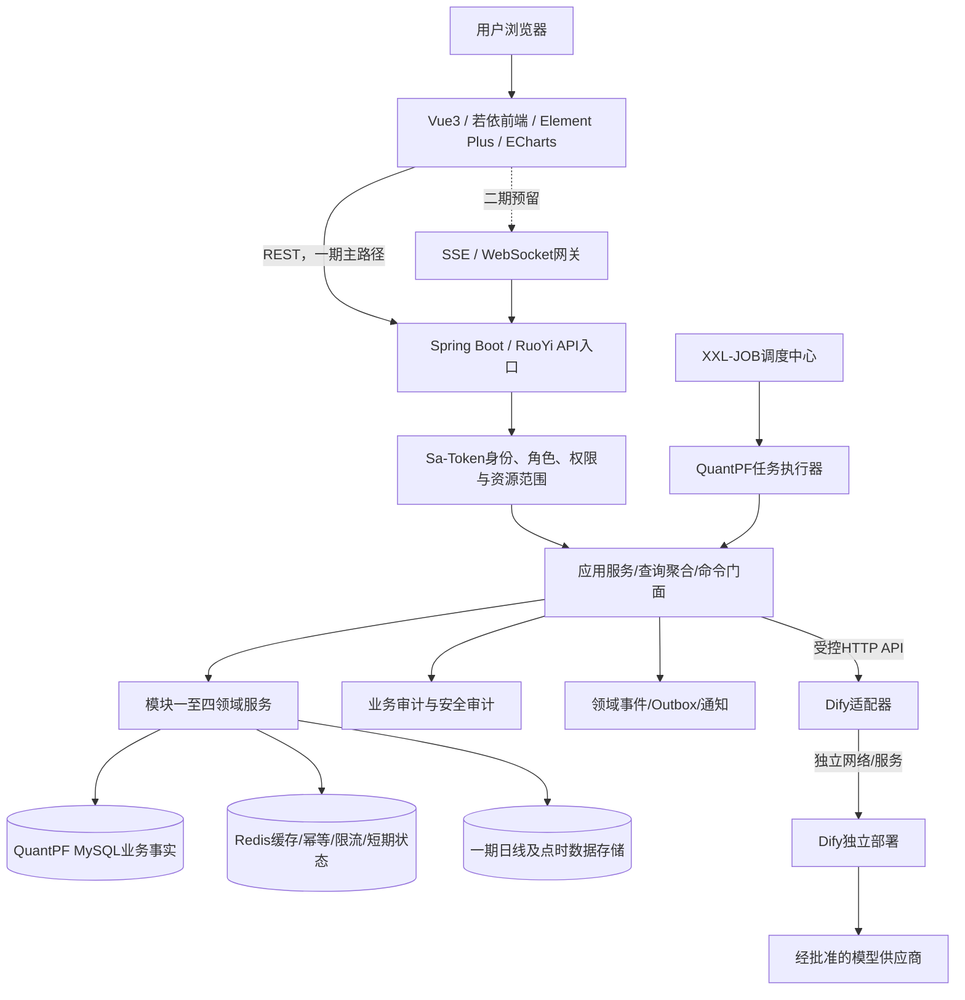
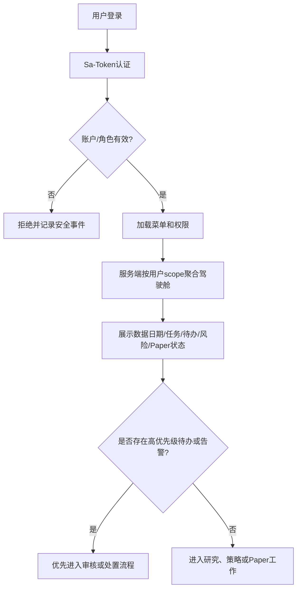
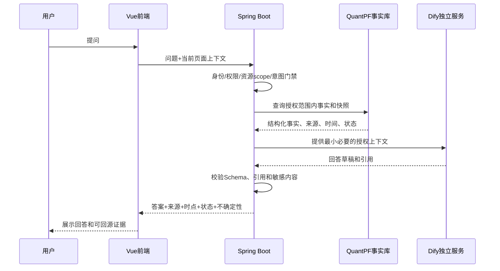
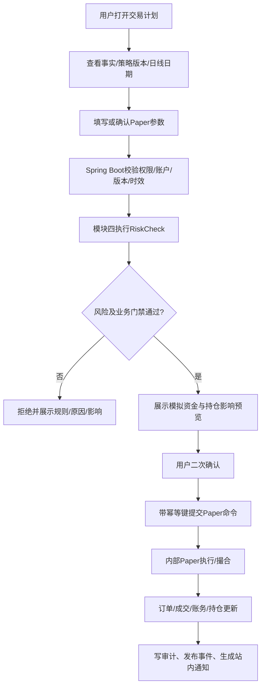
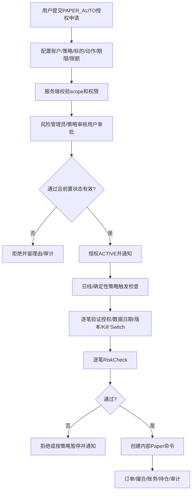
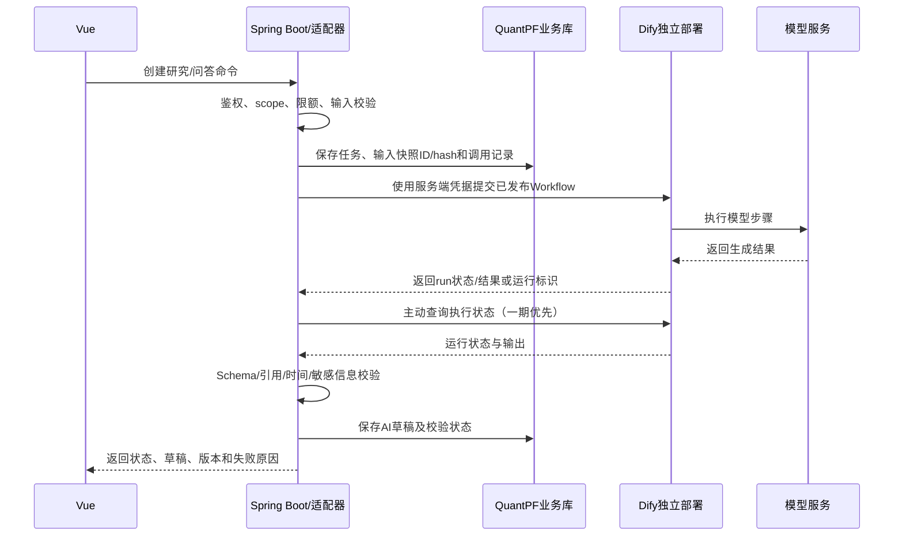
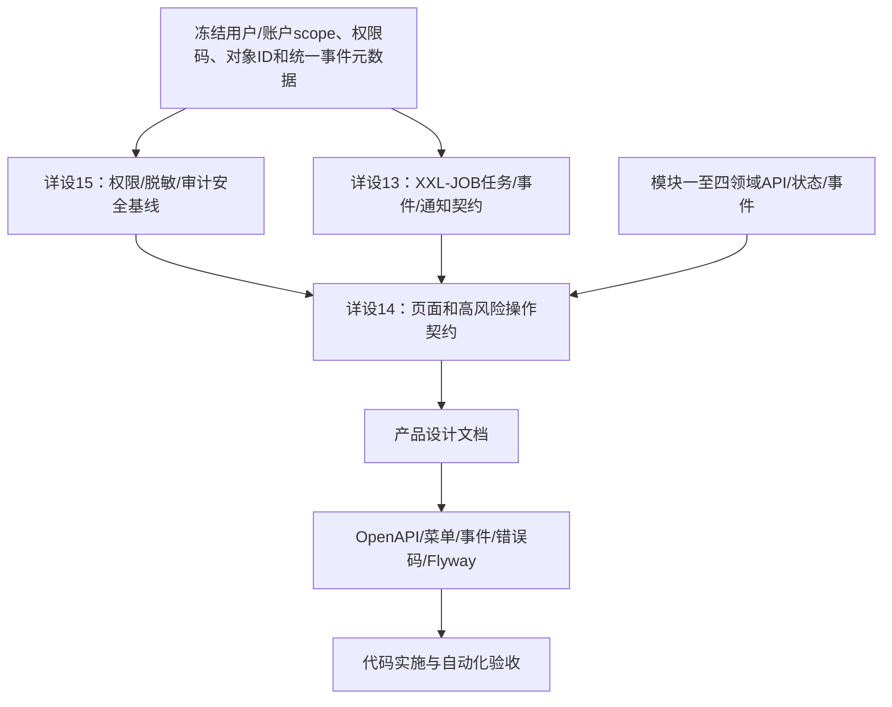

# QuantPF 详设 5：用户界面与系统支撑详细设计方案

| 项目 | 内容 |
|:---|:---|
| 文档名称 | 详设_5_用户界面与系统支撑详细设计方案 |
| 系统 | QuantPF（Quant Portfolio Framework） |
| 文档版本 | V1.3 |
| 编制日期 | 2026-10-23 |
| 所属分级 | 详设模块五：用户界面与系统支撑 |
| 上游总纲 | 《量化交易系统完整设计方案说明书_V4.md》 |
| 上游整体流程 | 《详设_0_整体流程文档.md》 |
| 上游业务详设 | 《详设_1_数据与标的基础详细设计方案.md》、《详设_2_研究与候选发现详细设计方案.md》、《详设_3_策略与交易决策详细设计方案.md》、《详设_4_风险、交易与验证详细设计方案.md》 |
| 上游技术分册 | 《总体业务架构及记录落地功能进度.md》 |
| 主要代码模块 | `plus-ui`、`ruoyi-admin`、`quantpf-domain`、`quantpf-job`、`quantpf-research`、`quantpf-marketdata`、`quantpf-strategy`、`quantpf-risk`、`quantpf-execution`、`quantpf-finance`、`quantpf-backtest` |
| 一期范围 | Vue用户入口、驾驶舱、研究/数据/策略/Paper/验证页面、站内通知、XXL-JOB任务支撑、事件、监控、审计、权限、Dify独立部署适配及敏感信息保护 |
| 一期行情交互边界 | 一期业务只使用日线；不实现分钟线、Tick和盘中日内交易界面/调度。Paper、策略和界面均遵守详设3、4定义的日线和模拟撮合边界 |
| 二期预留 | 分钟线、Tick、盘中交易与推送体验、微信公众号/WxPusher消息通道、SSE/WebSocket实时推送、量价时机优化界面 |

> 本文档定义模块五的总体业务流程、页面信息架构、用户操作与状态映射、调度和事件支撑、Dify协作入口、权限审计监控、安全降级、代码仓映射和验收门禁。本文是详设13、14、15及后续产品设计文档的上级基线；不替代对应子详设，不规定最终UI像素、最终数据库DDL或Java类级实现。用户已经确认的方案以本文为准；任何下级文档或代码契约不得让前端、Dify或调度器绕过Spring Boot业务状态、权限、审核和风险门禁。

---

## 目录

1. 文档目的与使用方式
2. 设计依据与决策记录
3. 模块定位、目标和原则
4. 一期/二期范围
5. 与模块一至四的职责边界
6. 总体架构与运行边界
7. 用户、角色、权限和账户范围
8. 信息架构与导航
9. 端到端用户流程
10. 驾驶舱与待办中心
11. 跨模块页面和用户操作设计
12. Paper与风险操作界面
13. 通知中心
14. 任务调度与领域事件
15. Dify独立部署与Spring Boot适配
16. 敏感信息、加密、脱敏和密钥治理
17. 操作审计、导出、留存和备份
18. 系统监控、业务监控和告警
19. 领域对象、API、事件和状态
20. 异常、幂等、降级与安全处置
21. 代码仓职责和现有能力复用
22. 分阶段实施顺序
23. 产品设计文档承接要求
24. 测试策略与验收门禁
25. 子详设拆分、依赖与文档同步项
26. 结论
27. 流程图索引

---

## 1. 文档目的与使用方式

### 1.1 文档目的

把总纲中的“用户界面与系统支撑”转化为可继续编制产品设计、API/事件契约、权限矩阵、测试方案和代码施工任务的总体方案，使用户能够在统一入口中完成研究、审核、观察、模拟交易、风险查看、复盘和运行维护，同时保证每个操作都映射到可审计的业务状态。

模块五的用户闭环为：

```text
登录并确认当前用户/账户范围
→ 查看驾驶舱、数据健康、待办与告警
→ 进入数据、研究、候选、观察、策略或Paper页面
→ 查看来源、快照、版本、状态和影响
→ 通过Spring Boot提交查询或业务命令
→ 服务端执行身份、权限、资源范围、状态、幂等和风险校验
→ 保存业务状态与审计记录
→ 通过领域事件更新任务、通知和驾驶舱
→ 用户查看结果、处理异常或进入复盘
```

### 1.2 读者与用途

| 读者 | 用途 |
|:---|:---|
| 产品设计人员 | 将页面目标、用户任务、状态、确认点、异常反馈转化为原型和产品设计文档 |
| 前端开发人员 | 按已确认的Vue/Element Plus/ECharts技术栈实现路由、页面、状态展示和操作入口 |
| 后端开发人员 | 设计REST API、应用服务、权限、聚合查询、任务、事件、审计和Dify适配 |
| Dify流程设计人员 | 设计版本化Workflow、输入输出Schema、超时/限额及研究辅助流程 |
| 测试人员 | 覆盖角色越权、状态门禁、Paper、任务重试、Dify失败、脱敏、审计和降级场景 |
| 运维/安全人员 | 部署与维护独立Dify、XXL-JOB、密钥、监控、备份和审计留存 |

### 1.3 文档层级

```text
总纲：业务目标、边界、原则和模块地图
→ 详设0：端到端流程、状态和系统级约束
→ 详设5：用户交互与系统支撑总体架构
→ 详设13/14/15：调度事件、页面交互、监控审计安全子详设
→ 产品设计文档：具体页面、表单、交互状态、API/Workflow和验收
→ 代码仓：正式契约、迁移、实现、测试和进度台账
```

---

## 2. 设计依据与决策记录

### 2.1 上游依据

1. 总纲模块五概要及文档分级索引：驾驶舱、研究与候选、数据健康、Paper与风险、调度事件、监控审计权限、Dify/Spring Boot协作入口；
2. 详设0：Spring Boot为业务事实源和状态主控、Dify为研究辅助与语言交互、Vue为用户入口；一期Paper与真实交易隔离；写操作须幂等和审计；
3. 详设1：数据来源、授权、质量、点时和标的身份信息的展示与人工处理边界；
4. 详设2：研究任务、Dify草稿、事实核验、研究链、候选、研究卡和问答入口；
5. 详设3：策略版本、观察池、等待、预警、交易计划和模块四交接；
6. 详设4：RiskCheck、PAPER_MANUAL/PAPER_AUTO、Shadow、回测、资金账务、持仓、熔断和复盘的业务事实边界；
7. 技术分册：RuoYi/Sa-Token、Vue3/Element Plus/ECharts、现有审计与任务执行审计、`quantpf-job`、XXL-JOB目标架构及当前施工状态。

### 2.2 用户已确认的模块五决策

| 编号 | 决策 | 详设落点 |
|:---|:---|:---|
| D5-01 | 模块五总体详设命名为“详设_5_用户界面与系统支撑详细设计方案”；总纲现有详设13/14/15继续作为子详设编号 | 文档层级、总纲索引 |
| D5-02 | 后续代码仓继续使用若依底座的Vue、Element Plus、ECharts | 前端架构、代码映射 |
| D5-03 | 支持多用户；每位用户可拥有多个Paper账户；一期REST查询为主，预留SSE/WebSocket | 用户数据范围、前端通信 |
| D5-04 | 一期先落地站内通知；后续可能接入微信公众号或WxPusher | 通知抽象与渠道边界 |
| D5-05 | 统一使用XXL-JOB作为任务调度框架 | 调度架构；禁止双栈执行 |
| D5-06 | 一期只使用日线；分钟线和Tick进入二期，服务盘中日内交易 | 数据、策略、Paper页面和任务频率 |
| D5-07 | PAPER_AUTO恢复必须由风险管理员或策略审核用户批准 | 权限、审核、审计和状态门禁 |
| D5-08 | 审计记录保留2年、允许导出、数据库每年备份；API密钥、账户标识、用户IP按本方案脱敏/加密 | 安全、审计、导出与备份 |
| D5-09 | Dify暂定独立部署；Workflow、模型、回调签名、限额配置按本方案设计 | 部署和Dify适配 |
| D5-10 | 一期优先使用REST及Spring Boot主动查询Dify执行状态；预留SSE/WebSocket及回调增强 | API与运行状态展示 |

### 2.3 规范性词语

| 词语 | 含义 |
|:---|:---|
| 必须 | 下级设计和实现不得偏离；偏离前须形成经批准的架构决策 |
| 应 | 默认采用；偏离时说明原因和替代控制 |
| 可 | 在权限、流程和安全约束内选择实现 |
| 用户命令 | 会改变业务状态的显式操作，必须服务端校验、幂等和审计 |
| 只读查询 | 不改变业务事实的查询，仍需身份、权限和资源范围过滤 |
| AI草稿 | Dify生成、尚未由Spring Boot校验或人工确认的内容 |
| 敏感操作 | 涉及权限、密钥、风险、Paper运行、策略/规则发布或安全控制的操作 |

---

## 3. 模块定位、目标和原则

### 3.1 模块定位

模块五是QuantPF的“用户控制与系统运行支撑层”，提供：

```text
用户交互入口
跨模块状态和待办聚合
研究/数据/策略/Paper/验证操作入口
调度任务和领域事件的可视化运维
站内通知
审计、监控、权限和安全控制
Dify与Spring Boot的受控协作入口
```

它不重新实现模块一至四的业务事实和算法；页面展示的是领域服务返回的事实，用户操作由相应领域应用服务完成。

### 3.2 模块目标

1. 让用户快速判断系统运行、数据新鲜度、研究待办、策略状态、风险和Paper账户状态；
2. 让用户从结论回到证据、来源、时间、快照和版本；
3. 让用户在执行前看到对象、影响、风险、权限和后续状态；
4. 把跨模块异步任务、失败、重试、补偿、事件和通知纳入一致的运行视图；
5. 使多用户和多Paper账户的资源边界在后端强制执行；
6. 对凭据、账户标识、用户IP、Dify输入输出实施分级保护；
7. 保持一期日线和平台内部Paper边界，为二期实时能力留扩展点但不提前实现。

### 3.3 不可违反原则

```text
前端不直连数据库、Redis、时序库或Dify。
Dify不直接写QuantPF数据库，不管理业务状态，不产生订单。
Spring Boot是结构化业务事实、权限、任务和状态的权威主控。
页面隐藏按钮不构成安全边界；后端必须重复校验权限和状态。
每个敏感命令均须确认、幂等、审计并返回可追踪结果。
候选≠信号≠交易计划≠订单；展示不得把这些状态混为“AI建议”。
一期只有日线，不提供盘中分钟线/Tick驱动的用户操作或自动策略能力。
一期Paper使用平台内部模拟资金，不接入交易所、券商、期货公司或真实资金。
```

---


### 3.4 用户体验模式与支撑对象

模块五必须提供三种体验模式：

| 模式 | 目标用户 | 默认内容 | 禁止事项 |
|:---|:---|:---|:---|
| 引导模式 | 非技术、非金融的团队内部/授权熟悉用户 | 结论、原因、风险、下一步、系统预填 | 不要求专业输入 |
| 审核模式 | 研究/策略审核用户 | 证据、版本、审核动作、退回理由 | 不直接改写事实主记录 |
| 专业模式 | 数据、风险、Dify、运维和审计用户 | 规则、任务、字段、版本、原始快照 | 不因专业权限绕过业务门禁 |

建议支撑对象：

~~~text
UserExperienceProfile：用户模式、默认市场、默认周期、默认Paper账户、是否显示高级字段
UserPreference：通知、证据展开、默认筛选和页面偏好
GuidedTask：引导任务、步骤、系统已完成项、待确认项、下一步和阻断原因
RecommendationSnapshot：系统建议、原因、输入日期、策略/风险版本、有效期和用户确认状态
UserDecisionRecord：用户确认/拒绝/延期、所见版本、理由和结果
~~~

这些对象只记录用户体验和用户决策，不复制模块一至四的权威事实。

### 3.5 低输入与系统建议卡

所有普通用户可执行对象都应提供统一的系统建议卡：

~~~text
系统建议
为什么这样建议
当前状态
主要风险
系统已经完成什么
需要用户确认什么
确认后系统会做什么
~~~

普通用户研究任务核心输入不超过3项；观察池加入/关闭不超过2个明确动作；接受Paper计划不超过3个确认步骤。专业字段默认折叠，错误码和内部对象ID不能作为唯一用户提示。


## 4. 一期/二期范围

### 4.1 一期范围

```text
多用户登录、角色权限和用户资源范围
每用户多个Paper账户的查询和隔离
统一驾驶舱、待办、状态时间线和站内通知
数据源、数据质量和数据任务健康展示
研究任务、Dify草稿、事实核验、候选、研究卡和受控问答页面
策略版本、观察池、等待条件、预警和交易计划页面
组合风险、PAPER_MANUAL/PAPER_AUTO、账户、订单、成交、台账和持仓页面
回测、概率验证和复盘任务/结果页面
XXL-JOB统一任务、领域事件、执行审计、重试/补偿管理入口
系统/业务/数据/Dify/安全监控和告警
审计查询、授权导出、2年留存和年度数据库归档备份
独立部署Dify的Spring Boot适配、Workflow/模型版本记录、主动轮询、配额和失败降级
REST查询为主；通知和状态推送接口预留SSE/WebSocket
```

### 4.2 一期行情与Paper显示边界

一期只使用日线行情作为系统策略和Paper模拟流程的数据基础。页面可以展示日线OHLCV、数据日期、数据质量、市场状态、策略检查结果和Paper账务状态；不得在一期宣称提供分钟级、Tick级或盘中实时行情能力。

具体模拟委托的成交价、bar+1口径、手续费、滑点、涨跌停/保证金等规则由详设4及其子详设定义。模块五只呈现规则版本、计算依据和结果，不能在前端自行推算成交或风险结论。

一期任务频率按日线数据可用时点设计，例如收盘后采集、质量核验、研究/策略扫描、风险复核和Paper模拟处理；必须依据交易日历和数据到达状态运行，不能仅凭固定墙钟时间假设数据已完整。

### 4.3 一期不包含

```text
真实交易所/券商/期货公司委托和真实账户同步
QMT/CTP等真实submit/cancel通道
分钟线、Tick、盘口实时采集和盘中交易操作
前端直接连接Dify或由浏览器持有Dify/模型API Key
Dify直接查询QuantPF数据库或修改业务状态
Dify控制风险、资金、仓位、订单、持仓或Kill Switch
微信公众号/WxPusher消息推送实际投产
强制使用SSE/WebSocket的实时UI协议
完整专业图表终端、订单流分析工作台
```

### 4.4 二期预留

```text
分钟线/Tick行情及盘中研究、日内策略和盘中Paper体验
SSE/WebSocket实时状态推送（在REST查询契约稳定后增加）
微信公众号/WxPusher通知渠道插件
通过量价关系优化交易时机的解释、回放和验证页面
更丰富的审计检索、告警路由和运行治理
```

### 4.5 二期量价主导机会发现体验

二期页面必须支持“先量价发现、再解释增强”的用户路径，不能把新闻列表作为机会发现首页的唯一入口：

~~~text
选择市场/资产范围
→ 查看量价机会扫描结果
→ 查看因子和市场状态过滤
→ 查看Dify解释、反方问题和可选新闻增强
→ 加入观察或查看策略计划
~~~

资产范围必须预留：A股、港股、美股、期货、外汇/海外经纪商品。普通用户看到的是机会状态、原因、风险、数据日期和下一步；分钟线、Tick、完整订单流等二期专业能力按阶段和权限展示。

### 4.6 二期多资产展示字段

量价机会详情至少显示：

~~~text
资产类型、市场/交易所、标的/合约、市场本地日期和时区
量价状态、关键因子、市场状态、机会有效期
是否使用新闻/基本面/供需增强、证据缺口和未知风险
策略匹配、等待条件、风险摘要和Paper可用性
~~~


---

### 4.7 二期机会来源筛选

二期驾驶舱和机会中心应允许用户选择：

~~~text
量价主导机会
量价+因子机会
量价+新闻/基本面/供需增强
全部来源
~~~

普通用户默认看到“量价主导机会 + 系统解释 + 风险摘要”，不会被新闻流淹没。详情页必须显示机会来源、特征/因子版本、是否使用上下文增强、数据缺口、市场本地日期和资产规则。


## 5. 与模块一至四的职责边界

| 能力 | 模块五职责 | 权威业务模块 |
|:---|:---|:---|
| 数据源、授权、采集、质量、标的身份 | 页面配置/查询入口、操作发起、健康与异常展示 | 模块一；Spring Boot维护事实 |
| 新闻、事实、解释、预测、候选、研究卡 | 任务、审核、证据链、问答页面及操作入口 | 模块二；Dify仅草稿和语言理解 |
| 策略版本、市场状态适配、观察池、预警、交易计划 | 状态展示、确认/审核入口和审计 | 模块三；Spring Boot计算和状态迁移 |
| 风险预算、RiskCheck、Paper订单/成交/账务/持仓 | Paper与风险用户界面、操作命令入口 | 模块四；Spring Boot风险及执行事实 |
| 回测、概率验证、复盘 | 任务提交、进度、结果和报告展示 | 模块四；确定性计算与结果存储 |
| 用户角色、系统资源、页面权限 | 菜单/按钮的用户体验和授权管理入口 | RuoYi/Sa-Token与Spring Boot后端鉴权 |
| 任务、事件、通知 | 配置/查询/重试/确认/失败查看 | XXL-JOB、Spring Boot任务和事件服务 |
| Dify | 研究助手入口与受控内容呈现 | Dify产出草稿；Spring Boot做调用、校验和业务状态 |

模块五不复制候选、订单、持仓和风险的权威字段；驾驶舱可以建立查询聚合/缓存快照，但必须保留来源对象ID、版本、更新时间和回源方式，不得形成第二个可独立写入的事实库。

---

## 6. 总体架构与运行边界

### 6.1 逻辑架构



### 6.2 组件责任

#### Vue/若依前端

负责页面、导航、表格、图表、筛选、用户输入、预览、二次确认、状态刷新和错误反馈。使用若依现有认证、菜单、按钮权限和通用组件；ECharts用于一期日线与业务状态的必要图表，不扩展成盘中实时行情终端。

#### Spring Boot / RuoYi API

负责Sa-Token登录态、权限编码、用户/账户范围校验、数据聚合、命令校验、调用领域服务、Dify调用、任务记录、幂等、审计、限流和通知。所有写操作由后端领域服务完成。

#### XXL-JOB

作为唯一调度框架，负责计划触发、执行分发、运行状态与调度层重试。任务处理器仍需调用QuantPF应用/领域服务；不得在XXL-JOB handler里复制交易、研究或风控规则。任务业务状态由Spring Boot领域/应用服务保存。

#### Dify独立部署

作为单独服务部署与升级，使用独立凭据、独立运行配置及独立存储边界。Spring Boot通过适配器向已发布Workflow提交授权上下文并获取AI草稿。Dify不连接QuantPF数据库、Redis、Paper账户或审计库。

### 6.3 数据访问原则

```text
浏览器 → Spring Boot API → 领域服务/存储
Spring Boot → Dify Service API（需要研究/解释时）
Dify → 模型提供商（按网络白名单和凭据权限）
Dify -X-> QuantPF业务数据库、Paper账户、真实交易通道
```

浏览器不能持有Dify Key、模型Key、数据库密码或外部数据源Token。内部Dify网络地址不作为浏览器接口。

### 6.4 多用户数据隔离

每个Paper账户、通知、任务和可见审计对象都要有明确owner/授权scope。查询必须在服务端按当前用户及授权范围过滤，不能依赖前端传入的`userId`作为唯一授权依据。管理员跨用户查看需有明确权限，并记录审计。共享研究资料是否全体可见，按各领域文档定义的共享范围执行；模块五不自行扩大共享范围。

---

## 7. 用户、角色、权限和账户范围

### 7.1 一期角色建议

| 角色 | 典型职责 |
|:---|:---|
| 普通研究用户 | 查询授权数据，创建研究任务，查看候选/研究卡/观察项 |
| 研究审核用户 | 核验AI草稿、事实、研究事件和研究卡 |
| 策略审核用户 | 审核策略版本、交易计划及PAPER_AUTO恢复申请 |
| Paper操作用户 | 对授权范围内Paper账户执行PAPER_MANUAL操作 |
| 风险管理员 | 管理风险规则与预算；审核自动模式恢复；处理风险/熔断 |
| 系统管理员 | 用户、角色、菜单、任务、数据源和系统配置管理；默认不因此获得业务越权 |
| 运维用户 | 查询服务健康、任务和Dify调用运行状况；不默认拥有Paper命令权限 |
| 审计只读用户 | 查询授权范围内审计记录；导出需要独立权限 |

一个用户可以同时具有多个角色。角色不是唯一授权条件，最终授权由“用户权限 + 对象范围 + 业务状态 + 风险门禁”共同决定。

### 7.2 权限控制模型

采用若依Sa-Token权限认证，与资源级检查组合：

```text
RBAC角色/权限码
+ 当前用户可访问的账户/业务对象scope
+ 对象当前状态及版本
+ 风险/授权/运行模式门禁
+ 敏感操作二次确认和原因
```

建议权限码按资源和动作拆分，例如：

```text
quant:dashboard:view
quant:research:task:view / create / retry
quant:research:fact:review
quant:candidate:view / review
quant:strategy:version:view / publish / pause
quant:observation:manage
quant:trade-plan:review
quant:paper:account:view
quant:paper:order:create / cancel
quant:paper:auto:authorize / pause / resume / approve-resume
quant:risk:view / configure / kill / restore
quant:job:view / retry / pause
quant:audit:view / export / raw-ip:view
quant:secret:view-masked / create / rotate / disable / test
quant:system:config:manage
```

权限码为设计建议，实施时须纳入正式菜单/按钮/接口契约，不可只在前端写常量。

### 7.3 敏感操作

至少包括：

```text
创建/轮换/停用API Key或Token
修改数据源主备关系、授权配置和系统密钥
发布/暂停策略版本和风险规则
创建、变更、启用、暂停PAPER_AUTO授权
批准PAPER_AUTO恢复
改变账户初始模拟资金、限额、撮合配置
执行或恢复Kill Switch
人工覆盖风险阻断或事实核验结果（只允许业务规则许可的覆盖）
导出审计原始明细或查看完整IP
用户角色/权限变化
```

上述操作必须进行后端权限校验、资源范围检查、前置状态和版本检查、明确确认、填写理由、生成幂等键并落审计。前端按钮隐藏/禁用只是用户体验，不替代后端校验。

### 7.4 PAPER_AUTO恢复审批

恢复必须满足：

1. 用户提交恢复申请并说明原因；
2. 系统重新验证账户、策略版本、授权范围、行情/日线数据状态、风险预算和Kill Switch；
3. 由风险管理员或策略审核用户之一完成审批；申请人不得通过普通权限自批（如确有单人运维需求，必须以后续ADR定义独立强控制）；
4. Spring Boot在批准事务内复核授权版本和前置状态，创建新的恢复版本/记录；
5. 恢复成功后发布事件并通知相关用户；失败则保持暂停并展示原因。

---


### 7.5 用户能力层级与业务权限分离

用户体验层级不等同于后端权限。普通用户可以拥有Paper操作权限，但不能因此获得策略参数、风险规则或系统配置权限。

~~~text
GUIDED_USER + PAPER_OPERATE：可以确认系统生成的Paper计划
REVIEW_USER + RESEARCH_REVIEW/STRATEGY_REVIEW：可以审核事实、研究卡、策略和计划
PROFESSIONAL_USER + DATA/RISK/DIFY/AUDIT权限：可以维护专业配置
~~~

用户切换到专业模式或查看敏感详情必须按权限审计；后端仍按Sa-Token和资源scope校验。


## 8. 信息架构与导航

### 8.1 主导航建议

```text
工作台
  驾驶舱 / 我的待办 / 通知
研究中心
  研究任务 / 新闻与研究事件 / 事实核验 / 研究链 / 候选池 / 研究决策卡 / 观察池 / 研究问答
数据与标的
  标的 / 日线行情 / 数据源健康 / 数据质量 / 采集与补偿任务 / 交易日历与合约事件
策略与决策
  策略版本 / 策略匹配 / 信号与预警 / 等待条件 / 交易计划
Paper与风险
  模拟账户 / 资金台账 / 订单 / 成交 / 持仓 / 组合风险 / 自动Paper授权 / 熔断状态
验证与复盘
  回测 / 概率验证 / 交易复盘 / 未交易候选复盘 / 规则改进建议
系统管理
  用户角色 / 任务运行 / 事件与通知 / 系统健康 / 操作审计 / 密钥与集成配置
```

菜单可按角色显示，但后端接口必须独立验证权限。不同用户切换Paper账户时需明显显示当前账户名称、账户所有者及运行模式。

### 8.2 全局状态条

在涉及交易或风险的页面固定显示：

```text
当前用户/用户scope
当前选中Paper账户
当前模式（PAPER_MANUAL / PAPER_AUTO / SHADOW / BACKTEST / READ_ONLY）
当前数据基准日期和日线新鲜度
风险/熔断状态
Dify或调度降级标记（在相关页面）
模拟资金、非真实交易提示
```

不能仅用绿色“系统正常”代替数据、风险、Paper和系统子状态。

### 8.3 状态时间线

重要业务对象提供统一时间线入口，按业务事件顺序展示：

```text
对象创建 → 输入快照冻结 → Dify执行 → 校验 → 人工审核
→ 候选/策略状态变化 → 预警 → 交易计划 → RiskCheck
→ Paper授权/订单/成交/资金/持仓 → 复盘
```

时间线内容只读，需提供来源事件ID、发生时间、操作者/系统来源、版本和详情权限控制。

---

## 9. 端到端用户流程

### 9.1 用户登录与进入工作台



### 9.2 从研究任务到Paper操作的导航链


模块五提供该链路的导航、详情、操作入口和状态回链，不替代各环节业务服务。

### 9.3 通用命令交互

任何改变状态的操作统一采用：

```text
查看对象当前状态和版本
→ 展示操作前置条件及影响预览
→ 校验用户权限与对象scope
→ 需要时二次认证/二次确认并填写原因
→ 提交带requestId、Idempotency-Key、expectedVersion的命令
→ Spring Boot再校验状态、权限、风险与幂等
→ 事务更新领域事实并写审计/发布事件
→ 返回业务结果、状态和可追踪ID
→ 前端刷新详情/待办/通知
```

请求超时不能让前端盲目重复创建新命令；应以同一幂等键查询原请求结果。

---

## 10. 驾驶舱与待办中心

### 10.1 驾驶舱目标

回答：

```text
系统和关键依赖是否健康？
哪些数据、研究或操作需要我处理？
候选、观察项、预警和交易计划处于什么状态？
Paper账户资金、订单、持仓和风险是否正常？
有哪些任务失败、数据过期或安全事件？
```

### 10.2 驾驶舱卡片

#### 系统运行

```text
Spring Boot服务与API健康
数据库/Redis/时序存储健康（只呈现脱敏状态）
XXL-JOB调度中心及执行器注册状态
事件投递/通知状态
Dify可用状态、调用成功率和排队情况
审计写入状态
```

#### 数据健康

```text
最新日线日期与预期交易日对比
日线采集成功/失败任务数
新闻/公告采集状态（按授权来源展示）
质量问题数量、严重度和影响对象
标的映射异常和数据源授权到期提醒
补偿任务进度
```

#### 研究和策略

```text
待处理研究任务、AI草稿、待核验事实和待审核研究卡
候选新增/淘汰/过期数量
观察池到期/待复核数量
策略运行批次及最后运行日期
待处理预警和交易计划审核项
```

#### Paper和风险

```text
当前Paper账户和模式
模拟总资产、现金、可用资金、冻结资金、保证金
持仓/未成交订单摘要
风险预算使用率、风险簇异常、最近RiskCheck拒绝
PAPER_AUTO授权有效期和运行/暂停状态
Kill Switch状态及原因
```

#### 验证和复盘

```text
回测/概率验证任务运行和失败摘要
到期复盘事项
已交易/未交易机会待复盘数量
验证窗口到期提醒
```

### 10.3 待办对象

待办必须包含：

```text
todoId、标题、来源对象类型/ID、优先级、创建时间、截止时间
需要的角色/权限、待执行动作、当前状态、影响摘要、详情路由
```

待办状态建议：

```text
OPEN / CLAIMED / COMPLETED / DISMISSED / EXPIRED / BLOCKED
```

系统任务提醒和人工审批事项分开显示；待办完成必须由业务对象实际状态变化确认，不能仅点击“已完成”就清掉关键业务事项。

### 10.4 告警与状态分级

每个告警至少显示：等级、发生时间、影响范围、当前值与阈值、原因、是否阻断、系统自动动作、建议用户动作、详情和审计入口。状态级别建议：`INFO / NOTICE / WARNING / CRITICAL`。颜色只是辅助，必须同时展示文字、图标和可读原因。

---

## 11. 跨模块页面和用户操作设计

### 11.1 研究任务与Dify草稿

页面显示：任务类型、来源、对象、创建人/触发器、固定输入快照、Workflow/模型版本、任务状态、尝试次数、耗时、输出Schema校验、引用校验、失败原因和关联研究对象。

用户可在权限内：新建、查看、取消尚未执行任务、提交重试、查看草稿、提交审核、退回/拒绝并填写原因。用户不能把Dify输出直接标记为事实，也不能在页面直接改写底层原始响应。

### 11.2 事实核验与证据链

并列呈现：AI主张、原始材料/授权可见片段、来源、发布时间、抓取时间、材料快照、引用位置、标的/行业映射候选、正反影响变量、冲突记录、Spring Boot校验结论、人工审核历史。

审核命令：确认、拒绝、标记冲突、要求补充材料、转交审核；每个动作记录理由和审核版本。确认后由Spring Boot完成状态迁移并发布研究事件。

### 11.3 候选池与研究决策卡

支持按资产类型、行业/品种、来源、方向、研究周期、候选状态、证据完整性、策略匹配、更新时间筛选。候选详情展示研究结论、已核验事实、解释与预测（区分标签）、反方问题、时间范围、数据快照、确定性评分分项、硬门禁结果、下一步和失效条件。

页面必须区分候选、观察项、预警、交易计划和Paper订单；不得提供绕过策略与风险流程的直接下单路径。

### 11.4 观察池与预警

观察卡显示：加入原因、观察条件及版本、数据日期、最后检查时间、命中/未命中原因、有效期、策略版本、触发后的建议复核和所属用户/账户范围。

用户可加入、暂停、恢复、关闭、发起复核、维护备注。修改业务条件必须产生新版本；条件运行和状态由模块三维护。预警触发不能被展示为订单已获批准。

### 11.5 策略与交易计划

策略页面提供版本、资产适用范围、状态、最近运行、触发明细、市场/日线输入日期及规则版本。交易计划显示来源候选/观察项、策略信号、计划方向、有效期、预期风险、等待条件、人工审核状态和RiskCheck入口。

前端不得计算策略信号或风险额度；服务端返回结构化结果和解释字段。规则变更不得覆盖已发布策略版本。

### 11.6 数据源与质量问题

数据源页面展示供应商、数据类型、授权用途/期限、主备优先级、最近成功/失败、最新日线日期、健康状态和影响范围。质量问题页面支持重试、补偿、停用来源、提交人工核验和查看影响对象。

用户不得直接编辑已落库原始行情、原始新闻或事实记录。修正须通过来源补采、人工核验记录或新版本纠正流程完成，保留历史。

### 11.7 回测、概率验证和复盘

提交或查看任务时明确：使用的历史点时快照、策略版本、成本/滑点规则、任务状态、参数摘要、样本/时间范围、结果版本及失败原因。结果页面区分样本内、样本外和未验证结论，并提供结果到输入快照和规则版本的回溯。

复盘页面可以使用Dify生成文字摘要草稿，但交易事实、盈亏、是否成交、风险拒绝、未交易原因、概率结果和版本变更由Spring Boot记录，用户确认后才形成正式复盘结论。

### 11.8 自然语言研究问答

问答以“Spring Boot先查权限范围内结构化事实，再让Dify组织表达”为标准路径：



答案必须标明事实与解释、来源和时间、当前状态、缺失/不确定信息。若用户在对话中提出操作意图，Dify只返回受控意图草稿；前端转换成明确表单/命令，Spring Boot再执行权限、状态和风险门禁，需用户确认时不得由Dify代替确认。

---


### 11.9 普通用户任务向导

推荐的普通用户研究到Paper路径：

~~~text
第1步：选择“我想研究什么”或输入一句话问题
第2步：系统自动准备材料、事实、候选和策略结果
第3步：查看结论、理由、风险和等待条件
第4步：确认关注/加入观察/接受Paper模拟
~~~

页面必须显示每一步由谁完成：系统自动完成、用户只需确认、审核用户需要复核或专业管理员可配置。页面刷新或退出后，GuidedTask可恢复，已确认字段不重复询问。


## 12. Paper与风险操作界面

### 12.1 账户和模式固定提示

每个Paper页面固定显示：账户名/业务编号、所有者或授权范围、`PAPER_MANUAL`/`PAPER_AUTO`/`SHADOW`/`BACKTEST`模式、模拟资金提示、最新可用日线日期、真实交易连接状态（一期明确未连接）、风险/熔断状态及授权有效期。

### 12.2 PAPER_MANUAL流程



二次确认页至少展示：账户、标的、资产类型、方向、开平动作、数量/手数、订单类型/价格参数、有效期、预计资金/保证金、手续费/滑点模型、现持仓影响、风险规则和版本、数据日期、交易计划来源、模式及模拟资金声明。

### 12.3 PAPER_AUTO授权与运行

用户授权表至少涵盖账户、策略及版本范围、标的/品种范围、允许动作、运行时段、有效期限、单笔/组合限制、允许风险规则版本和审批记录。创建、变更、启用均要独立权限与二次确认。



自动模式页必须支持：查看授权范围、有效期、版本、审批人，暂停、申请恢复、查看触发/拒绝/订单明细和暂停原因。暂停必须可快速执行；恢复需风险管理员或策略审核用户审批并重新通过所有前置校验。过期、风险超限、行情/日线质量不合格、策略停用、账户异常、Kill Switch等事件不得由前端按钮绕过。

### 12.4 风险和Kill Switch

风险页展示风险预算/风险簇/单标的集中度/资金和保证金/流动性状态/压力场景结果/规则版本/计算快照及阻断影响。RiskCheck不通过时要显示具体规则、触发值、阈值、涉及对象和允许的后续操作，不只显示“失败”。

Kill Switch页面区分：全局、账户、策略或授权范围（具体粒度依模块四）；触发需高权限和原因，成功后明确禁止新增订单的范围、现有订单/持仓是否受影响以及由哪个模块定义处置。恢复同样需要审批和审计。模块五只发起受控命令和展示事实，不自行决定自动平仓。

### 12.5 账户、订单、成交、资金和持仓

- 账户：模拟初始资金、账户状态、所有者、授权人、币种/资产类型、运行模式；
- 资金：现金、可用、冻结、保证金、已实现/未实现损益、费用和逐笔台账；
- 订单：订单号、来源计划/策略版本、方向、数量、价格参数、状态、拒绝/撤单原因、幂等关联；
- 成交：成交编号、关联订单、成交规则/数据快照、成交时间和费用；
- 持仓：标的、方向、数量、可平量、成本、盈亏、风险簇、关联策略/计划和退出状态。

页面查询应支持分页、筛选、时间区间和详情回源；不得允许用户通过编辑展示值改变账务或持仓。

---

## 13. 通知中心

### 13.1 一期渠道和扩展方式

一期只实现站内通知。定义统一通知通道适配接口，后续可增加微信公众号/WxPusher适配器，但不在一期要求用户绑定、模板审核、消息推送和回执闭环。

### 13.2 通知类别

```text
数据源失败/授权临期/日线过期/质量问题
研究任务完成/失败/AI草稿待审/事实冲突
候选进入观察池/观察条件触发/交易计划待审
RiskCheck通过/拒绝、风险超限、熔断触发
Paper订单/成交/撤单/拒绝、持仓异常
PAPER_AUTO授权待审/到期/暂停/恢复审批结果
回测/验证/复盘完成或失败
XXL-JOB任务失败/重试/死信、Dify服务不可用/限额超出
登录异常、权限拒绝、密钥轮换和敏感操作告警
```

### 13.3 通知对象与状态

建议通知对象字段：`notificationId`、`recipientId`、`eventId`、`category`、`severity`、`title`、`summary`、`aggregateType/Id`、`createdAt`、`readAt`、`acknowledgedAt`、`actionRequired`、`status`、`channel`。

状态建议：`PENDING / SENT / READ / ACKNOWLEDGED / FAILED / EXPIRED`。通知未送达不回滚业务事实；通知由Outbox/重试补偿。对敏感内容只发送摘要和受权限保护的站内详情路由，不在通知中放API Key、完整账户标识、完整IP、完整研究原文或Paper凭据。

### 13.4 用户偏好

一期支持站内未读/已读、分类过滤和重要通知置顶；通知偏好不能关闭法定/安全或关键Paper风险告警。后续外部渠道按用户单独绑定、验证、退订、权限和审计策略设计。

---

## 14. 任务调度与领域事件

### 14.1 调度决策

XXL-JOB为唯一任务调度框架。当前技术分册标注的迁移未完成属于施工现状，方案目标为完成从底座SnailJob的统一迁移，并在迁移验收前不同时启用两套框架处理同一业务任务。实际版本、JDK/Spring Boot兼容性、执行器注册、鉴权、升级和集群参数在代码施工前按ADR/技术分册核验并冻结。

XXL-JOB只负责调度和执行分发，不作为QuantPF业务状态主库。任务业务状态、输入快照、结果、失败语义、重试次数和审计由Spring Boot领域/应用服务保存。

### 14.2 一期任务类型

```text
日线数据采集、完整性和质量检查、数据补偿
新闻/公告监听与研究任务入队
Dify研究Workflow调用协调和状态轮询
候选扫描、策略日线扫描、观察池复核、预警重新检查
交易计划期限复核、RiskCheck重算（按模块三/四定义）
PAPER_AUTO日线触发检查及逐笔Paper风险闸门（按授权运行）
Paper订单/资金/持仓一致性、结算、期货合约事件和移仓提醒
回测、概率验证、复盘窗口到期
站内通知发送/补偿、审计归档/保留任务
```

分钟线、Tick、盘中策略扫描和盘中自动交易任务明确属于二期，不得只因XXL-JOB可设高频Cron就在一期开启。

### 14.3 任务定义与实例

任务定义包括：`jobKey`、显示名、业务域、触发方式、日历/时区、允许环境、并发策略、超时、最大重试、失败策略、启停状态和责任人。任务实例至少保存：`jobInstanceId`、`jobKey`、计划时间、真实开始/结束时间、触发来源、业务对象/批次、输入快照ID/hash、执行器/调度运行ID、尝试次数、结果摘要、错误码、幂等键和关联审计。

任务运行状态建议：

```text
CREATED → QUEUED → RUNNING → SUCCESS
                         ├→ PARTIAL_SUCCESS
                         ├→ RETRY_WAIT → RUNNING
                         ├→ FAILED
                         ├→ TIMEOUT
                         ├→ CANCELLED
                         └→ DEAD_LETTER
```

已运行的任务不得通过“重试”覆盖原始结果，应创建新的尝试或重试记录，并保留父子关联。具副作用任务必须使用稳定业务幂等键；调度重发不得重复建立订单、成交或账务流水。

### 14.4 任务用户操作

权限允许时，运维/管理员可查看、暂停未来触发、恢复、重试可重试失败、取消尚未产生副作用的任务、查看输入快照引用和结果摘要。下列操作禁止或受限：

- 不在任务页面编辑已运行实例输入后重放；变更输入须建新业务任务；
- 不手工伪造任务成功状态；
- 不因系统任务失败而直接修改订单/事实状态；
- 不对非幂等任务执行“再跑一次”；必须先核对执行记录和业务幂等键。

### 14.5 领域事件

推荐事件统一携带：

```json
{
  "eventId": "全局唯一事件ID",
  "eventType": "领域事件类型",
  "eventVersion": "Schema版本",
  "occurredAt": "事件发生时间",
  "aggregateType": "聚合类型",
  "aggregateId": "对象ID",
  "ownerScope": "资源可见范围引用",
  "source": "USER/API/JOB/DIFY_CALLBACK/SYSTEM",
  "requestId": "请求追踪ID",
  "idempotencyKey": "幂等键",
  "payload": {},
  "trace": {}
}
```

事件包括数据质量、研究任务、事实核验、候选、观察池、策略信号、预警、交易计划、RiskCheck、Paper授权、订单、成交、资金台账、持仓、任务、通知和安全事件。事件投递使用Outbox或等效可靠模式；消费者按`eventId`/业务键幂等，失败可重试并进入失败队列；事件只通知和驱动受控后续任务，不能作为未经校验的命令。

### 14.6 一期日线调度节奏

按市场交易日历、供应商数据时点和完整性检查设置任务：采集→质量检查→快照封存→研究/策略扫描→风险和Paper流程→通知。关键任务的启动条件应以“所需日线已到齐并通过质量门禁”为准；未到齐则延迟、标记等待或失败，不得使用旧日期行情并伪装为当日数据。

---

## 15. Dify独立部署与Spring Boot适配

### 15.1 部署与网络边界

Dify独立部署意味着它作为独立服务/容器和独立运行数据域维护，不嵌入QuantPF业务进程、不与QuantPF业务数据库混用。至少区分开发、测试、正式环境；不同环境使用不同应用凭据、模型密钥、Workflow发布版本、回调密钥和数据权限。

网络原则：

```text
用户浏览器 → Spring Boot：允许
浏览器 → Dify API：禁止作为业务链路
Spring Boot适配器 → Dify Service API：按白名单允许
Dify → QuantPF MySQL/Redis/时序库/Paper事实库：禁止
Dify → 模型供应商：按批准的出口白名单允许
Dify → QuantPF受控只读接口：一期默认不开放；后续逐个工具评审
```

Dify本身的数据库、Redis、对象存储和密钥配置与QuantPF隔离；生产凭据不写在前端、Workflow节点明文、普通日志或代码仓。

### 15.2 Workflow含义和一期清单

Workflow是Dify内部版本化的模型处理编排，不是QuantPF领域状态机，也不是策略/风险/交易引擎。建议按业务职责定义稳定`workflowKey`：

| Workflow Key | 用途 | 允许的输出 |
|:---|:---|:---|
| `NEWS_MAJOR_EVENT_ANALYSIS` | 新闻重大程度和是否进入研究的候选判断 | 摘要、重大程度候选、理由候选、缺失信息 |
| `NEWS_FACT_EXTRACTION` | 从材料提取事实/实体/引用候选 | 事实候选、引文位置、实体候选、时间候选 |
| `NEWS_IMPACT_ANALYSIS` | 对已提供的核验事实生成影响变量/传导链草稿 | 变量、利多/利空候选、传导链、反方问题 |
| `RESEARCH_CARD_EXPLANATION` | 将结构化研究卡转为用户可读说明 | 说明草稿、证据摘要、不确定性 |
| `RESEARCH_QA` | 受控研究问答 | 答案、引用对象ID、局限和下一步建议 |
| `REVIEW_SUMMARY` | 对已确认交易和验证数据生成复盘说明草稿 | 归因候选、反方、改进问题，不修改交易事实 |

每个Workflow登记：`workflowKey`、Dify App/Workflow标识、已发布版本、模型配置、提示词/节点配置版本、输入/输出Schema版本、责任人、状态、发布时间、超时、最大输入/输出和调用级别。Spring Boot只调用已审核的已发布版本；修改采用新版本，经过固定样本回归、Schema/引用/安全评审和发布记录后切换。历史结果保留其原Workflow和模型元数据。

### 15.3 模型配置含义

模型配置是Workflow调用的模型供应商、模型标识/版本、温度等参数、上下文/输出上限和超时策略。模型与Workflow分开登记，同一Workflow变更模型也视为影响研究结果的版本变化，必须记录调用时实际模型元数据。

建议原则：

- 事实/实体抽取：低随机性、结构化输出优先、受限输入；
- 研究解释：使用已核验的结构化上下文，并要求显式区分事实、解释和假设；
- 问答：Spring Boot先取授权范围内事实，再交给模型组织表达；
- 复盘：仅输入已确认的交易、风险和验证事实，模型只起草文字；
- 所有模型均不得将没有证据的内容包装为事实或业务状态。

### 15.4 Spring Boot Dify适配流程



浏览器不得绕过Spring Boot调用Dify。调用记录应能关联QuantPF任务、输入快照、Dify运行标识、Workflow/模型版本、状态、耗时、Token/费用（若供应链可提供）、校验结果和错误码。

### 15.5 调用模式、轮询和回调

一期以Spring Boot主动调用并查询任务状态为主；适配器隔离Dify API版本及响应模式，避免业务模块直接依赖具体端点。应为每次调用先生成QuantPF侧`invocationId`和研究任务记录，再提交Dify；`difyRunId`返回后建立关联。超时、网络中断或重复查询以同一调用记录恢复，不重复创建副作用。

Dify主动回调是可选增强，不是一期前置条件。若启用，采用专用内部回调端点、TLS/网络白名单、时间戳、Nonce、防重放、HMAC-SHA256签名、常量时间比较、requestId/runId校验和幂等处理；建议时钟偏差窗口不超过5分钟，Nonce短期存储并防重复。回调只提交结果到校验队列，不能直接把事实/候选/订单状态置为成功。若部署版本无法提供稳定可信的签名回调，继续轮询或在边界增加受控Gateway，不降低签名要求。

### 15.6 调用限额与排队

限额在Spring Boot和Dify/模型供应商两端均设置，包含：用户请求速率、单用户并发、Workflow并发、全局并发、每日/每月Token或成本预算、输入/输出长度、超时、重试、队列深度和批量任务权限。

可作为首轮配置基线（均为可调起始值，需依据实际Dify部署与模型容量压测后定稿）：

| 项目 | 起始建议 |
|:---|:---:|
| 全局Dify并发 | 2–4 |
| 单用户研究问答 | 10次/分钟 |
| 单用户研究任务 | 20次/小时 |
| 单Workflow并发 | 1–2 |
| 单次调用超时 | 120–180秒 |
| 快速自动重试 | 1次；整项任务总尝试数建议不超过3次 |
| 输入/输出 | 同时设字符数与Token上限 |
| 队列长度/成本预算 | 配置化并设置告警和拒绝策略 |

业务优先级建议：重大新闻/数据质量风险优先，其次已创建研究任务和候选复核，其后研究卡解释、问答，批量历史复盘最低。达到限额时不得静默丢弃：排队、退避重试或拒绝，并返回用户可读原因和预计重试条件。相同材料Hash + Workflow版本 + 模型版本 + 输入快照可复用结果，避免重复调用。

### 15.7 Dify结果安全门禁

Spring Boot至少校验：响应结构和Schema版本、必填字段/枚举/长度、run与任务关联、Workflow是否获准、引用是否指向输入快照、引用位置与主张的匹配状态、时间/标的身份候选、敏感信息、输出安全策略和重放幂等。验证失败只能保存为失败/待人工复核草稿，不得升级为已核验业务事实。

---

## 16. 敏感信息、加密、脱敏和密钥治理

### 16.1 四级分类

| 分类 | 例子 | 存储/展示原则 |
|:---|:---|:---|
| S1秘密凭据 | Dify API Key、模型Key、Tushare Token、密码、私钥、签名密钥 | 可逆加密存储；明文只在服务端短暂使用；API不返回；日志全量遮盖 |
| S2高敏标识 | 外部数据账户号、未来券商/期货账户号、外部用户标识 | 密文 + HMAC指纹 + 掩码；按用途授权访问 |
| S3安全/个人信息 | 用户完整IP、设备指纹、登录环境、审计原始明细 | 最小化采集、加密或指纹化；普通页面脱敏，原值受限查询 |
| S4普通业务标识 | Paper业务编号、订单/研究任务ID | 在授权范围内展示，避免把内部数据库主键暴露为授权依据 |

### 16.2 处理方式

```text
脱敏：只控制接口、页面、日志和导出中的可见内容，不可用于恢复调用凭据。
加密：保护数据库、备份和可恢复凭据；密钥与密文分离。
HMAC：对账户/IP/凭据生成不可逆指纹，用于精确匹配、去重或变更判断。
权限：控制谁可执行密钥轮换、查安全审计或导出明细；不以“管理员”身份自动授予读取明文Key。
```

### 16.3 密钥存储与轮换

禁止将明文密钥写入代码仓、普通`application.yml`、系统参数明文列、数据库日志、Dify输入、前端配置和异常文本。首选KMS/Vault/密钥管理服务；一期未接入时，可用受保护部署环境的环境变量提供主加密密钥，数据库仅存密文和`keyId`，密钥不可与密文一起备份到同一位置。

敏感配置逻辑记录建议：`secretId`、`secretType`、`ownerScope`、`ciphertext`、`keyId`、`HMAC fingerprint`、`maskedValue`、状态、创建/轮换/到期时间、最近使用时间、创建人。精确DDL留给详设15/产品设计/正式迁移。

密钥页面只显示掩码，不提供“查看完整Key”功能。创建时完整值仅在一次性输入/提交上下文中出现；之后修改采用重新录入或轮换。轮换流程：权限和二次确认→加密新值并计算指纹→服务端测试连接→新值激活→旧值退役→记录结果与审计。连接失败时不清除已工作的旧密钥。

### 16.4 脱敏规则

| 字段 | 页面/普通API | 普通日志/通知 | 受限安全查看 |
|:---|:---|:---|:---|
| API Key/Token/密码/私钥 | 不返回明文；仅显示`已配置`或掩码 | `[REDACTED]`，不记录原值 | 不提供明文回显；通过轮换管理 |
| 外部账户号 | 保留前后少量字符，其余`*`；短值统一`****`+末位 | 仅掩码或HMAC短指纹 | 经额外权限查密文解密结果，查看本身审计；优先避免需要原值 |
| 手机/邮箱 | 复用若依字段脱敏策略 | 掩码 | 按现有用户管理权限查看 |
| IPv4 | 普通页可显示前三段加`*` | 掩码+HMAC指纹 | 安全审计专用权限可查完整值，访问审计 |
| IPv6 | 普通页显示网络前缀/掩码 | 网络前缀或HMAC | 受限安全审计 |
| Authorization/Cookie/签名 | 不返回 | 完全删除或`[REDACTED]` | 不提供查看入口 |
| Dify Prompt/输入/输出 | 展示结构化摘要与快照引用 | 默认只记ID/hash/长度/摘要 | 加密存储且按权限读取；访问审计 |

采用字段名大小写不敏感的递归过滤名单，至少包含`password/passwd/secret/token/apiKey/accessToken/refreshToken/authorization/cookie/privateKey/clientSecret/signature`。同时对`requestBody/detail/errorMessage/prompt/workflowInput/workflowOutput`等自由文本字段做内容级过滤；不能只依赖属性名注解。异常堆栈和第三方HTTP客户端日志也必须遮盖Header及敏感参数。

### 16.5 账户标识与IP

外部账户标识采用：`ciphertext + HMAC-SHA256(fingerprint) + maskedValue`。如需精确匹配，用户输入经服务端同一HMAC密钥计算指纹再查询；不对密文做模糊搜索。内部Paper账户用业务编号/账户ID标识，但每次查询仍需服务端owner scope校验。

IP采用最小化方案：记录经过可信代理链解析的客户端IP；普通审计记录掩码值和HMAC指纹；确有安全调查保留需要时，将完整IP加密保存并限制读取角色。只信任显式配置的反向代理，不直接采信任意请求的`X-Forwarded-For`/`X-Real-IP`。查看完整IP必须新增审计事件。

### 16.6 若依底座复用边界

- 继续使用Sa-Token进行登录、角色、权限和二次认证接入；新增QuantPF资源级scope校验；
- 复用`ruoyi-common-sensitive`/`@Sensitive`用于VO/API展示脱敏，并按需要增加账户/IP等策略；
- `@Sensitive`只负责响应序列化/展示，不替代数据库加密、输入日志过滤和审计清洗；
- 可复用`ruoyi-common-encrypt`的加密基础能力，但生产密钥必须由外部安全配置注入并支持版本/轮换，不得把演示代码中的固定密码/私钥方案直接用于生产；
- 若依`@Log`/系统操作日志可用于通用操作记录，QuantPF关键业务命令仍写领域审计；两者职责映射要清晰，避免敏感请求体被默认记录。

---

## 17. 操作审计、导出、留存和备份

### 17.1 审计分层

1. **业务操作审计**：谁对哪个领域对象执行了什么命令、结果和原因；当前代码仓已有`quantpf_audit_record`方向，后续按字段扩展保持兼容；
2. **任务执行审计**：XXL-JOB调度实例、QuantPF任务业务状态和重试/补偿关系；当前已有`quantpf_job_execution_audit`方向；
3. **安全审计**：登录、权限拒绝、密钥轮换、敏感字段查看、导出、Dify签名失败、角色变化等；可独立安全事件表或按审计域分流；
4. **运行日志/指标**：用于运维诊断，不替代不可随意修改的业务审计记录。

### 17.2 必须审计的动作

```text
登录/退出和认证失败
角色/权限/scope变化
数据源启停、授权变化、质量问题人工处理
研究/事实/候选/观察/交易计划审核和人工覆盖
策略或风险规则发布、暂停、恢复
PAPER_MANUAL命令、撤单、RiskCheck结果、成交/资金/持仓/移仓
PAPER_AUTO申请、审批、授权变化、启停、暂停、恢复和恢复审批
Kill Switch触发/恢复及影响范围
回测/验证/复盘关键操作与版本
任务暂停/恢复/重试/取消/死信处理
Dify调用、Workflow/模型版本、校验结果、限额拒绝和失败
敏感配置创建/测试/轮换/停用
查看完整IP/敏感审计详情、导出审计文件
系统安全配置变化
```

### 17.3 审计字段

总体字段建议：

```text
auditId, requestId, traceId, actorId, actorType, actorRole/scope
action, objectType, objectId, aggregateVersion
beforeState摘要, afterState摘要, reason, result, errorCode
eventId, source(USER/API/JOB/DIFY/SYSTEM), occurredAt
strategyVersion, riskRuleVersion, workflowKey/version, modelVersion
inputSnapshotId, idempotencyKey, clientIpMasked, clientIpFingerprint
```

不能把完整凭据、完整Prompt、完整原始HTTP Header或未经清洗的异常文本放入`detail`。现有审计表字段是否扩展、是否拆分安全审计表，留待详设15和Flyway契约设计；不在本总体文档宣称当前表已具备全部字段。

### 17.4 审计查询与导出

审计查询按时间、操作者、对象、动作、结果、requestId、事件ID和权限scope筛选。默认掩码；导出需要`quant:audit:export`并再次校验用户资源范围。导出支持CSV/JSON等由产品设计文档确定，必须：

```text
限制时间跨度和单次行数
对敏感字段按默认策略脱敏
原始IP/敏感明细需更高权限或不允许导出
记录导出人、过滤条件、字段集合、记录数、文件Hash、创建/下载时间
导出操作本身写安全审计
文件采用短时下载授权，设置失效时间并防止公开URL
导出失败可重试但不复制或丢失审计事实
```

### 17.5 留存与备份

用户确认：审计记录保留2年、允许导出、数据库每年备份。详设采用以下解释：

- 审计在线/归档总留存目标为2年；到期清理按批次和策略执行，清理范围/数量/执行结果需审计；争议或调查保留需有受控保留标记能力；
- 年度数据库备份作为年度归档基线，备份文件必须加密、校验完整性、权限隔离并记录备份元数据；
- 为避免将“每年备份”误解为一年内没有可恢复点，生产实施方案建议在年度归档之外配置更频繁的全量/增量备份、明确RPO/RTO并定期演练恢复；频率及保存周期由运维实施计划确认，不改变用户已确认的2年审计留存；
- 恢复演练必须验证审计链、订单/账务一致性、密钥恢复和Dify/任务凭据安全；备份不能把生产明文密钥与数据放在同一介质。

---

## 18. 系统监控、业务监控和告警

### 18.1 监控分层

| 层次 | 关键指标/状态 |
|:---|:---|
| 基础设施 | API可用性、耗时、错误率、CPU/内存/磁盘、数据库连接、Redis、时序存储、线程池 |
| 日线数据 | 最新业务日期、采集延迟、质量缺失/重复、来源状态、快照封存结果 |
| 研究/Dify | Workflow成功率、排队数、耗时、限流拒绝、模型错误、Schema/引用校验失败、Token/费用（可得时） |
| XXL-JOB/任务 | 调度成功率、执行器在线、超时、连续失败、重试、死信、重复执行拦截 |
| 研究/策略 | 任务吞吐、候选变化、待审积压、策略运行日期、预警和过期数 |
| Paper/风险 | RiskCheck拒绝/失败、订单状态异常、台账与持仓一致性、授权过期、AUTO暂停、Kill Switch |
| 通知/事件 | Outbox积压、投递延时、失败重试、死信和未读关键通知 |
| 安全 | 登录失败、越权拒绝、敏感操作、密钥轮换、导出、回调签名失败、限流攻击 |

### 18.2 告警处理

告警模型至少包含：`alertId`、来源指标/事件、等级、对象scope、发生/恢复时间、阈值与实际值、自动动作、是否阻断写入、责任角色、处置状态和审计链接。告警处理状态建议`OPEN / ACKNOWLEDGED / MITIGATING / RESOLVED / SUPPRESSED`，相同根因要去重并保留发生次数，不得因抑制而删除原始事件。

### 18.3 日线安全降级

一期若当日应有的日线未到齐、过期、质量失败、身份映射不确定或交易日历异常：停止依赖该数据产生的新策略触发和Paper新增风险；保留历史查询、任务状态和既有持仓/订单查询；显示最后有效日期和阻断原因。已存在Paper订单/持仓如何管理依模块四定义，不由前端自行撤销/平仓。

---

## 19. 领域对象、API、事件和状态

### 19.1 模块五自有/支撑对象

模块五可拥有或协调以下支撑对象：

```text
DashboardQuerySnapshot（短期读模型/聚合缓存）
UserResourceScope
TaskDefinition / TaskInstance / TaskAttempt
EventOutbox / EventDelivery / EventConsumerCheckpoint
Notification / NotificationPreference
Alert / AlertAcknowledgement
DifyInvocation / DifyWorkflowRegistry / DifyCallbackReceipt
SecretMetadata（密文由专用安全存储/加密字段管理）
AuditRecord / SecurityAuditRecord / AuditExportJob
HealthSnapshot / FeatureFlag / SystemIntegrationConfig
```

具体表拆分按既有MyBatis/Flyway分层设计，不复制模块一至四领域事实。驾驶舱查询快照须可过期、可重建且能回到权威领域API。

### 19.2 API分组方向

只定义接口职责，具体路径、请求/响应Schema及权限码必须落在正式OpenAPI契约：

```text
驾驶舱/待办：摘要、列表、状态时间线
研究入口：任务查询/创建/取消/重试、审核命令
数据管理：数据源健康、质量问题、补偿任务
策略/观察：版本查询、观察操作、预警处理、计划查看/审核
Paper/风险：账户/资金/订单/成交/持仓查询，手动命令，自动授权/审批/恢复，Kill Switch
任务/事件：任务定义/实例/运行详情/受控重试，事件失败/投递状态
通知：列表、未读数、读取/确认
监控：健康、指标摘要、告警、恢复状态
审计：分页查询、详情、导出任务/下载
Dify适配：内部调用端点、状态查询、可选签名回调
安全配置：密钥元数据、轮换/禁用/连接测试，不提供明文读取接口
```

每个写API必须带认证上下文，并根据风险级别要求`Idempotency-Key`、`requestId`、`expectedVersion`、理由、二次确认令牌或审批引用。回调API使用独立服务身份，不接受浏览器用户凭据替代签名。

### 19.3 统一状态和错误返回

API成功返回应包含业务对象ID、最新状态/版本、requestId、是否需要后续用户动作和可回查链接。错误返回应包含稳定错误码、可重试属性、用户可读摘要、阻断对象和安全可公开的下一步；不得把SQL、密钥、完整Prompt、堆栈和供应商秘密返回浏览器。

### 19.4 操作状态映射表

产品设计和接口契约逐功能填写：

| 字段 | 内容 |
|:---|:---|
| 操作名/权限码 | 唯一业务动作和所需权限 |
| 对象类型/ID | 命令目标及owner scope |
| 前置状态/expectedVersion | 允许执行的状态与版本 |
| 请求字段 | 业务参数、理由、幂等键 |
| 后端服务 | 唯一负责迁移状态的领域服务 |
| 风险/数据门禁 | 风险、日线时效、授权、模式等 |
| 成功状态/事件 | 领域状态和事件 |
| 失败/冲突状态 | 错误码和补救路径 |
| 审计/通知 | 审计字段、接收对象及敏感字段规则 |
| 验收用例 | 正常、重复、越权、过期、并发、下游故障 |

---

## 20. 异常、幂等、降级与安全处置

### 20.1 Dify不可用/超时

已有业务事实、日线采集、确定性策略/风险和Paper查询继续运行；新AI研究任务排队/失败并显示状态，不伪造结果。可重试任务按次数和退避规则执行；重复请求复用原调用记录。问答显示暂不可用并提供结构化查询入口。

### 20.2 XXL-JOB/任务异常

执行器离线或调度异常时，停止依赖失败任务的新副作用。保留任务定义、业务实例和最后成功结果；人工重试前核对幂等键和业务状态。调度中心执行记录与QuantPF业务任务记录关联，但调度中心状态不能直接覆盖业务状态。

### 20.3 风险/行情服务异常

RiskCheck不可用：禁止新增Paper订单及启用/恢复PAPER_AUTO。日线数据过期或质量不合格：禁止新依赖该数据的策略触发和新风险。保留查询和持仓监控；既有订单/持仓处置遵从模块四安全规则。

### 20.4 审计、权限和数据库异常

审计写失败：下单、PAPER_AUTO授权/恢复、风险限额、Kill Switch、角色/密钥变更等敏感命令应失败关闭，或进入经批准的安全待处理机制；不能以“先执行后补审计”为常态。权限服务故障时敏感写操作拒绝；普通只读仅在明确安全策略允许时提供最小服务。数据库不可用时不得以缓存作为业务事实写入。

### 20.5 通知或事件失败

业务事务和Outbox在同一一致性边界保存；通知发送失败仅改变通知投递状态，不能回滚已提交订单或审核事实。重复事件需幂等消费；重试耗尽进入失败队列和管理待办。

### 20.6 常见风险与控制

| 风险 | 控制 |
|:---|:---|
| 前端越权访问其他用户Paper账户 | 服务端按每请求用户scope校验；ID不可作为授权凭证 |
| API Key落入日志/导出 | HTTP日志过滤、DTO输出白名单、审计清洗、导出脱敏测试 |
| 任务重复导致重复副作用 | 业务幂等键、版本校验、唯一约束、重放测试 |
| Dify返回越界内容 | 输入最小化、输出Schema/引用校验、人工复核、禁止直接写域对象 |
| PAPER_AUTO未经批准恢复 | 独立审批命令、审批角色校验、版本/风险重检、审计 |
| 日线迟到却按最新数据运行 | 交易日历和质量就绪门禁、展示数据日期、阻断新风险 |
| 审计导出泄漏隐私 | 独立导出权限、字段白名单、默认脱敏、下载短时授权和导出审计 |
| Dify与QuantPF网络横向访问 | 独立部署、白名单、独立凭据、禁止直连业务库 |

---

## 21. 代码仓职责和现有能力复用

| 位置/模块 | 模块五相关职责 |
|:---|:---|
| `plus-ui` | Vue3/Element Plus/ECharts页面、RuoYi菜单路由、请求封装、表单确认、日线与状态可视化；不承载最终权限/风险规则 |
| `ruoyi-admin` | REST控制器、Sa-Token鉴权、DTO校验、应用服务编排、Dify边界、全局异常和响应 |
| `quantpf-domain` | 支撑对象、状态、事件Schema、审计/任务/通知共享类型和仓储契约 |
| `quantpf-job` | XXL-JOB执行入口/Handler，调用应用服务，记录调度与业务任务关联；不复制领域规则 |
| `quantpf-research` | ResearchTask、Dify调用与校验结果、研究页面所需读接口 |
| `quantpf-marketdata` | 日线健康、采集与质量页面查询、数据任务协作 |
| `quantpf-strategy` | 策略/观察池/预警/计划页面查询和命令入口 |
| `quantpf-risk` | 风险结果、授权、Kill Switch、Paper门禁服务 |
| `quantpf-execution` / `quantpf-finance` | Paper订单/成交/账户/台账/持仓事实与页面命令 |
| `quantpf-backtest` | 回测、概率验证和复盘结果查询/任务入口 |
| 若依common模块 | Sa-Token、敏感字段注解、加密工具、全局日志/异常能力；须按本文边界配置 |
| `contract/openapi` | REST契约、权限注释、请求/响应Schema、错误码 |
| `contract/events` | 任务/研究/Paper/通知/审计/安全事件Schema |
| `db/migration` | Flyway新增或演进表；不得直接手改生产结构或覆盖历史迁移 |

总体阶段先在现有RuoYi入口和QuantPF模块内复用支撑能力，不为驾驶舱/通知/审计各自复制一套业务库。若后续通知、审计或支撑服务复杂到需要独立部署，再由ADR评估模块拆分。

---

## 22. 分阶段实施顺序

### Phase 0：支撑基线与安全门禁

```text
确认统一XXL-JOB迁移设计和环境兼容
冻结用户scope、角色/权限编码和统一错误码
冻结requestId、traceId、幂等、任务/事件Schema
确定审计字段、敏感日志过滤和密钥注入方式
确定Dify独立环境、Workflow登记、服务端调用和限额配置
建立OpenAPI、事件、菜单/权限契约和Flyway门禁
确保没有SnailJob/XXL-JOB双栈执行和真实交易接口
```

### Phase 1A：最小可用驾驶舱和Paper_MANUAL

```text
RuoYi登录和基础多用户scope
驾驶舱摘要、站内待办/通知
日线数据健康和最后有效日期
Paper账户/订单/资金/持仓只读页面
PAPER_MANUAL操作确认、RiskCheck结果与审计展示
系统/审计健康和基本错误反馈
```

### Phase 1B：研究和策略交互

```text
研究任务/Dify草稿状态/事实核验
候选、研究决策卡、观察池、预警和交易计划
受控Dify问答入口及引用回源
数据质量处理和任务补偿页面
```

### Phase 1C：受控自动Paper和任务运行体验

```text
PAPER_AUTO申请、审批、授权、暂停和恢复审批
日线策略触发和逐笔RiskCheck可视化
XXL-JOB/任务实例、重试、死信和关联事件管理
订单/持仓/告警的REST刷新体验
```

此阶段不引入分钟线、Tick和盘中交易界面；与既有计划中“盘口+模拟跟盘”的表述需在详设0及技术分册维护时按本决策修订。

### Phase 1D：回测验证、复盘与运维闭环

```text
回测/概率验证任务和结果页面
交易与未交易候选复盘
审计查询/导出/两年留存任务
备份归档、恢复演练与安全事件流程
站内通知补偿和全量监控
```

### 二期

按单独评审增加分钟线/Tick、盘中策略与交易界面、实时推送、外部通知渠道和量价时机优化。进入二期不自动解锁真实交易，真实交易仍需独立合规、安全和接入门禁。

---

## 23. 产品设计文档承接要求

产品设计文档应按页面/用户任务说明：

1. 页面目标、入口、适用角色和用户scope；
2. 页面信息结构、查询对象、权威来源和刷新时间；
3. 可执行动作、禁用原因、前置状态和后置状态；
4. 对应Spring Boot API/权限码/领域服务/事件；
5. Dify Workflow/Schema/版本/输入快照（如适用）；
6. 加载、空数据、失败、超时、数据过期、无权、风险阻断、Dify降级和任务排队状态；
7. 预览、确认、二次认证、理由输入、幂等和重复提交反馈；
8. 操作日志/审计、通知、证据链和对象回溯；
9. 敏感字段在页面、导出、日志和通知中的显示规则；
10. 页面验收用例和可访问性/错误恢复标准。

每个高风险操作必须有页面操作契约表：操作名称、对象/账户、权限、owner scope、前置状态/版本、用户确认、RiskCheck、API、幂等键、成功/失败状态、审计字段、通知对象和测试。

页面文案必须明确区分：

```text
AI草稿 vs 已核验事实
研究结论 vs 策略触发
交易计划 vs 风险通过
风险通过 vs Paper订单
Paper订单 vs 成交
模拟资金 vs 真实资金
日线数据日期 vs 实时行情
任务已完成 vs 业务已审核
```

---

## 24. 测试策略与验收门禁

### 24.1 单元测试

```text
权限码与用户scope过滤
多Paper账户所属关系和跨用户隔离
状态/expectedVersion/幂等校验
DTO输出脱敏、递归日志清洗和敏感Key过滤
Dify Workflow登记、输入/输出Schema和限额策略
任务与事件状态迁移、重复消费和通知补偿
PAPER_AUTO恢复审批角色和申请人自批阻断
审计导出字段白名单、掩码和记录数限制
日线数据日期就绪门禁及日期展示
```

### 24.2 集成测试

```text
Sa-Token登录→菜单/按钮→API权限与数据scope一致
用户A不能查询/操作用户B Paper账户及其通知/导出
前端命令→Spring Boot→RiskCheck→Paper事务→审计→站内通知
研究任务→Dify调用/轮询→校验→草稿状态→页面回显
XXL-JOB触发→QuantPF任务实例→执行审计→重试/死信页面
密钥轮换→测试连接→旧Key退役→操作审计
审计查询/导出→脱敏/授权/下载过期/导出审计
```

### 24.3 故障/安全测试

```text
Dify超时、不可用、认证失败、Schema错误、重复/延迟回调、限额耗尽
XXL-JOB执行器离线、任务重复触发、任务超时、数据库暂时不可用
审计写失败、权限服务异常、Redis限流状态丢失
外部账户/IP/API Key在日志、错误、审计详情、通知和导出中的泄漏扫描
伪造X-Forwarded-For、重放签名、Nonce重复、过期时间戳
PAPER_AUTO未经审批恢复、恢复并发、授权过期/策略版本失效
日线迟到/缺失/错误交易日，不触发依赖该数据的新风险
通知重复或发送失败不造成业务重复副作用
```

### 24.4 验收门禁

以下任一成立不得验收通过：

```text
前端或Dify能够直连业务数据库或真实交易接口
普通用户跨scope访问其他用户Paper账户
PAPER_AUTO可以由未授权用户或Dify恢复
RiskCheck或日线质量门禁失败仍能新增Paper风险
敏感Key出现在API响应、前端存储、日志、审计明文或导出中
重复任务/事件能重复下单、重复入账或重复生成业务事实
审计故障时敏感写操作仍无审计地成功
审计导出不做scope过滤、脱敏或自身审计
一期UI/调度出现分钟线/Tick盘中交易能力
调度双栈运行同一业务任务
```

### 24.5 一期成功标准

1. 多用户和多Paper账户按服务端scope可靠隔离；
2. 驾驶舱能解释数据、研究、策略、风险、Paper、任务和Dify状态；
3. 用户可从研究线索追到事实、策略、风险、Paper执行和复盘；
4. 关键操作均可通过权限、状态、幂等和审计测试；
5. Paper界面明确显示平台内部模拟资金、不连接真实交易；
6. 一期只消费日线，不呈现分钟/Tick盘中交易能力；
7. Dify独立服务异常或超限时安全降级，不能产生未经校验的业务状态；
8. 通知失败、事件重试和任务补偿可观察、可追踪；
9. 审计2年留存目标、授权导出、敏感信息遮盖和备份/恢复方案已验收；
10. 后续通知、推送与实时传输能在不改业务状态主控的前提下扩展。

---


### 24.6 用户体验与输入量验收

~~~text
没有技术/金融专业背景但了解股票/期货基本操作的用户可以完成研究到Paper确认；
常用研究任务核心输入不超过3项；
普通用户不填写策略公式、风险预算、仓位公式或数据源配置；
系统建议卡包含结论、原因、风险、状态、下一步和有效期；
普通用户能理解数据未就绪、无匹配策略、风险拒绝和Paper暂停原因；
高级字段默认折叠，技术错误码仅作为详情；
用户确认记录所见建议版本、数据日期和风险版本；
简化交互不减少二次确认、RiskCheck、PAPER_AUTO审批和审计。
~~~


## 25. 子详设拆分、依赖与文档同步项

### 25.1 子详设索引

#### 详设13：任务调度与事件机制

负责XXL-JOB统一调度、任务定义/实例/重试/补偿/死信、执行审计、Outbox、事件Schema/消费幂等、站内通知投递和运行控制。须先与技术分册ADR/代码仓实际版本完成兼容核验。

#### 详设14：前端页面与交互

负责Vue3/Element Plus/ECharts信息架构、驾驶舱、研究/候选/观察、数据健康、策略、Paper/风险、验证复盘、通知、状态时间线、REST映射、确认交互、权限态和异常提示。

#### 详设15：监控、审计和安全

负责Sa-Token扩展权限和资源scope、敏感数据分类/加密/脱敏、Dify回调与密钥、日志清洗、审计/导出/保留、监控告警、备份恢复、安全降级和验收。

### 25.2 依赖顺序



权限/安全、任务事件、页面设计可部分并行，但共享的用户scope、事件ID、状态、权限码和API契约必须先冻结。

### 25.3 其他文档同步项

本详设是模块五基线；已确认的一期日线边界和XXL-JOB统一调度决策还应在后续维护窗口同步到：

```text
详设0：Phase 1C/一期行情、模拟跟盘和盘中范围描述
详设1：一期日线范围与二期分钟/Tick预留
详设3：策略输入频率、运行时点和盘中边界
详设4：Paper行情/成交模型和PAPER_AUTO触发时点
总体业务架构及记录落地功能进度：XXL-JOB目标、迁移现状、阶段计划、审计留存和日线范围
总纲文档分级索引：模块五总详设和详设13/14/15子索引
```

同步时不得将尚未施工的XXL-JOB、页面或Dify适配误标为已落地。技术分册仍是代码进度唯一事实源；当前技术状态与本方案目标态应分栏记录。

### 25.4 编制前置项

用户已确认本总体设计所需的业务决策，无剩余阻塞确认项。进入子详设/实施前按项目情况落实：

- XXL-JOB目标版本与现有Spring Boot/JDK、若依底座的兼容测试及迁移窗口；
- Dify部署环境、资源规格、模型供应商、Workflow发布审批人和网络白名单；
- 账户/用户资源scope、共享研究对象的可见规则和管理员跨用户审计；
- 2年审计留存起算、到期清理、备份归档/增量频率、RPO/RTO与恢复测试；
- 日线Paper成交口径由详设4B冻结，并将页面展示与实际模拟撮合规则一致；
- 通知优先级、站内通知保留期和后续WxPusher/微信公众号接入流程；
- SSE/WebSocket是否进入二期及其鉴权、重连和事件回放方案。

这些是实现级参数和子详设输入，不阻碍本总体方案成立。

---

## 26. 结论

模块五完整职责为：

```text
Vue/若依前端为多用户提供统一、友好的查看/审核/操作入口
→ Spring Boot按Sa-Token权限、用户scope、业务状态、幂等和RiskCheck执行命令
→ 模块一至四保存权威业务事实
→ XXL-JOB以唯一调度框架触发受控任务，事件/Outbox驱动状态刷新与站内通知
→ 独立Dify仅处理经授权的研究语言任务，Spring Boot保存运行关联并校验输出
→ 审计、安全、监控和脱敏覆盖全过程
→ 用户在驾驶舱、任务页、Paper页和复盘页完成闭环
```

一期界面采用Vue3、Element Plus和ECharts，REST为主，单用户可有多个Paper账户；一期仅日线、站内通知、Dify独立部署、XXL-JOB统一调度。敏感字段按用途加密/掩码/HMAC/权限分层，审计目标留存2年并支持受控导出，数据库按年度归档并补充可恢复备份策略。分钟线、Tick、盘中日内交易、WxPusher/微信公众号和SSE/WebSocket为后续扩展，不改变Spring Boot的业务事实主控和一期真实交易禁区。

---

## 27. 流程图索引

| 编号 | 图名 | 章节 |
|:---|:---|:---|
| F5-001 | 模块五总体架构 | 6.1 |
| F5-002 | 登录与工作台 | 9.1 |
| F5-003 | 研究到Paper用户链路 | 9.2 |
| F5-004 | Dify受控问答流程 | 11.8 |
| F5-005 | PAPER_MANUAL流程 | 12.2 |
| F5-006 | PAPER_AUTO授权与执行 | 12.3 |
| F5-007 | Dify调用和状态轮询 | 15.4 |
| F5-008 | 详设13/14/15依赖关系 | 25.2 |

---

## 参考说明

Dify与XXL-JOB的具体API、部署方式和兼容版本应以实施时锁定的官方文档及代码仓版本为准。本方案采用版本隔离的Spring Boot适配、主动查询优先和唯一调度框架原则，不依赖未冻结的具体API路径或某个小版本行为。
